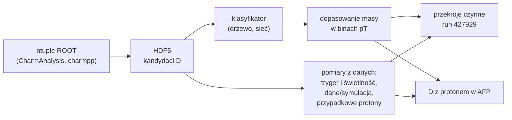

# charmbkg

Narzędzia do badania tła, kalibracji dane/symulacja i pomiaru mezonów D (D⁰ → Kπ, D⁺ → Kππ, D*⁺ → D⁰π)
w danych ATLAS minimum bias 2022, także w zdarzeniach z protonem w detektorze AFP.

Dane wejściowe to tabele kandydatów na mezony D (ntuple) wytworzone kodem grupy
[CharmPhysics](https://gitlab.cern.ch/berkeleylab/CharmPhysics) i zapisane w formacie HDF5:
dane ATLAS z runów 427929 i 428770 oraz symulacja (Pythia 8). Na tych plikach policzono pomiary opisane w `docs/results/`.
Pliki są duże i wewnętrzne, więc leżą na dyskach CERN (EOS), a nie w tym repozytorium.


## Pierwsze kroki
Sklonuj repozytorium:
```
git clone https://github.com/333963/charmbkg.git
cd charmbkg
```

Utwórz środowisko (Python 3.10 lub nowszy):
```
python -m venv .venv
source .venv/bin/activate
```

Zainstaluj pakiet:
```
pip install -e ".[dev]"
```

Przy kolejnym uruchomieniu wystarczy:
```
source .venv/bin/activate
```

Sprawdź, że wszystko działa:
```
pytest -q -m "not slow"
```

Testy trwają kilka minut i nie wymagają dostępu do plików na EOS.

Analizy na danych liczono na lxplus pakietami z `analysis/<temat>/lxplus/`; wymagają dostępu do plików na EOS.
Opis wejść i kolejności kroków: [PRZEGLAD.md](PRZEGLAD.md#jak-odtworzyć).

Polecenia pakietu:
 - `charmbkg bkggen --method <metoda>` buduje tło pod pikiem; metody: `sideband`, `reflection`, `dstar_wrong`, `mix`, `generate`, `validate`, `candrot`
 - `charmbkg s8salad -c <konfiguracja> --species Dplus` wyznacza kształt tła z symulacji przeważonej do danych w pasmach bocznych
 - `charmbkg hyp-extract` wybiera hipotezę K↔π dla D⁰

## Struktura
 - `charmbkg/` to pakiet: odczyt danych, zmienne, klasyfikator, dopasowanie masy, generatory tła (`bkggen/`), hipotezy K↔π (`hyp*`), tło przypadkowych protonów (`afp_mix*`).
 - `analysis/` zawiera skrypty analiz, jeden katalog na temat. Spis: [analysis/README.md](analysis/README.md).
 - `docs/results/` zawiera raporty z liczbami, tabele i rysunki, jeden katalog na temat. Spis: [docs/results/README.md](docs/results/README.md).
 - `docs/` zawiera opisy metod i szkic noty.
 - `configs/`, `tests/` to konfiguracje i testy.

## Jak to działa


## Wyniki w skrócie
 - Tło „przez konstrukcję” jako tło treningowe nie poprawia precyzji uzysku: wynik ogranicza statystyka, nie metoda.
 - Przekroje czynne D⁰, D⁺ i D*± w runie 427929 (0,4648 nb⁻¹), na przykład σ(D⁰) = 278 ± 29 ± 49 ± 6 µb dla 5–8 GeV.
 - Wejścia do pomiaru z protonem: regiony trygera ze świetlnością, współczynniki dane/symulacja, ułamek tagów przypadkowych 0,87 ± 0,44 %.
 - Pierwszy odczyt D⁰ z protonem w AFP: N = 54,7 −18,7 +19,4 ± 12,6, czyli wskazanie na granicy 3σ, nie obserwacja.

Pełne tabele, zastrzeżenia i znane problemy: [PRZEGLAD.md](PRZEGLAD.md).

Projekt bliźniaczy (pary D–D): [charmtag](https://github.com/333963/charmtag).
