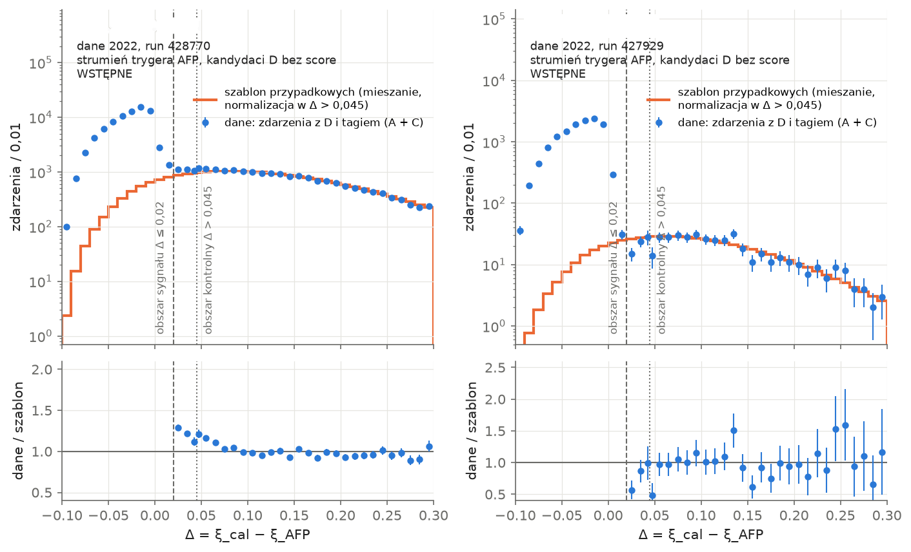
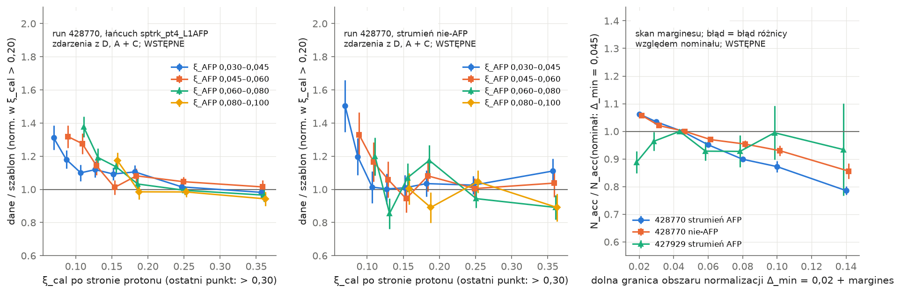
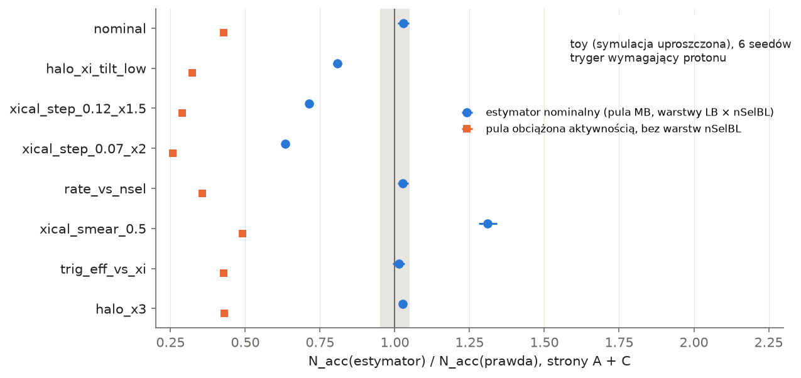

# Tło przypadkowego tagu AFP w strumieniu trygera AFP — metoda kształtu Δ = ξ_cal − ξ_AFP (WSTĘPNE)

Wygenerowano 2026-11-17 07:05 przez `AFPTRIG/report_md.py`. Projekt B (ATLAS minbias 2022, runy 427929 i 428770, h5 v2.0, kandydaci D po luźnej selekcji, bez score).
Praca lokalna, tylko odczyt danych z `AFP_mix/runs/lxplus/`; kod metody v2 (`charmbkg`) i wyniki `out/`, `out_v2/`, `TEMPLATE/` nietknięte.
**Czego tu nie ma:** uzysków sygnału D w zdarzeniach z tagiem, fitów masy, przekrojów. N_tag to liczba zdarzeń albo kandydatów (sygnał + kombinatoryka) w oknie.

## 0. Wynik w skrócie

| run | strumień | N_tag(SR) zdarzeń z D (A + C) | N_acc | **f_acc ± stat + syst − syst** | − syst z efektem lustrzanym | f_acc przy normalizacji w Δ > 0,10 | K1 | K4 | K5 | używalna (K6) |
|---|---|---|---|---|---|---|---|---|---|---|
| 427929 | AFP (dowolny łańcuch) | 12 953 | 129.1 ± 14.7 | **0.0100 ± 0.0011 + 0.0006 − 0.0006** | − 0.0022 | 0.0099 ± 0.0016 | PASS | PASS | PASS | TAK |
| 427929 | sptrk_pt4_L1AFP | 3 161 | 42.5 ± 9.9 | **0.0134 ± 0.0031 + 0.0042 − 0.0045** | − 0.0070 | 0.0097 ± 0.0028 | PASS | PASS | PASS | NIE |
| 427929 | nie-AFP | 18 935 | 164.9 ± 15.3 | **0.0087 ± 0.0008 + 0.0002 − 0.0005** | − 0.0022 | 0.0083 ± 0.0011 | PASS | PASS | PASS | TAK |
| 428770 | AFP (dowolny łańcuch) | 78 012 | 4 004.4 ± 55.3 | **0.0513 ± 0.0007 + 0.0047 − 0.0069** | − 0.0121 | 0.0448 ± 0.0018 | FAIL | PASS | FAIL | NIE |
| 428770 | sptrk_pt4_L1AFP | 66 839 | 3 454.4 ± 51.0 | **0.0517 ± 0.0008 + 0.0032 − 0.0056** | − 0.0118 | 0.0465 ± 0.0020 | FAIL | PASS | FAIL | NIE |
| 428770 | noalg_L1AFP | 14 786 | 641.1 ± 23.4 | **0.0434 ± 0.0016 + 0.0342 − 0.0141** | − 0.0141 | 0.0299 ± 0.0016 | FAIL | FAIL | FAIL | NIE |
| 428770 | nie-AFP | 16 134 | 798.3 ± 21.6 | **0.0495 ± 0.0013 + 0.0021 − 0.0040** | − 0.0109 | 0.0460 ± 0.0017 | PASS | PASS | PASS | TAK |

- **428770, strumień AFP:** f_acc = 0.0513 ± 0.0007 (stat) + 0.0047 − 0.0069 (syst); z nierozstrzygniętym efektem lustrzanym dół rośnie do − 0.0121. Wartość jest bliska f_acc strumienia nie-AFP (v2: 0,0477 ± 0,0135). **Walidacja K1 (domknięcie w obszarze kontrolnym) i K5 (stabilność względem marginesu) nie przechodzą**: dane mają nad szablonem nadwyżkę 16 % w 0,045 < Δ < 0,10, układającą się wzdłuż ξ_cal ≈ ξ_AFP + stała (rys. 2) i rosnącą z μ. To przeciek własnych protonów zdarzenia ponad cięcie, nie tło przypadkowe; zawyża normalizację. Normalizacja dalej od cięcia (Δ > 0,10, wybór po obejrzeniu walidacji) daje f_acc = 0.0448 ± 0.0018; różnica jest w systematyce „w dół”.
- **427929, strumień AFP** (99,98 % zdarzeń ma też tryger MBTS): f_acc = 0.0100 ± 0.0011 + 0.0006 − 0.0006; wszystkie kryteria przechodzą, błąd statystyczny 11 % (413 zdarzeń w obszarze kontrolnym).
- **Łańcuch HLT_noalg_L1AFP_A_OR_C w 428770:** metoda nie przechodzi walidacji (K1: 1,53; kształt K4 FAIL) — pula centralna z łańcuchów L1MBTS nie opisuje tych zdarzeń. Liczba w tabeli jest tylko orientacyjna.
- Metoda kształtu w strumieniu nie-AFP odtwarza v2 (0,0087 i 0,0495 wobec 0,0087 i 0,0477), ale to w dużej części ta sama informacja (§4.2) — sprawdza implementację, nie fizykę.
- Ograniczenia, których metoda nie usuwa: obszar ξ_cal ≲ 0,075 po stronie protonu pozostaje nietestowalny (toy: skok częstości ×2 poniżej 0,07 daje bias −35 % bez żadnego sygnału w walidacji), efekt lustrzany (−19 %) jest nierozstrzygnięty.

## 1. Kryteria walidacji (zapisane przed obejrzeniem rozkładów Δ; plik `KRYTERIA_WALIDACJI.txt`)

```
KRYTERIA WALIDACJI metody kształtu (AFPTRIG) — zapisane 2026-11-17 PRZED obejrzeniem jakiegokolwiek rozkładu Δ
w strumieniu AFP (do tej chwili obejrzano tylko liczności zdarzeń per łańcuch trygera i kwantyle ξ, ξ_cal: explore0.log).

Estymator: N_acc(SR) = N_dane(CR: Δ > δ + m) × R,  R = T(Δ ≤ δ)/T(Δ > δ + m),  δ = 0,02, nominalny margines m = 0,025
(jak cr_margin w v2), T = szablon z mieszania (ξ_cal zdarzenia centralnego − ξ protonu z innego zdarzenia tego samego bloku LB).
f_acc = N_acc(SR)/N_tag(SR).

K1 domknięcie w obszarze kontrolnym: normalizacja w Δ > 0,10, przewidywanie w 0,045 < Δ < 0,10 (oraz podprzedziały
   0,045–0,07 i 0,07–0,10). PASS: |z| < 2,5 (z = (obs − pred)/√(obs + σ²_pred)) ALBO |obs/pred − 1| < 5 %.
   Niedomknięcie max(|R − 1|, σ_R) wchodzi do systematyki niezależnie od werdyktu.
K2 zgodność z metodą częstościową v2 w strumieniu nie-AFP (ta sama selekcja co v2: GRL ∧ tryger nie-AFP ∧ npu = 0 ∧ z D):
   f_acc(kształt) vs 0,0087 ± 0,0044 (427929) i 0,0477 ± 0,0135 (428770). PASS: |różnica| < 2,5 σ (σ = błędy obu metod w kwadracie).
   Dodatkowo (427929): podpróbka z odpalonym łańcuchem AFP (99,98 % ma też MBTS) — ta sama liczba odniesienia.
K3 toy (tryger wymagający protonu): scenariusz nominalny — średnie N_acc(est)/N_acc(prawda) w granicach 5 % od 1
   albo 2σ błędu średniej. Scenariusze naruszające (inny rozkład ξ protonów w puli, obciążona pula centralna, przeciek
   rozdzielczości) — bez werdyktu, raportowany bias.
K4 kształt Δ w CR (biny 0,01 od δ + m do 0,30): p(χ²) ≥ 0,01 ALBO największe odchylenie zgrupowane < 10 %.
K5 stabilność względem marginesu: N_acc dla m = 0,01; 0,025; 0,04; 0,06 — rozrzut względem nominału < 2,5 σ
   różnicy albo < 5 %; trend monotoniczny (przeciek sygnału) raportowany i brany jako systematyka.
K6 warianty puli centralnej (≥ 2): różnica wchodzi jako ½Δ; metoda „używalna”, jeśli K1, K2, K3-nominalny PASS
   i całkowity błąd względny f_acc < 50 %.
Liczby ustalone z góry: δ = 0,02; okno tagu 0,03–0,10 (dokładnie 1 proton po stronie); biny pT 3–5, 5–8, 8–30;
okna masy jak w run_data.py (SPECIES); npu = 0; GRL.
```

Odstępstwa od zapisu, wszystkie po obejrzeniu wyniku i tak oznaczone w tekście: (1) wariant „normalizacja w Δ > 0,10” (margines 0,08) jako liczba pomocnicza i źródło systematyki „przeciek”; (2) błąd różnicy wariantów marginesu liczony wzorem dla obszarów zagnieżdżonych (`make_report.py::sd_nested`), bo pierwotny |σ_a² − σ_b²| dawał zero przy równych błędach; (3) w K4 zakres 0,045–0,30 z łączeniem przedziałów do ≥ 10 oczekiwanych, szablon przeskalowany do danych w tym zakresie (test samego kształtu).

## 2. Opis próbki

Selekcja wspólna: GRL ∧ nPileupVertices == 0 ∧ ≥ 1 zapisany łańcuch. „Z D” = ≥ 1 kandydat D⁺, D⁰ lub D* (slim). Tag po stronie = dokładnie jeden proton po stronie, 0,03 ≤ ξ ≤ 0,10. SR: Δ ≤ 0,02 (cięcie analizy); przerwa: 0,02 < Δ ≤ 0,045; CR: Δ > 0,045 („proton niemożliwy”).

| run | strumień / łańcuch | zdarzeń | z D | kandydatów w oknach | ⟨nSelBL⟩ z D | strona | tagów z D | SR | przerwa | CR | w tym ξ_cal > 0,14 | CR/SR |
|---|---|---|---|---|---|---|---|---|---|---|---|---|
| 427929 | HLT_noalg_L1AFP_A_OR_C | 570 001 | 16 292 | 21 889 | 18.6 | A | 9 124 | 8 810 | 32 | 282 | 211 | 0.032 |
| 427929 | HLT_noalg_L1AFP_A_OR_C | 570 001 | 16 292 | 21 889 | 18.6 | C | 4 295 | 4 143 | 21 | 131 | 95 | 0.032 |
| 427929 | HLT_mb_sptrk_pt4_L1AFP_A_OR_C | 9 854 | 4 127 | 7 585 | 21.8 | A | 2 252 | 2 145 | 10 | 97 | 73 | 0.045 |
| 427929 | HLT_mb_sptrk_pt4_L1AFP_A_OR_C | 9 854 | 4 127 | 7 585 | 21.8 | C | 1 062 | 1 016 | 3 | 43 | 34 | 0.042 |
| 427929 | AFP: dowolny z obu | 570 001 | 16 292 | 21 889 | 18.6 | A | 9 124 | 8 810 | 32 | 282 | 211 | 0.032 |
| 427929 | AFP: dowolny z obu | 570 001 | 16 292 | 21 889 | 18.6 | C | 4 295 | 4 143 | 21 | 131 | 95 | 0.032 |
| 427929 | AFP i żaden nie-AFP | 98 | 1 | 1 | 5.0 | A | 1 | 1 | 0 | 0 | 0 | 0.000 |
| 427929 | AFP i żaden nie-AFP | 98 | 1 | — | — | C | 0 | 0 | 0 | 0 | 0 | — |
| 427929 | nie-AFP (dowolny) | 23 626 322 | 3 410 405 | 8 159 463 | 31.3 | A | 10 067 | 9 706 | 38 | 323 | 247 | 0.033 |
| 427929 | nie-AFP (dowolny) | 23 626 322 | 3 410 405 | 8 159 463 | 31.3 | C | 9 541 | 9 229 | 47 | 265 | 191 | 0.029 |
| 427929 | HLT_mb_sptrk_pt4_L1MBTS_2 (bliźniak) | 1 609 039 | 1 078 487 | 3 798 907 | 36.1 | A | 2 473 | 2 355 | 10 | 108 | 83 | 0.046 |
| 427929 | HLT_mb_sptrk_pt4_L1MBTS_2 (bliźniak) | 1 609 039 | 1 078 487 | 3 798 907 | 36.1 | C | 2 404 | 2 316 | 9 | 79 | 62 | 0.034 |
| 427929 | HLT_noalg_mb_L1MBTS_1/2 | 23 626 322 | 3 410 405 | 8 159 463 | 31.3 | A | 10 067 | 9 706 | 38 | 323 | 247 | 0.033 |
| 427929 | HLT_noalg_mb_L1MBTS_1/2 | 23 626 322 | 3 410 405 | 8 159 463 | 31.3 | C | 9 541 | 9 229 | 47 | 265 | 191 | 0.029 |
| 427929 | HLT_noalg_L1J12 | 60 057 | 51 538 | 345 506 | 42.3 | A | 114 | 111 | 0 | 3 | 3 | 0.027 |
| 427929 | HLT_noalg_L1J12 | 60 057 | 51 538 | 345 506 | 42.3 | C | 110 | 108 | 1 | 1 | 1 | 0.009 |
| 428770 | HLT_noalg_L1AFP_A_OR_C | 683 409 | 21 534 | 32 646 | 20.4 | A | 11 600 | 9 870 | 276 | 1 454 | 1 033 | 0.147 |
| 428770 | HLT_noalg_L1AFP_A_OR_C | 683 409 | 21 534 | 32 646 | 20.4 | C | 5 789 | 4 916 | 137 | 736 | 517 | 0.150 |
| 428770 | HLT_mb_sptrk_pt4_L1AFP_A_OR_C | 177 418 | 110 755 | 337 296 | 28.6 | A | 58 061 | 44 684 | 1 610 | 11 767 | 9 448 | 0.263 |
| 428770 | HLT_mb_sptrk_pt4_L1AFP_A_OR_C | 177 418 | 110 755 | 337 296 | 28.6 | C | 28 949 | 22 155 | 844 | 5 950 | 4 807 | 0.269 |
| 428770 | AFP: dowolny z obu | 847 996 | 126 700 | 357 882 | 27.4 | A | 66 675 | 52 122 | 1 812 | 12 741 | 10 100 | 0.244 |
| 428770 | AFP: dowolny z obu | 847 996 | 126 700 | 357 882 | 27.4 | C | 33 284 | 25 890 | 940 | 6 454 | 5 145 | 0.249 |
| 428770 | AFP i żaden nie-AFP | 826 968 | 111 421 | 293 907 | 27.0 | A | 58 615 | 45 806 | 1 582 | 11 227 | 8 857 | 0.245 |
| 428770 | AFP i żaden nie-AFP | 826 968 | 111 421 | 293 907 | 27.0 | C | 29 323 | 22 820 | 827 | 5 676 | 4 502 | 0.249 |
| 428770 | nie-AFP (dowolny) | 5 449 549 | 4 475 334 | 27 597 957 | 41.8 | A | 10 609 | 8 271 | 315 | 2 023 | 1 651 | 0.245 |
| 428770 | nie-AFP (dowolny) | 5 449 549 | 4 475 334 | 27 597 957 | 41.8 | C | 10 188 | 7 863 | 276 | 2 049 | 1 664 | 0.261 |
| 428770 | HLT_mb_sptrk_pt4_L1MBTS_2 (bliźniak) | 791 901 | 644 218 | 3 121 493 | 40.9 | A | 1 483 | 1 135 | 45 | 303 | 261 | 0.267 |
| 428770 | HLT_mb_sptrk_pt4_L1MBTS_2 (bliźniak) | 791 901 | 644 218 | 3 121 493 | 40.9 | C | 1 446 | 1 114 | 41 | 291 | 237 | 0.261 |
| 428770 | HLT_noalg_mb_L1MBTS_1/2 | 63 632 | 41 850 | 177 029 | 39.5 | A | 122 | 93 | 2 | 27 | 21 | 0.290 |
| 428770 | HLT_noalg_mb_L1MBTS_1/2 | 63 632 | 41 850 | 177 029 | 39.5 | C | 101 | 71 | 2 | 28 | 25 | 0.394 |
| 428770 | HLT_noalg_L1J12 | 4 263 108 | 3 644 174 | 24 163 749 | 42.3 | A | 8 724 | 6 851 | 263 | 1 610 | 1 305 | 0.235 |
| 428770 | HLT_noalg_L1J12 | 4 263 108 | 3 644 174 | 24 163 749 | 42.3 | C | 8 379 | 6 482 | 225 | 1 672 | 1 357 | 0.258 |

Preskale (nie ma ich w ntupli; oszacowanie z danych: wśród zdarzeń zapisanych przez łańcuch nie-AFP z bitem L1_AFP_A_OR_C „before prescale”, a dla pt4 dodatkowo z odpalonym bliźniakiem pt4_L1MBTS_2, odwrotność ułamka z odpalonym łańcuchem AFP):

| run | łańcuch | zdarzeń odniesienia | efektywna preskala | w 8 blokach LB |
|---|---|---|---|---|
| 427929 | noalg_L1AFP | 569 903 | 1.00 | 1.0, 1.0, 1.0, 1.0, 1.0, 1.0, 1.0, 1.0 |
| 427929 | sptrk_pt4_L1AFP | 9 844 | 1.00 | 1.0, 1.0, 1.0, 1.0, 1.0, 1.0, 1.0, 1.0 |
| 428770 | noalg_L1AFP | 29 432 | 23.07 | 27.5, 23.8, 22.0, 20.9, 22.6, 23.0, 23.1, 22.9 |
| 428770 | sptrk_pt4_L1AFP | 4 182 | 1.08 | 1.8, 1.2, 1.0, 1.0, 1.0, 1.0, 1.0, 1.0 |

- 428770: zdarzenia z D w strumieniu AFP pochodzą w 87 % z łańcucha sptrk_pt4 (preskala ≈ 1, na początku runu 1,8); noalg ma preskalę ≈ 23. 1 364 623 zdarzeń po GRL nie ma żadnego z zapisanych bitów trygera (inne łańcuchy; 41 % z tagiem) — poza zakresem.
- 427929: łańcuchy AFP bez preskali, ale MBTS też — tylko 98 zdarzeń wyłącznie z AFP. Strumień AFP jest tu podzbiorem strumienia MBTS, więc służy do walidacji.
- Wydajność L1_AFP_A_OR_C (bit TBP) dla zdarzeń nie-AFP z dokładnie jednym protonem po jednej stronie, w przedziałach ξ 0,03–0,04 … 0,09–0,10: strona A 0.89, 0.89, 0.89, 0.90, 0.92, 0.92, 0.93 (427929), 0.91, 0.92, 0.92, 0.91, 0.92, 0.92, 0.92 (428770); strona C 0.39, 0.40, 0.42, 0.44, 0.45, 0.47, 0.48 (427929), 0.45, 0.48, 0.47, 0.48, 0.47, 0.46, 0.48 (428770). Strona C ma wydajność o połowę mniejszą — stąd asymetria liczby tagów A/C w strumieniu AFP.

Rozkłady ξ_AFP (tagi z D, strumień AFP, udział w przedziałach 0,03–0,04 … 0,09–0,10):

| run | strona | próbka | N | udziały | ⟨ξ⟩ |
|---|---|---|---|---|---|
| 427929 | A | SR (Δ ≤ 0,02) | 8 810 | 0.13, 0.13, 0.14, 0.15, 0.16, 0.16, 0.13 | 0.0658 ± 0.0002 |
| 427929 | A | CR (Δ > 0,045) | 282 | 0.28, 0.21, 0.14, 0.11, 0.11, 0.09, 0.06 | 0.0549 ± 0.0011 |
| 427929 | A | ξ_cal > 0,14, strumień AFP (pula protonów) | 430 | 0.26, 0.19, 0.15, 0.12, 0.12, 0.09, 0.07 | 0.0568 ± 0.0009 |
| 427929 | A | ξ_cal > 0,14, strumień nie-AFP | 491 | 0.27, 0.18, 0.15, 0.12, 0.12, 0.09, 0.07 | 0.0564 ± 0.0009 |
| 427929 | C | SR (Δ ≤ 0,02) | 4 143 | 0.12, 0.12, 0.13, 0.13, 0.16, 0.18, 0.16 | 0.0674 ± 0.0003 |
| 427929 | C | CR (Δ > 0,045) | 131 | 0.31, 0.15, 0.13, 0.12, 0.08, 0.10, 0.11 | 0.0575 ± 0.0018 |
| 427929 | C | ξ_cal > 0,14, strumień AFP (pula protonów) | 200 | 0.24, 0.14, 0.15, 0.14, 0.10, 0.12, 0.10 | 0.0597 ± 0.0014 |
| 427929 | C | ξ_cal > 0,14, strumień nie-AFP | 411 | 0.22, 0.20, 0.16, 0.11, 0.10, 0.10, 0.09 | 0.0580 ± 0.0010 |
| 428770 | A | SR (Δ ≤ 0,02) | 52 122 | 0.12, 0.13, 0.14, 0.15, 0.16, 0.17, 0.14 | 0.0666 ± 0.0001 |
| 428770 | A | CR (Δ > 0,045) | 12 741 | 0.26, 0.19, 0.16, 0.13, 0.11, 0.09, 0.07 | 0.0566 ± 0.0002 |
| 428770 | A | ξ_cal > 0,14, strumień AFP (pula protonów) | 14 175 | 0.22, 0.18, 0.15, 0.13, 0.12, 0.11, 0.09 | 0.0592 ± 0.0002 |
| 428770 | A | ξ_cal > 0,14, strumień nie-AFP | 2 081 | 0.23, 0.17, 0.15, 0.12, 0.13, 0.11, 0.08 | 0.0590 ± 0.0004 |
| 428770 | C | SR (Δ ≤ 0,02) | 25 890 | 0.11, 0.12, 0.14, 0.15, 0.16, 0.17, 0.15 | 0.0672 ± 0.0001 |
| 428770 | C | CR (Δ > 0,045) | 6 454 | 0.24, 0.20, 0.15, 0.13, 0.12, 0.10, 0.07 | 0.0573 ± 0.0002 |
| 428770 | C | ξ_cal > 0,14, strumień AFP (pula protonów) | 7 289 | 0.21, 0.17, 0.15, 0.14, 0.13, 0.12, 0.09 | 0.0598 ± 0.0002 |
| 428770 | C | ξ_cal > 0,14, strumień nie-AFP | 2 099 | 0.21, 0.18, 0.15, 0.13, 0.14, 0.11, 0.08 | 0.0595 ± 0.0004 |

Protony z SR mają widmo rosnące z ξ, protony „niemożliwe” — malejące. Pula protonów do szablonu to te drugie (ξ_cal > 0,14: nie zależy od ξ, więc widmo nieobciążone cięciem). Rozkład Δ: rys. 1 i histogramy w `results_raw_*.json` (`hist_delta`), ξ_cal: `describe.json`.



Rys. 1. Rozkład Δ zdarzeń z D i tagiem w strumieniu AFP (strony A + C) i szablon tła przypadkowego znormalizowany w Δ > 0,045. Na dole stosunek dane/szablon dla Δ > 0,02. W 428770 nadwyżka danych do Δ ≈ 0,07.

## 3. Metoda

Zdarzenie z tagiem przypadkowym = dowolne oddziaływanie z D bez własnego protonu po stronie s ⊕ niezależny proton. Tryger AFP zapisuje je, bo odpala od protonu przypadkowego, więc liczby „wystawionych” zdarzeń centralnych nie znamy i częstości nie da się użyć. Znamy natomiast kształt:

    N_acc(SR) = Σ_c N_CR,c(dane) · R_c,     R_c = T_c(Δ ≤ 0,02) / T_c(Δ > 0,045)

- T_c: wszystkie pary (zdarzenie centralne z puli, proton z puli protonów) w komórce c; Δ = ξ_cal,s zdarzenia centralnego − ξ protonu. Liczone dokładnie (bez losowania).
- **Pula protonów:** tagi strumienia AFP po stronie s ze zdarzeń z ξ_cal,s > 0,14 (z D i bez D), ten sam blok LB (8 bloków o równej liczbie tagów).
- **Pula centralna (nominał):** zdarzenia z D z łańcuchów nie-AFP o tym samym warunku HLT, bez protonu po stronie s: dla sptrk_pt4_L1AFP bliźniak HLT_mb_sptrk_pt4_L1MBTS_2; dla noalg_L1AFP łańcuchy MB (noalg_mb_L1MBTS, sptrk(_pt2)_L1MBTS); dla sumy łańcuchów AFP bliźniak ∪ MB; w 427929 wszystkie nie-AFP (tam to MBTS bez preskali).
- **Komórki:** blok LB × klasa nSelBL (0, 5, 10, 15, 20, 25, 30, 40, 50, 80, ∞). Normalizacja w CR osobno w każdej komórce jest równoważna przeważeniu puli do rozkładu aktywności zdarzeń przypadkowych widzianego w CR, więc usuwa zarówno różnicę aktywności pula ↔ strumień, jak i zależność prawdopodobieństwa protonu przypadkowego od nSelBL.
- Błąd stat.: Poisson N_CR ⊕ skończona pula centralna ⊕ skończona liczba protonów (estymator ilorazowy). Kategorie D: wagi = liczba kandydatów zdarzenia w kategorii, po stronie danych i puli.
- f_acc(A + C) = (N_acc,A + N_acc,C)/(N_SR,A + N_SR,C). Zdarzenia z tagiem po obu stronach (428770, z D: 1 032 z 99 959 tagów) wchodzą po obu stronach; regionu „A∨C z cięciem na każdej stronie” nie odtwarzano.

### 3.1 Warianty puli centralnej (N_acc, strony A + C; nominał pogrubiony)

| run | strumień | bliźniak sptrk_pt4_L1MBTS_2 | MB (noalg_mb/sptrk L1MBTS) | bliźniak ∪ MB | wszystkie nie-AFP | L1J12 | sam strumień | nominał bez warstw nSelBL |
|---|---|---|---|---|---|---|---|---|
| 427929 | AFP (dowolny łańcuch) | 128 ± 13 | — | — | **129 ± 15** | — | 8 036 ± 1 092 | 117 |
| 427929 | sptrk_pt4_L1AFP | **42 ± 10** | — | — | 45 ± 13 | — | 1 428 ± 345 | 31 |
| 427929 | nie-AFP | 165 ± 13 | — | — | **165 ± 15** | — | 11 471 ± 1 176 | 163 |
| 428770 | AFP (dowolny łańcuch) | 4 052 ± 56 | 3 449 ± 63 | **4 004 ± 55** | 4 327 ± 54 | 4 464 ± 54 | 67 779 ± 1 229 | 3 064 |
| 428770 | sptrk_pt4_L1AFP | **3 454 ± 51** | 2 945 ± 55 | 3 414 ± 50 | 3 709 ± 49 | 3 832 ± 50 | 57 161 ± 1 059 | 2 810 |
| 428770 | noalg_L1AFP | 763 ± 26 | **641 ± 23** | 754 ± 25 | 792 ± 25 | 811 ± 25 | 13 297 ± 758 | 346 |
| 428770 | nie-AFP | 740 ± 22 | 641 ± 20 | 732 ± 21 | **798 ± 22** | 826 ± 22 | 13 788 ± 508 | 679 |

- **Tasowanie wewnątrz strumienia AFP (pula „sam strumień”) nie nadaje się**: strumień to w ~95 % prawdziwe tagi z małym ξ_cal, więc szablon przewiduje kilkanaście razy za dużo zdarzeń w SR (toy: ×8–20). Wzorzec CMS-TOTEM działa, bo tam próbka centralna (dijety) nie jest wybrana protonem.
- Pula nie-AFP zdominowana przez L1J12 daje po warstwowaniu +7…8 % względem bliźniaka; bez warstw nSelBL wynik spada o 19–23 % — warstwowanie jest konieczne (toy: pula obciążona aktywnością bez warstw daje 0,43 prawdy, z warstwami 1,00).

## 4. Walidacja

### 4.1 K1, K4, K5: obszar kontrolny (zdarzenia z D, A + C)

| run | strumień | norm. Δ > 0,10 → 0,045–0,10: obs / pred | stosunek (z) | 0,045–0,07 | 0,07–0,10 | norm. Δ > 0,20 → 0,10–0,20 | K1 | K4: χ²/ndf (p), maks. odchylenie | K4 | margines 0,01 / 0,04 / 0,06 / 0,08 / 0,12: N_acc/nominał | K5 |
|---|---|---|---|---|---|---|---|---|---|---|---|
| 427929 | AFP (dowolny łańcuch) | 152 / 161 ± 12 | 0.945 ± 0.106 (-0.5) | 0.84 ± 0.13 | 1.03 ± 0.13 | 0.90 ± 0.14 | **PASS** | 15/19 (0.74), 3.6 % | **PASS** | 0.96 / 0.93 / 0.93 / 0.99 / 0.93 | **PASS** |
| 427929 | sptrk_pt4_L1AFP | 57 / 42 ± 6 | 1.360 ± 0.260 (+1.6) | 1.16 ± 0.30 | 1.52 ± 0.32 | 0.89 ± 0.23 | **PASS** | 3/8 (0.92), 16.4 % | **PASS** | 0.88 / 0.87 / 0.84 / 0.72 / 0.59 | **PASS** |
| 427929 | nie-AFP | 205 / 220 ± 14 | 0.931 ± 0.088 (-0.8) | 0.80 ± 0.11 | 1.04 ± 0.11 | 0.84 ± 0.11 | **PASS** | 24/21 (0.29), 13.9 % | **PASS** | 0.99 / 0.95 / 0.91 / 0.95 / 0.92 | **PASS** |
| 428770 | AFP (dowolny łańcuch) | 6 003 / 5 167 ± 60 | 1.162 ± 0.020 (+8.5) | 1.25 ± 0.03 | 1.09 ± 0.02 | 1.08 ± 0.02 | **FAIL** | 89/25 (4.1e-09), 4.0 % | **PASS** | 1.03 / 0.95 / 0.90 / 0.87 / 0.79 | **FAIL** |
| 428770 | sptrk_pt4_L1AFP | 5 326 / 4 733 ± 57 | 1.125 ± 0.021 (+6.4) | 1.21 ± 0.03 | 1.06 ± 0.02 | 1.05 ± 0.02 | **FAIL** | 64/25 (3.1e-05), 2.7 % | **PASS** | 1.03 / 0.96 / 0.91 / 0.90 / 0.83 | **FAIL** |
| 428770 | noalg_L1AFP | 910 / 594 ± 20 | 1.533 ± 0.073 (+8.7) | 1.66 ± 0.10 | 1.43 ± 0.08 | 1.78 ± 0.13 | **FAIL** | 95/25 (4.5e-10), 32.2 % | **FAIL** | 1.06 / 0.90 / 0.80 / 0.69 / 0.53 | **FAIL** |
| 428770 | nie-AFP | 1 160 / 1 128 ± 25 | 1.029 ± 0.038 (+0.8) | 1.07 ± 0.05 | 1.00 ± 0.05 | 1.01 ± 0.04 | **PASS** | 24/25 (0.53), 1.9 % | **PASS** | 1.02 / 0.97 / 0.95 / 0.93 / 0.86 | **PASS** |

- 427929: wszystko przechodzi w granicach (dużych) błędów. 428770, strumień nie-AFP: przechodzi.
- **428770, strumień AFP (suma i sptrk_pt4): K1 i K5 FAIL.** Dane leżą nad szablonem o 12–16 % w 0,045 < Δ < 0,10 i o 5–8 % w 0,10–0,20; N_acc maleje monotonicznie z marginesem (−13 % przy normalizacji w Δ > 0,10). K4 formalnie PASS tylko dzięki klauzuli „odchylenie zgrupowane < 10 %” (p ≪ 0,01).
- 428770, noalg_L1AFP: K1 1,53, K4 FAIL — szablon z puli MB nie opisuje danych także daleko od cięcia (norm. > 0,20 → 0,10–0,20: 1,78). Przyczyna nieustalona (pula L1MBTS a zdarzenia bez wymogu MBTS; możliwy większy udział przecieku przy SR/CR = 6,8). Dla tego łańcucha metoda w obecnej postaci nie jest zwalidowana.



Rys. 2. Lewy i środkowy: dane/szablon w funkcji ξ_cal dla czterech przedziałów ξ_AFP (szablon znormalizowany w ξ_cal > 0,20). Niedopasowanie puli dałoby jedną krzywą dla wszystkich ξ_AFP; nadwyżka zaczyna się zaś tuż nad cięciem każdego przedziału ξ_AFP (ξ_cal ≈ ξ_AFP + 0,02…0,07), czyli jest skorelowana z protonem. Prawy: N_acc względem nominału w funkcji dolnej granicy obszaru normalizacji.

### 4.2 K2: zgodność z metodą częstościową v2 w strumieniu nie-AFP

| run | strona | N_acc kształt | N_acc v2 | f_acc kształt (A + C) | f_acc v2 (A∨C) | z | K2 |
|---|---|---|---|---|---|---|---|
| 427929 | A | 93.5 ± 12.9 | 91.7 ± 16.9 | | | | |
| 427929 | C | 71.4 ± 8.2 | 73.9 ± 12.6 | | | | |
| 427929 | A + C | 164.9 | 164.7 | 0.0087 ± 0.0009 | 0.0087 ± 0.0044 | +0.00 | **PASS** |
| 428770 | A | 392.8 ± 15.1 | 376.5 ± 18.0 | | | | |
| 428770 | C | 405.5 ± 15.4 | 393.4 ± 19.6 | | | | |
| 428770 | A + C | 798.3 | 766.1 | 0.0495 ± 0.0043 | 0.0477 ± 0.0135 | +0.13 | **PASS** |

**Zastrzeżenie:** zgodność jest w dużej części z konstrukcji. v2 liczy N_acc = (otagowani dawcy z ξ_cal > 0,14)/(dawcy) × Σ_biorcy P(para w SR); metoda kształtu z CR ograniczonym do ξ_cal > 0,14 byłaby algebraicznie tym samym. Różnią się tylko dodatkiem obszaru Δ > 0,045 ∧ ξ_cal ≤ 0,14 (ok. 20 % CR) i komórkami. K2 sprawdza więc implementację i to, że normalizacja w CR nie psuje wyniku tam, gdzie v2 działa — nie jest niezależnym pomiarem. Dodatkowy test z 427929: w podpróbce z odpalonym łańcuchem AFP (wydajność L1 ≈ 0,9 / 0,45) f_acc = 0.0100 ± 0.0011 wobec 0,0087 ± 0,0044 (v2) — przerzedzenie trygerem protonowym nie zmienia frakcji.

### 4.3 K3: toy z trygerem wymagającym protonu

Generator `charmbkg.afp_mix_toy.generate` bez zmian (3·10⁶ zdarzeń na seed, 6 seedów) + dodany w `toy.py` tryger: L1 odpala od każdego widzianego protonu z ε_A = 0,9, ε_C = 0,45; strumień AFP = zdarzenia z odpalonym L1; pula centralna = wszystkie zdarzenia (jak MBTS w 427929) albo klasa trygera 1 (obciążona aktywnością, ≈ J12). Prawda: tag w SR, który nie jest własnym protonem zdarzenia. Stosunki N_acc(est)/N_acc(prawda), A + C, średnia ± błąd średniej:

| scenariusz | f_acc prawda | **nominał** | bez warstw nSelBL | pula „J12” z warstwami | pula „J12” bez warstw | tasowanie w strumieniu | protony: wszystkie tagi | margines 0,01 | margines 0,06 | domknięcie K1 (obs/pred) |
|---|---|---|---|---|---|---|---|---|---|---|
| nominal | 0.044 | **1.03 ± 0.02** | 1.01 ± 0.01 | 1.01 ± 0.04 | 0.43 ± 0.00 | 19.8 | 0.91 ± 0.02 | 1.04 ± 0.02 | 1.03 ± 0.02 | 0.98 ± 0.01 |
| halo_xi_tilt_low (inne widmo ξ halo przy ξ_cal < 0,14) | 0.059 | **0.81 ± 0.01** | 0.76 ± 0.01 | 0.79 ± 0.02 | 0.32 ± 0.00 | 15.1 | 0.72 ± 0.01 | 0.84 ± 0.02 | 0.77 ± 0.01 | 1.23 ± 0.03 |
| xical_step_0.12_x1.5 (częstość ×1,5 przy ξ_cal < 0,12) | 0.065 | **0.71 ± 0.01** | 0.68 ± 0.01 | 0.69 ± 0.02 | 0.29 ± 0.00 | 13.8 | 0.64 ± 0.01 | 0.73 ± 0.01 | 0.69 ± 0.01 | 1.10 ± 0.01 |
| xical_step_0.07_x2 (częstość ×2 przy ξ_cal < 0,07) | 0.072 | **0.63 ± 0.01** | 0.61 ± 0.01 | 0.61 ± 0.01 | 0.26 ± 0.00 | 12.4 | 0.57 ± 0.01 | 0.63 ± 0.01 | 0.64 ± 0.01 | 0.97 ± 0.02 |
| rate_vs_nsel (częstość zależna od nSelBL) | 0.057 | **1.03 ± 0.02** | 0.84 ± 0.01 | 0.98 ± 0.02 | 0.36 ± 0.00 | 15.7 | 0.92 ± 0.01 | 1.02 ± 0.01 | 1.02 ± 0.02 | 0.98 ± 0.02 |
| xical_smear_0.5 (przeciek własnych protonów) | 0.050 | **1.31 ± 0.03** | 1.14 ± 0.02 | 1.27 ± 0.04 | 0.49 ± 0.01 | 18.4 | 1.13 ± 0.02 | 1.50 ± 0.03 | 1.14 ± 0.02 | 1.60 ± 0.04 |
| trig_eff_vs_xi (ε_L1 rośnie z ξ: ×(0,6 + 4ξ)) | 0.047 | **1.01 ± 0.02** | 1.00 ± 0.01 | 1.00 ± 0.04 | 0.43 ± 0.00 | 18.5 | 0.90 ± 0.02 | 1.02 ± 0.02 | 1.02 ± 0.02 | 0.98 ± 0.01 |
| halo_x3 (większa częstość przypadkowych) | 0.121 | **1.03 ± 0.01** | 1.01 ± 0.01 | 1.01 ± 0.02 | 0.43 ± 0.00 | 7.7 | 0.94 ± 0.01 | 1.03 ± 0.01 | 1.03 ± 0.01 | 0.98 ± 0.01 |

- **K3 PASS**: nominał 1.028 ± 0.018. Zależność częstości od nSelBL, większa częstość i wydajność trygera zależna od ξ nie psują estymatora (1,01–1,04).
- **Bias, gdy widmo ξ protonów w puli różni się od widma w obszarze użycia** (`halo_xi_tilt_low`: inne widmo halo przy ξ_cal < 0,14): −19 %; domknięcie K1 to wykrywa (1,23). Pula „wszystkie tagi strumienia” (skażona protonami sygnału) daje −9 %.
- **Martwe pole jak w v2:** częstość przypadkowych ×2 tylko przy ξ_cal < 0,07 → estymator 0,65 prawdy, domknięcie 0,97 (nic nie widać). Skok poniżej 0,12 (×1,5): 0,72, domknięcie 1,11.
- **Przeciek własnych protonów** (`xical_smear_0.5`): +32 %, domknięcie 1,59, N_acc maleje z marginesem (1,51 → 1,15) — ten sam obraz co w danych 428770, w danych o mniejszej amplitudzie.



Rys. 3. Toy: N_acc(estymator)/N_acc(prawda). Szary pas: ±5 % (kryterium K3).

## 5. Wynik: f_acc w strumieniu AFP

### 5.1 Per strona (zdarzenia z D)

| run | strumień | strona | N_tag(SR) | N_CR | N_acc ± stat | f_acc ± stat | pula centralna (zdarzeń) | protonów w puli |
|---|---|---|---|---|---|---|---|---|
| 427929 | AFP (dowolny łańcuch) | A | 8 810 | 282 | 86.7 ± 13.0 | 0.0098 ± 0.0015 | wszystkie nie-AFP (3 398 852) | 430 |
| 427929 | AFP (dowolny łańcuch) | C | 4 143 | 131 | 42.4 ± 6.9 | 0.0102 ± 0.0017 | wszystkie nie-AFP (3 399 623) | 200 |
| 427929 | sptrk_pt4_L1AFP | A | 2 145 | 97 | 28.0 ± 8.9 | 0.0131 ± 0.0041 | bliźniak sptrk_pt4_L1MBTS_2 (1 075 640) | 90 |
| 427929 | sptrk_pt4_L1AFP | C | 1 016 | 43 | 14.5 ± 4.4 | 0.0143 ± 0.0043 | bliźniak sptrk_pt4_L1MBTS_2 (1 075 758) | 44 |
| 428770 | AFP (dowolny łańcuch) | A | 52 122 | 12 741 | 2 673.4 ± 45.8 | 0.0513 ± 0.0009 | bliźniak ∪ MB (658 408) | 14 175 |
| 428770 | AFP (dowolny łańcuch) | C | 25 890 | 6 454 | 1 331.1 ± 31.1 | 0.0514 ± 0.0012 | bliźniak ∪ MB (658 521) | 7 289 |
| 428770 | sptrk_pt4_L1AFP | A | 44 684 | 11 767 | 2 308.9 ± 42.2 | 0.0517 ± 0.0009 | bliźniak sptrk_pt4_L1MBTS_2 (642 488) | 11 027 |
| 428770 | sptrk_pt4_L1AFP | C | 22 155 | 5 950 | 1 145.6 ± 28.6 | 0.0517 ± 0.0013 | bliźniak sptrk_pt4_L1MBTS_2 (642 580) | 5 618 |
| 428770 | noalg_L1AFP | A | 9 870 | 1 454 | 432.5 ± 19.3 | 0.0438 ± 0.0020 | MB (noalg_mb/sptrk L1MBTS) (41 712) | 3 644 |
| 428770 | noalg_L1AFP | C | 4 916 | 736 | 208.6 ± 13.1 | 0.0424 ± 0.0027 | MB (noalg_mb/sptrk L1MBTS) (41 729) | 1 905 |

### 5.2 Rozbicie błędu względnego N_acc (A + C)

| run | strumień | stat | pula centralna (½Δ, alternatywa) | pula protonów | LB / μ | ziarnistość nSelBL | niedomknięcie daleko od cięcia (↑) | przeciek: norm. Δ > 0,10 (↓) | lustrzany κ (↓, nierozstrzygnięty) | **razem ↑** | **razem ↓ bez lustrzanego** | razem ↓ z lustrzanym |
|---|---|---|---|---|---|---|---|---|---|---|---|---|
| 427929 | AFP (dowolny łańcuch) | 11.4 % | 0.3 % (bliźniak sptrk_pt4_L1MBTS_2: ×0.995) | 2.5 % | 4.1 % | 3.6 % | 0.0 % (0.903 ± 0.141) | 0.0 % (0.995 ± 0.098) | 21.0 % (0.83 ± 0.12) | **12.9 %** | **12.9 %** | 24.7 % |
| 427929 | sptrk_pt4_L1AFP | 23.3 % | 3.2 % (wszystkie nie-AFP: ×1.065) | 14.4 % | 25.1 % | 11.1 % | 0.0 % (0.893 ± 0.233) | 12.5 % (0.721 ± 0.154) | 39.4 % (0.64 ± 0.16) | **38.9 %** | **40.9 %** | 56.7 % |
| 427929 | nie-AFP | 9.3 % | 0.1 % (bliźniak sptrk_pt4_L1MBTS_2: ×1.001) | 0.0 % | 1.8 % | 1.9 % | 0.0 % (0.845 ± 0.107) | 0.0 % (0.952 ± 0.075) | 24.1 % (0.78 ± 0.10) | **9.6 %** | **10.8 %** | 26.4 % |
| 428770 | AFP (dowolny łańcuch) | 1.4 % | 4.0 % (wszystkie nie-AFP: ×1.080) | 0.3 % | 0.7 % | 1.8 % | 8.1 % (1.081 ± 0.021) | 12.8 % (0.872 ± 0.020) | 19.2 % (0.81 ± 0.02) | **9.3 %** | **13.6 %** | 23.6 % |
| 428770 | sptrk_pt4_L1AFP | 1.5 % | 3.7 % (wszystkie nie-AFP: ×1.074) | 0.7 % | 0.6 % | 1.5 % | 4.8 % (1.048 ± 0.021) | 10.0 % (0.900 ± 0.022) | 20.0 % (0.80 ± 0.02) | **6.4 %** | **10.9 %** | 22.8 % |
| 428770 | noalg_L1AFP | 3.6 % | 8.8 % (bliźniak ∪ MB: ×1.176) | 2.9 % | 1.0 % | 4.6 % | 78.2 % (1.782 ± 0.127) | 30.9 % (0.691 ± 0.027) | nie liczono | **79.0 %** | **32.8 %** | 32.8 % |
| 428770 | nie-AFP | 2.7 % | 4.1 % (bliźniak ∪ MB: ×0.917) | 0.0 % | 0.4 % | 0.7 % | 0.0 % (1.011 ± 0.041) | 7.0 % (0.930 ± 0.018) | 20.5 % (0.80 ± 0.04) | **5.0 %** | **8.6 %** | 22.2 % |

Definicje składników:
- pula centralna: połowa różnicy nominał ↔ pula alternatywna (reguła CMS-TOTEM 2002.12146); pula protonów: |nominał − protony z weta strumienia nie-AFP| (te nie przeszły przez tryger AFP);
- LB / μ: największa zmiana przy 1, 4, 16 blokach LB i 8 blokach μ zamiast LB; ziarnistość nSelBL: największa zmiana przy klasach zgrubnych (5) i drobnych (24, 44). W 427929/sptrk_pt4 (140 zdarzeń CR) te składniki to głównie szum statystyczny;
- niedomknięcie (↑): istotna część |obs/pred − 1| w teście „norm. Δ > 0,20 → 0,10–0,20”, czyli poza obszarem przecieku — dopuszcza, że gęstość przypadkowych rośnie ku małym ξ_cal szybciej niż w puli;
- przeciek (↓): istotna część różnicy nominał ↔ normalizacja w Δ > 0,10. Znak znany (przeciek zawyża N_CR), wartość centralna nieprzesunięta, bo nominał był ustalony z góry;
- lustrzany (↓): √((1 − κ)² + σ_κ²), zob. §6.3. Obowiązuje tylko, jeśli efekt nie zależy od strony; podany osobno.

### 5.3 Zależność od LB, μ, nSelBL (428770, strumień AFP, f_acc ± stat)

| blok LB | 4–216 | 216–238 | 238–260 | 260–281 | 281–302 | 302–323 |
|---|---|---|---|---|---|---|
| strona A | 0.0527 ± 0.0022 | 0.0535 ± 0.0022 | 0.0491 ± 0.0019 | 0.0520 ± 0.0023 | 0.0493 ± 0.0020 | 0.0517 ± 0.0022 |
| strona C | 0.0537 ± 0.0032 | 0.0521 ± 0.0029 | 0.0476 ± 0.0026 | 0.0528 ± 0.0031 | 0.0548 ± 0.0030 | 0.0481 ± 0.0026 |

| μ | 0.0109–0.0358 | 0.0358–0.045 | 0.045–0.0514 | 0.0514–0.0588 | 0.0588–0.0702 | 0.0702–0.277 |
|---|---|---|---|---|---|---|
| strona A | 0.0351 ± 0.0016 | 0.0437 ± 0.0019 | 0.0526 ± 0.0023 | 0.0515 ± 0.0022 | 0.0588 ± 0.0025 | 0.0715 ± 0.0026 |
| strona C | 0.0348 ± 0.0023 | 0.0437 ± 0.0026 | 0.0464 ± 0.0029 | 0.0513 ± 0.0027 | 0.0616 ± 0.0035 | 0.0771 ± 0.0037 |

| nSelBL | 0–10 | 10–20 | 20–30 | 30–50 | ≥ 50 |
|---|---|---|---|---|---|
| strona A | 0.0451 ± 0.0052 | 0.0480 ± 0.0017 | 0.0498 ± 0.0011 | 0.0602 ± 0.0010 | 0.0854 ± 0.0019 |
| strona C | 0.0396 ± 0.0064 | 0.0495 ± 0.0023 | 0.0501 ± 0.0016 | 0.0589 ± 0.0013 | 0.1007 ± 0.0029 |

f_acc nie zależy od bloku LB, rośnie z μ (0,035 → 0,072–0,077; składnik pile-up) i z nSelBL (0,04–0,05 → 0,085–0,10). Wynik zbiorczy jest ważony składem próbki; przy innej selekcji (score, pT) trzeba go przeliczyć, a nie przenosić.

### 5.4 Gatunki × pT × okno masy (strumień AFP, A + C; kandydaci, bez fitu)

N_tag = kandydaci w oknie w zdarzeniach z tagiem w SR; N_CR = kandydaci w zdarzeniach z CR; N_acc = Σ_c N_CR,c R_c z wagami = liczba kandydatów. Błąd: stat ⊕ systematyka względna strumienia z §5.2 (↑ / ↓ bez lustrzanego). „—”: N_CR < 5, estymata bez znaczenia. Okna: D⁺ 1,84–1,90 (SB 1,75–1,80, 1,94–2,00), D⁰ 1,835–1,895 (SB 1,75–1,80, 1,93–2,00) GeV, D* Δm 0,144–0,147 (SB 0,150–0,160) GeV. Per strona: `facc_afptrig.json`.

**Run 427929**

| gatunek | pT [GeV] | N_tag pik | N_CR pik | N_acc pik ± stat | f_acc pik ± stat + syst − syst | N_tag SB | N_CR SB | f_acc SB ± stat | pik/SB | pula alternatywna / nominał (pik) |
|---|---|---|---|---|---|---|---|---|---|---|
| Dplus | 3–5 | 2 526 | 236 | 24.4 ± 3.5 | 0.0097 ± 0.0014 + 0.0006 − 0.0006 | 4 638 | 417 | 0.0135 ± 0.0020 | 0.72 ± 0.15 | 1.00 |
| Dplus | 5–8 | 202 | 9 | 0.6 ± 0.3 | 0.0032 ± 0.0016 + 0.0002 − 0.0002 | 321 | 26 | 0.0102 ± 0.0037 | 0.32 ± 0.19 | 1.00 |
| Dplus | 8–30 | 43 | 3 | 0.2 ± 0.2 | — | 70 | 2 | — | — | 1.00 |
| D0 | 3–5 | 2 185 | 102 | 16.7 ± 3.5 | 0.0077 ± 0.0016 + 0.0005 − 0.0005 | 4 210 | 196 | 0.0091 ± 0.0016 | 0.84 ± 0.23 | 1.00 |
| D0 | 5–8 | 220 | 11 | 0.6 ± 0.2 | 0.0030 ± 0.0011 + 0.0002 − 0.0002 | 429 | 25 | 0.0199 ± 0.0089 | 0.15 ± 0.09 | 1.00 |
| D0 | 8–30 | 35 | 1 | 0.2 ± 0.2 | — | 77 | 2 | — | — | 1.00 |
| Dstar | 3–5 | 150 | 14 | 0.6 ± 0.2 | 0.0038 ± 0.0015 + 0.0002 − 0.0002 | 617 | 56 | 0.0145 ± 0.0039 | 0.26 ± 0.12 | 1.00 |
| Dstar | 5–8 | 20 | 1 | 0.1 ± 0.1 | — | 74 | 9 | 0.0069 ± 0.0034 | — | 1.00 |
| Dstar | 8–30 | 2 | 0 | 0 | — | 6 | 0 | — | — | — |

**Run 428770**

| gatunek | pT [GeV] | N_tag pik | N_CR pik | N_acc pik ± stat | f_acc pik ± stat + syst − syst | N_tag SB | N_CR SB | f_acc SB ± stat | pik/SB | pula alternatywna / nominał (pik) |
|---|---|---|---|---|---|---|---|---|---|---|
| Dplus | 3–5 | 20 754 | 16 899 | 1 149.3 ± 26.1 | 0.0554 ± 0.0013 + 0.0051 − 0.0075 | 37 355 | 31 012 | 0.0552 ± 0.0010 | 1.00 ± 0.03 | 1.17 |
| Dplus | 5–8 | 5 213 | 2 482 | 278.8 ± 13.4 | 0.0535 ± 0.0026 + 0.0049 − 0.0072 | 9 414 | 4 561 | 0.0545 ± 0.0021 | 0.98 ± 0.06 | 1.22 |
| Dplus | 8–30 | 1 919 | 614 | 114.9 ± 10.5 | 0.0599 ± 0.0055 + 0.0055 − 0.0081 | 3 486 | 1 067 | 0.0560 ± 0.0039 | 1.07 ± 0.12 | 1.09 |
| D0 | 3–5 | 17 248 | 8 546 | 917.9 ± 26.0 | 0.0532 ± 0.0015 + 0.0049 − 0.0072 | 33 401 | 16 865 | 0.0536 ± 0.0011 | 0.99 ± 0.03 | 1.15 |
| D0 | 5–8 | 5 268 | 1 898 | 280.2 ± 13.6 | 0.0532 ± 0.0026 + 0.0049 − 0.0072 | 10 750 | 3 695 | 0.0517 ± 0.0020 | 1.03 ± 0.06 | 1.18 |
| D0 | 8–30 | 1 705 | 396 | 66.0 ± 6.4 | 0.0387 ± 0.0037 + 0.0036 − 0.0052 | 3 109 | 776 | 0.0495 ± 0.0034 | 0.78 ± 0.09 | 1.17 |
| Dstar | 3–5 | 1 378 | 880 | 70.3 ± 7.6 | 0.0510 ± 0.0055 + 0.0047 − 0.0069 | 5 745 | 4 206 | 0.0555 ± 0.0031 | 0.92 ± 0.11 | 1.19 |
| Dstar | 5–8 | 409 | 205 | 30.3 ± 7.8 | 0.0742 ± 0.0191 + 0.0068 − 0.0100 | 1 904 | 941 | 0.0641 ± 0.0059 | 1.16 ± 0.32 | 1.13 |
| Dstar | 8–30 | 137 | 29 | 3.6 ± 1.5 | 0.0261 ± 0.0109 + 0.0024 − 0.0035 | 341 | 112 | 0.0647 ± 0.0181 | 0.40 ± 0.20 | 1.00 |

- 428770: f_acc w kategoriach jest w granicach błędów stałe (0,05–0,06) i zgodne ze zbiorczym 0,051; pik i sidebandy zgodne (pik/SB 0,98–1,07 tam, gdzie błąd < 10 %). Odchylenia D⁰ 8–30 GeV (0,039) i D* 8–30 GeV to 2–3σ stat. Pula alternatywna (wszystkie nie-AFP) daje w kategoriach +9…22 %, więcej niż zbiorczo (+8 %).
- 427929: policzalne tylko 3–5 GeV dla D⁺ i D⁰ (N_CR 102–236); pozostałe kategorie mają N_CR ≤ 26 i błąd rzędu samej wartości.
- Sidebandy nie są próbką bez prawdziwych tagów; stosunek pik/SB jest informacyjny.

## 6. Czego metoda nie daje

### 6.1 Przeciek własnych protonów zdarzenia do obszaru kontrolnego

Lokalnie nie ma MC SD z ξ_cal (`DIFF_model` ma tylko prawdę generatora bez ξ; `afp_ext` nie ma MC), więc przeciek oszacowano z danych: nadwyżka danych nad szablonem znormalizowanym w Δ > 0,10, jako ułamek prawdziwych tagów N_SR − N_acc (strony A + C), w tercylach μ:

| run | strumień | ⟨μ⟩ | N_tag(SR) | nadwyżka w przerwie 0,02 < Δ ≤ 0,045 | nadwyżka w CR 0,045 < Δ ≤ 0,10 |
|---|---|---|---|---|---|
| 427929 | AFP (dowolny łańcuch) | wszystkie 0.0085 | 12 953 | -0.14 % ± 0.08 % | -0.07 % ± 0.14 % |
| 427929 | AFP (dowolny łańcuch) |  0.0031 | 4 365 | -0.10 % ± 0.11 % | -0.06 % ± 0.19 % |
| 427929 | AFP (dowolny łańcuch) |  0.0052 | 4 344 | -0.09 % ± 0.12 % | -0.18 % ± 0.21 % |
| 427929 | AFP (dowolny łańcuch) |  0.0172 | 4 244 | -0.23 % ± 0.17 % | 0.03 % ± 0.30 % |
| 427929 | nie-AFP | wszystkie 0.0086 | 18 935 | -0.04 % ± 0.06 % | -0.08 % ± 0.11 % |
| 427929 | nie-AFP |  0.0031 | 6 376 | -0.09 % ± 0.09 % | -0.16 % ± 0.15 % |
| 427929 | nie-AFP |  0.0052 | 6 350 | -0.01 % ± 0.10 % | -0.12 % ± 0.16 % |
| 427929 | nie-AFP |  0.0175 | 6 209 | -0.03 % ± 0.14 % | 0.04 % ± 0.23 % |
| 428770 | AFP (dowolny łańcuch) | wszystkie 0.0549 | 78 012 | 0.97 % ± 0.08 % | 1.12 % ± 0.13 % |
| 428770 | AFP (dowolny łańcuch) |  0.0337 | 27 265 | 0.78 % ± 0.12 % | 0.62 % ± 0.19 % |
| 428770 | AFP (dowolny łańcuch) |  0.0516 | 26 162 | 0.74 % ± 0.13 % | 1.01 % ± 0.22 % |
| 428770 | AFP (dowolny łańcuch) |  0.0795 | 24 585 | 1.46 % ± 0.16 % | 1.84 % ± 0.26 % |
| 428770 | nie-AFP | wszystkie 0.0551 | 16 134 | 0.94 % ± 0.18 % | 0.21 % ± 0.27 % |
| 428770 | nie-AFP |  0.0338 | 5 662 | 0.55 % ± 0.26 % | -0.31 % ± 0.40 % |
| 428770 | nie-AFP |  0.0519 | 5 385 | 1.07 % ± 0.30 % | 0.02 % ± 0.46 % |
| 428770 | nie-AFP |  0.0796 | 5 087 | 1.24 % ± 0.36 % | 1.01 % ± 0.56 % |

- 428770, strumień AFP: 2.1 % prawdziwych tagów ma 0,02 < Δ ≤ 0,10, z tego 1.1 % w nominalnym CR. Ułamek rośnie z μ (1.4 % → 3.3 % między skrajnymi tercylami), a w 427929 (μ dziesięć razy mniejsze) jest zgodny z zerem.
- Hipoteza (niepotwierdzona): prawdziwy tag ⊕ depozyt kalorymetryczny oddziaływania pile-up bez zrekonstruowanego wierzchołka, który podnosi ξ_cal. Sama rozdzielczość ξ_cal nie zależałaby od μ. Po stronie ujemnej Δ nie ma z czego zbudować kształtu ogona: rozkład prawdziwych tagów jest tam szeroki i niesymetryczny (rys. 1).
- Skutek dla metody: przeciek zawyża N_CR, więc N_acc. Przeciek poza Δ > 0,10 nie jest ograniczony tym oszacowaniem (szablon jest tam normalizowany). Te same zdarzenia to zarazem strata prawdziwych tagów na cięciu (ok. 2 % w 428770) — do uwzględnienia w wydajności, nie w tle.

### 6.2 Obciążenie trygerem AFP

- **Zależność od ξ:** wydajność L1 rośnie z ξ o kilka procent (§2). Protony „niemożliwe” ze strumienia AFP i z weta strumienia nie-AFP mają to samo widmo: ⟨ξ⟩ = 0.0592 ± 0.0002 wobec 0.0590 ± 0.0004 (A), 0.0598 ± 0.0002 wobec 0.0595 ± 0.0004 (C); zamiana puli protonów zmienia N_acc o 0.3 %. Metoda bierze protony z tego samego strumienia, więc zależność ε(ξ) znosi się z konstrukcji (toy: 1,01 ± 0,02). Nie znosi się natomiast dla prawdziwych tagów: wydajność trygera dla sygnału trzeba zmierzyć osobno (strumień centralny, wzorzec ALFA 2212.00664).
- **Topologia:** zdarzenie z protonem po stronie przeciwnej odpala tryger samo, więc jest w strumieniu nadreprezentowane. Udział zdarzeń z protonem po stronie przeciwnej: CR 2.1 % (A) i 3.9 % (C) wobec 0.25 % w puli. Usunięcie ich z danych i puli zmienia f_acc z 0.0513 na 0.0504 (A) i z 0.0514 na 0.0500 (C), czyli −2…3 % względnie; nieuwzględnione w budżecie osobno (mniejsze od składnika puli).
- **Strona C** ma wydajność L1 ≈ 0,45: połowa tagów C jest zapisana tylko wtedy, gdy odpali coś innego. Frakcje f_acc stron A i C są mimo to zgodne (0,0513 i 0,0514).
- Zdarzeń bez żadnego zapisanego bitu trygera (1,36 mln w 428770) i innych łańcuchów AFP ta analiza nie obejmuje.

### 6.3 Zależność prawdopodobieństwa protonu przypadkowego od topologii zdarzenia (test lustrzany w strumieniu AFP)

Zdarzenia z D, ξ_cal,s > 0,14 (proton po stronie s na pewno przypadkowy), bez protonu po stronie przeciwnej o. Rozkład ξ_cal,o danych wobec puli w tych samych komórkach, normalizacja w ξ_cal,o > 0,14:

| ξ_cal,o | 0–0.02 | 0.02–0.04 | 0.04–0.06 | 0.06–0.08 | 0.08–0.1 | 0.1–0.12 | 0.12–0.14 | razem < 0,14 |
|---|---|---|---|---|---|---|---|---|
| 427929: obs/pred | 0/2 = 0.00 | 6/7 = 0.87 | 12/12 = 0.96 | 16/18 = 0.88 | 13/23 = 0.56 | 20/27 = 0.74 | 32/29 = 1.09 | **0.83 ± 0.12** |
| 428770: obs/pred | 43/124 = 0.35 | 193/329 = 0.59 | 342/535 = 0.64 | 556/716 = 0.78 | 750/907 = 0.83 | 940/1061 = 0.89 | 1098/1178 = 0.93 | **0.81 ± 0.02** |

- W strumieniu AFP efekt jest ten sam co w strumieniu nie-AFP (`TEMPLATE/RAPORT.md`: κ_L = 0,79 ± 0,04): zdarzenia z małym ξ_cal po stronie przeciwnej mają o ok. 20 % mniej protonów przypadkowych, a przy ξ_cal,o < 0,02 trzy razy mniej.
- Jeśli efekt nie zależy od strony, szablon zawyża N_acc w SR o ok. 20 % (stąd kolumna „z lustrzanym”). Hipoteza alternatywna: proton przypadkowy pochodzi z dyfrakcyjnego oddziaływania pile-up, którego układ X zostawia energię po stronie przeciwnej do protonu (więc takie zdarzenie nie może mieć małego ξ_cal,o), a po stronie protonu prawie nic (przegląd: ⟨ξ_cal | tag⟩ − ⟨ξ_cal | brak⟩ = −0,0001 ± 0,0020). Wtedy SR nie jest obciążony. Dane tego nie rozstrzygają.

### 6.4 Pozostałe

- **Obszar ξ_cal,s ≲ 0,075 jest nietestowalny** (prawdziwe i przypadkowe tagi nieodróżnialne). Metoda kształtu przenosi to ograniczenie z v2 bez zmian: zakłada, że rozkład ξ_cal zdarzeń centralnych tagów przypadkowych jest poniżej 0,075 taki jak w puli. Toy: naruszenie daje bias −28…−35 % przy poprawnym domknięciu.
- **Pula centralna** to zdarzenia z L1MBTS; strumień AFP nie wymaga MBTS. Dla łańcucha sptrk_pt4 walidacja daleko od cięcia daje 1,05 ± 0,02, dla noalg 1,78 ± 0,13.
- **Zdarzenia z tagiem po obu stronach** (1 % tagów z D w 428770) liczone po obu stronach; regionu A∨C z cięciem na każdej otagowanej stronie nie odtworzono.
- **Kandydaci bez score**: f_acc zależy od krotności i pT (§5.3, §5.4), po selekcji score trzeba przeliczyć.
- Preskale oszacowane z danych, nie z bazy trygera; do samej frakcji f_acc nie wchodzą.
- K2 nie jest niezależnym testem (§4.2). Jedyne testy niezależne od v2 to domknięcia w CR, toy i podpróbka 427929.

## 7. Ocena

- **Czy metoda jest używalna?** Dla łańcucha HLT_mb_sptrk_pt4_L1AFP_A_OR_C i sumy łańcuchów AFP — **warunkowo**. Według kryteriów zapisanych z góry K6 nie jest spełnione w 428770 (K1, K5 FAIL), bo obszar kontrolny tuż nad cięciem jest skażony przeciekiem własnych protonów. Rozrzut wyniku między normalizacją w Δ > 0,045 i Δ > 0,10 to 13 % N_acc, czyli 0.0066 w f_acc — przy f_acc ≈ 0,05 przesuwa to liczbę prawdziwych tagów o ≈ 0,7 %.
- **Zalecenie (po obejrzeniu walidacji, do decyzji):** normalizować w Δ > 0,10 zamiast Δ > 0,045 i przyjąć połowę różnicy względem 0,045 jako systematykę; nominał z tego raportu zostawiono zgodny z zapisem sprzed analizy.
- Dla HLT_noalg_L1AFP_A_OR_C w 428770 metoda w obecnej postaci nie jest zwalidowana; potrzebna pula centralna bez wymogu MBTS (tryger losowy — w tych danych 0 zdarzeń HLT_noalg_L1RD0_FILLED).
- Do zrobienia przed użyciem w pomiarze: MC SD z pełną symulacją (kształt ogona Δ prawdziwych tagów, wpływ pile-up na ξ_cal), fit dwuskładnikowy szablon przypadkowych + ogon sygnału zamiast samej normalizacji w CR (wzorzec ALFA 2212.00664), rozstrzygnięcie efektu lustrzanego, próbka po score.

## 8. Pliki

| plik | zawartość |
|---|---|
| `facc_afptrig.json` | wynik: per run × strumień (afp_any, pt4_L1AFP, noalg_L1AFP, nonAFP): N_tag, N_CR, N_acc, f_acc, budżet błędu, walidacja K1/K4/K5/K6, strony, kategorie gatunek × pT × okno (A + C i per strona); K2, K3 |
| `KRYTERIA_WALIDACJI.txt` | kryteria zapisane przed analizą |
| `lib.py`, `core.py`, `analysis.py` | wczytanie danych (cache `cache/ev_*.npz`, 3,3 GB — do odtworzenia przez `prep.py`), estymator, bieg na danych → `results_raw_<run>.json` |
| `describe.py`, `extra.py`, `leak.py`, `diag2d.py`, `strat_var.py` | opis próbki, test lustrzany / widma ξ / topologia, przeciek, diagnostyka (ξ_AFP, ξ_cal), ziarnistość nSelBL → `*.json`, `*.log` |
| `toy.py` | toy z trygerem protonowym → `toy_results.json`, `toy.log` |
| `make_report.py`, `report_md.py` | budżet błędu, kryteria, rysunki `fig1_delta.png`, `fig2_walidacja.png`, `fig3_toy.png`, ten raport |
| `explore0.py`, `peek.py`, `prep.py` | pomocnicze |

Odtworzenie: `prep.py` → `describe.py` → `analysis.py 427929`, `analysis.py 428770` → `extra.py`, `leak.py`, `diag2d.py`, `strat_var.py`, `toy.py` → `make_report.py` → `report_md.py` (Python `~/Documents/charm/.venv_h5/bin/python`, katalog roboczy `AFPTRIG/`).
