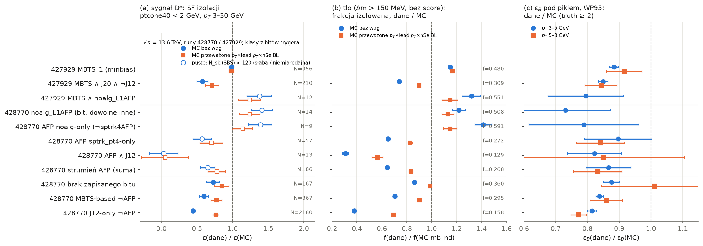
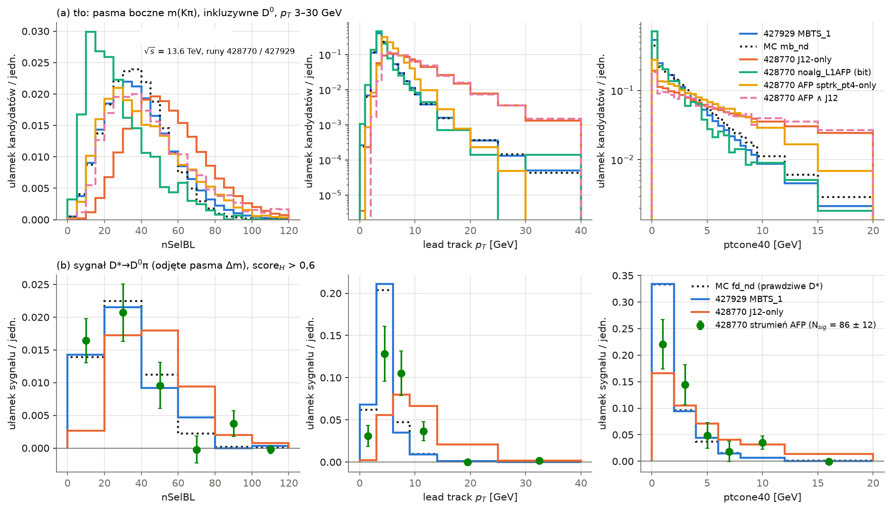

# AFPSTREAM — SF izolacji / klasyfikatora H / ε_B w strumieniu trygerów AFP runu 428770 (17.11.2026)

Projekt B (tło podobne do sygnału), D⁰→Kπ z tagu D*. Praca lokalna na `B_trig/runs/lxplus/bt_*.npz` (tylko odczyt).
Klasy definiowane WYŁĄCZNIE bitami trygera (`e_tp_*` = trigPassed po preskali). Tagu AFP ani ξ_cal w tych plikach nie ma i nie są odtwarzane.

## 0. Kryteria rozstrzygnięcia (zapisane 17.11.2026 PRZED obejrzeniem jakichkolwiek liczb klas AFP)

Znane wcześniej (z `ISO_origin`, `BKG_427929`, `RAPORT_DANE`): SF_iso(ptcone40 < 2 GeV, bez wag) = 0,98 ± 0,04 (427929 MB), 0,46 ± 0,03 (J12only),
0,62 ± 0,07 („MBTSbased”), 0,80 ± 0,09 (other = ¬J12 ∧ ¬MBTS, bez podziału); frakcja izolowanego tła f = 0,480 (427929), 0,158 (J12only), 0,346 (other).
Liczb dla klas AFP (noalg / sptrk_pt4 / ∧J12) nie znałem w chwili pisania kryteriów.

Definicje klas (rozłączne, 428770; A = noalg_L1AFP_A_OR_C ∨ mb_sptrk_pt4_L1AFP_A_OR_C, J = noalg_L1J12, M = dowolny z 7 łańcuchów L1MBTS):
`AFPonly` = A ∧ ¬J ∧ ¬M, dzielona na `AFPnoalg` (noalg ∧ ¬sptrk4AFP), `AFPsptrk4` (sptrk4AFP ∧ ¬noalg), `AFPboth` (oba);
`AFP∧J12` = A ∧ J ∧ ¬M; `AFP∧MBTS` = A ∧ M; `J12only¬A` = J ∧ ¬M ∧ ¬A; `MBTS¬A` = M ∧ ¬A; `none` = brak J, M, A.
(Ostateczny podział podklas może zostać scalony, jeśli któraś będzie pusta — decyzja wyłącznie na licznościach par, nie na SF.)

Selekcja i estymatory identyczne z `ISO_origin` (|m−m₀| < 40 MeV, score_H > 0,6, pT 3–30 GeV; fit Δm pass/fail dla N_sig ≥ 150, SBS zawsze) oraz
`btrig_analyze sf` (|m−m₀| < 55 MeV, progi WP z fd_nd) i `BKG_427929` (ε_B pod pikiem, exp(pol2) z SB, MC truth ≥ 2).

| # | pytanie | kryterium | werdykt |
|---|---|---|---|
| K0 | miarodajność | N_sig(fit albo SBS/0,82) ≥ 150 → „miarodajna”; 50–150 → „słaba” (tylko SBS, bez wniosków ≥ 2σ); < 50 albo N/σ < 3 → „niemiarodajna” (liczba tylko informacyjnie) | per klasa × bin |
| K1 | czy klasa AFP jest „jak minbias” w izolacji (cięcie główne ptcone40 < 2 GeV, pT 3–30, bez wag) | **minbias-podobna**: |SF − SF₄₂₇₉₂₉| < 2σ (błędy niezależne) ORAZ |SF − SF_J12only| > 3σ. **dżetowa**: |SF − SF_J12only| < 2σ ORAZ |SF − 1| > 3σ. **pośrednia**: odległa > 2σ od obu. **nierozstrzygnięte**: zgodna < 2σ z obiema albo klasa niemiarodajna | per klasa AFP |
| K1b | kontrola na tle (Δm > 150 MeV, bez score; duża statystyka; to NIE jest SF) | f_tła klasy: „minbias-podobne” gdy |f − 0,480| < 0,05; „dżetowe” gdy |f − 0,158| < 0,05; inaczej pośrednie. Przy niemiarodajnym sygnale K1b jest jedynym wskaźnikiem i ma status hipotezy co do sygnału | per klasa |
| K1c | przeważenie pT × lead_pt × nSelBL (schemat z ISO_origin) | „domyka” gdy |SF_rw − 1| < 2σ; raportować też różnicę SF_rw − SF_bez wag | per klasa |
| K2 | SF klasyfikatora H (WP95/80/50; 5–8, 8–30 GeV) | zgodność klasy z 427929 MB i z J12only: |pull| < 2 = zgodne; rozróżnienie wymaga, by 427929 i J12only same różniły się ≥ 2σ w danym punkcie — inaczej „brak mocy” | per punkt |
| K3 | ε_B pod pikiem, R = dane/MC (truth ≥ 2) | porównanie R klasy z R₄₂₇₉₂₉ i R_J12only; „jak minbias” gdy |R − R₄₂₇₉₂₉| < 2σ i |R − R_J12only| > 2σ (stat) w binach 3–5 i 5–8 przy WP95/80 | per klasa |
| K4 | C2ST (GBDT, 5-krotna walidacja; zmienne all_*: pT, ptcone40, ptcone100, nSelBL, lead_pt, ntrk500; pasma boczne masy) | AUC < 0,55: praktycznie nierozróżnialne; 0,55–0,70: umiarkowanie różne; > 0,70: wyraźnie różne. Klasa „bliższa” tej próbce odniesienia (427929 / J12only / MC), względem której AUC jest mniejsze | per klasa |
| K5 | „do której próbki strumień AFP jest podobny” | werdykt łączny = K1 (sygnał) jeśli miarodajne, inaczej K1b + K4 z etykietą „hipoteza” | — |
| K6 | liczby dla pomiaru z tagiem AFP | średnia ważona SF po klasach z bitem AFP, wagi = udział klasy w N_sig strumienia AFP (SBS); błąd = stat ⊕ rozrzut klas (√(χ²/ndf) gdy > 1); osobno wariant wag = udział kandydatów. Z góry zaznaczam: skład klas w obszarze z tagiem po ξ_cal jest NIEZNANY — średnia dotyczy strumienia trygera, nie obszaru sygnału | — |

Odpowiedź na pytanie kluczowe („czy AFP noalg zachowuje się jak minimum bias, SF_iso ≈ 1”) = werdykt K1 dla `AFPnoalg`; jeśli klasa niemiarodajna (preskala 60–120),
odpowiedź brzmi „niezmierzone na sygnale” + K1b/K4 jako hipoteza.

Uzupełnienie kryteriów po obejrzeniu LICZNOŚCI (przed wydajnościami; `s0_classes.py`): klasa `AFPnoalg` (noalg ∧ ¬sptrk4AFP) jest z konstrukcji obciążona w dół
(to zdarzenia L1AFP, które NIE przeszły wymogu toru pT > 4 GeV), więc na pytanie „czy tryger wyłącznie protonowy jest jak minbias” właściwą próbką jest
`AFPnoalg_any` = bit noalg_L1AFP_A_OR_C niezależnie od pozostałych bitów (preskala 60/120, czyli nieobciążona próbka zdarzeń L1AFP). Dodana jako klasa diagnostyczna
(nakłada się z rozłącznymi). Dodano też z 427929: `MB9&AFPnoalg`, `MB9&j20&!J12` jako odniesienia „ten sam łańcuch w dobrym runie”.

---

## 1. Odpowiedź

1. **Strumień AFP w 428770 nie jest minimum bias (wynik na tle i na aktywności; na sygnale tylko wskazanie).** W 73 % zdarzeń (75 % par, 65 % N_sig) zapisał go
   `HLT_mb_sptrk_pt4_L1AFP_A_OR_C` (preskala 1–2), który wymaga toru o pT > 4 GeV. Ta klasa zachowuje się jak dotychczasowa klasa „MBTS ∧ j20”, nie jak 427929:
   - tło: frakcja izolowana f(ptcone40 < 2) = 0,272 ± 0,006 (N = 5668), wobec 0,480 (427929), 0,309 (427929 ∧ j20 ∧ ¬J12), 0,295 (428770 MBTS¬AFP), 0,158 (J12only);
   - C2ST na pasmach bocznych (6 zmiennych): AUC 0,82 względem 427929, 0,69 względem 427929 ∧ j20, 0,84 względem J12only (zero: 0,500 ± 0,001);
   - sygnał: SF_iso = 0,57 ± 0,13 przy N_sig = 57 ± 10 (klasa **słaba**) — zgodny z 427929 ∧ j20 (0,58 ± 0,08) i z J12only (0,44 ± 0,02), 3,1σ od 427929 (0,99 ± 0,04).
2. **„AFP noalg” (tryger tylko na protonie, bit noalg_L1AFP, N = 28 678 zdarzeń) zachowuje się na tle jak minimum bias albo ciszej (wynik); na sygnale jest niezmierzony.**
   Tło: f = 0,508 ± 0,022 (N = 533), po przeważeniu aktywności f/f_MC = 1,13 ± 0,05 wobec 1,166 ± 0,006 w 427929 (−0,7σ). lead_pt jak w minbias (mediana 3,37 vs 3,47 GeV),
   krotność niższa (⟨nSelBL⟩ 21,6 vs 30,5). Sygnał: N_sig = 14 ± 4 — **niemiarodajny** (SF 1,41 ± 0,15 jest liczbą bez znaczenia statystycznego).
   Że SF_iso sygnału ≈ 1 w tej klasie, pozostaje **hipotezą** opartą na tle.
3. **Ta klasa to jednak tylko 16 % zdarzeń strumienia AFP (7 % par).** Zapisany strumień AFP z kandydatem D to mieszanina: 73 % sptrk_pt4-only, 11 % noalg-only,
   4,5 % oba, 9,6 % AFP ∧ J12 (dżetowe: f = 0,129 ± 0,010), 2 % AFP ∧ MBTS.
4. **Liczby dla strumienia AFP jako całości** (N_sig = 86 ± 12, „słaba”; §6): SF_iso(ptcone40 < 2) = 0,65 ± 0,11 bez wag, **0,78 ± 0,13** po przeważeniu pT × lead_pt × nSelBL;
   SF_H(WP95) = 0,57 ± 0,17 (5–8 GeV), 0,80 ± 0,09 (8–30 GeV); ε_B dane/MC (WP95) = 0,87 ± 0,03 ± 0,06 (3–5), 0,83 ± 0,07 ± 0,04 (5–8).
   Żadna z liczb sygnałowych nie odróżnia strumienia AFP od 1 na poziomie > 3,3σ ani od klas dżetowych na poziomie > 2σ — statystyka D* w tym strumieniu jest za mała.
5. **Nie zmierzono** niczego w obszarze z tagiem AFP po cięciu ξ_cal (§7). Skład klas trygera w tym obszarze jest nieznany; jeśli tam dominuje sptrk_pt4_L1AFP tak jak
   w strumieniu, to izolacja nie jest minbiasowa.

## 2. Klasy, liczności, preskale (`s0_classes.py`, `out/s0.json`; T1)

Bity `e_tp_*` / `ev_tp_*` = trigPassed po preskali; A = noalg_L1AFP ∨ sptrk_pt4_L1AFP, J = noalg_L1J12, M = dowolny z 7 łańcuchów L1MBTS.

| klasa (rozłączne) | definicja | zdarzenia z kandydatem | udział | pary D⁰←D* | N_sig D* (SBS) | N_sig (fit) | miarodajność |
|---|---|---|---|---|---|---|---|
| AFPnoalg | noalg ∧ ¬sptrk4AFP ∧ ¬J ∧ ¬M | 19 995 | 0,37 % | 809 | 9 ± 3 | – | niemiarodajna |
| AFPsptrk4 | sptrk4AFP ∧ ¬noalg ∧ ¬J ∧ ¬M | 131 608 | 2,41 % | 15 019 | 57 ± 10 | – | słaba |
| AFPboth | noalg ∧ sptrk4AFP ∧ ¬J ∧ ¬M | 8 103 | 0,15 % | 586 | 5 ± 2 | – | niemiarodajna |
| AFP∧J12 | A ∧ J ∧ ¬M | 17 415 | 0,32 % | 3 167 | 13 ± 5 | – | niemiarodajna |
| AFP∧MBTS | A ∧ M | 3 617 | 0,07 % | 460 | 3 ± 2 | – | niemiarodajna |
| J12only¬A | J ∧ ¬M ∧ ¬A | 3 818 966 | 69,84 % | 993 002 | 2180 ± 73 | 2492 ± 148 | miarodajna |
| MBTS¬A | M ∧ ¬A | 978 929 | 17,90 % | 158 925 | 367 ± 30 | 513 ± 68 | miarodajna |
| none | brak J, M, A (żaden z 11 zapisanych bitów) | 489 598 | 8,95 % | 61 612 | 167 ± 20 | 170 ± 31 | miarodajna |
| *suma* | | 5 468 231 | 100 % | 1 233 580 | | | |
| AFPonly (suma 3 pierwszych) | A ∧ ¬J ∧ ¬M | 159 706 | 2,92 % | 16 414 | 71 ± 11 | – | słaba |
| **AFPstream** (suma 5 pierwszych) | A | 180 738 | 3,31 % | 20 041 | 86 ± 12 | – | słaba |
| AFPnoalg_any (nakłada się) | bit noalg_L1AFP | 28 678 | 0,52 % | 1 480 | 14 ± 4 | – | niemiarodajna |

- N_sig: selekcja ISO_origin (|m−m₀| < 40 MeV, score_H > 0,6, pT 3–30 GeV). SBS = okno Δm minus tło z pasm; N_sig(SBS) ≈ 0,82 · N_sig(fit). Fit Δm pass/fail tylko dla N_sig(SBS) ≥ 120.
- **Preskale (z `e_ps_*`):** noalg_L1AFP_A_OR_C 60 (90 % par) i 120 (10 %); sptrk_pt4_L1AFP_A_OR_C 1 i 2; J12 1; j20_L1MBTS_2 i sptrk_pt4_L1MBTS_2 25 i 50. Zgodne z liczbami głównego łańcucha analizy.
- P(sptrk4AFP | noalg) = 0,30 (zdarzenia): tylko 30 % nieobciążonych zdarzeń L1AFP z kandydatem D ma tor pT > 4 GeV. P(noalg | sptrk4AFP) = 0,054 (oczekiwane 1/60 = 0,017 przy niezależnych preskalach — nie wyjaśnione, nie wpływa na wnioski).
- P(J12 | A) = 0,098 (zdarzenia), 0,16 (pary); P(A | J12) = 0,0045.
- 427929: bity AFP występują tylko razem z MBTS (noalg_L1AFP 20 818 zdarzeń, sptrk4AFP 5 937) — użyte jako odniesienie.
- **Zastrzeżenie:** strumień AFP z zapisanym bitem to 3,3 % zdarzeń z kandydatem. Klasa `none` (9 %) nie ma żadnego z 11 zapisanych bitów; produkcja przechowuje 11 ze 106 łańcuchów,
  więc `none` może zawierać inne łańcuchy AFP (nie do sprawdzenia lokalnie). Stwierdzenia „~96 % tagów AFP leży w strumieniu AFP” nie mogę tu zweryfikować (brak tagu w npz).
- Ułamek zdarzeń z nPileupVertices ≥ 1: strumień AFP 21,5 % (pary: 34,5 %), J12only 5 %, 427929 1,4 %. Proton w AFP często pochodzi więc z innego zderzenia niż kandydat (**hipoteza** zgodna z liczbą; nie testowana bez tagu).

## 3. Izolacja (`s1_iso.py`, `out/s1.json`; T2, T2b, T3; rys. 1)

### 3a. Sygnał D* — SF = ε_dane/ε_MC, pT 3–30 GeV, SBS (w nawiasie fit profilowy); „/” = po przeważeniu pT × lead_pt × nSelBL

| próbka | N_sig SBS | ptcone40 < 1 | ptcone40 < 2 | ptcone40 < 4 | rel40 < 0,25 | rel40 < 0,5 | ptcone100 < 5 | ptcone100 < 10 |
|---|---|---|---|---|---|---|---|---|
| 427929 MBTS_1 | 956 ± 46 | 1,04 ± 0,05 / 1,04 ± 0,05 | 0,99 ± 0,04 (0,98 ± 0,04) / 0,98 ± 0,03 | 1,00 ± 0,02 / 1,00 ± 0,02 | 1,02 ± 0,05 / 1,03 ± 0,04 | 0,98 ± 0,03 / 0,99 ± 0,03 | 0,98 ± 0,05 / 0,99 ± 0,04 | 0,93 ± 0,03 / 0,95 ± 0,02 |
| 427929 MBTS ∧ j20 ∧ ¬J12 | 210 ± 22 | 0,51 ± 0,09 / 0,71 ± 0,13 | 0,58 ± 0,08 (0,66 ± 0,10) / 0,71 ± 0,09 | 0,80 ± 0,06 / 0,90 ± 0,07 | 0,66 ± 0,09 / 0,77 ± 0,10 | 0,73 ± 0,07 / 0,81 ± 0,07 | 0,43 ± 0,07 / 0,66 ± 0,11 | 0,71 ± 0,07 / 0,87 ± 0,08 |
| 428770 AFPnoalg_any *(niemiarodajna)* | 14 ± 4 | 0,88 ± 0,34 / 0,72 ± 0,29 | 1,41 ± 0,15 / 1,24 ± 0,14 | 1,14 ± 0,08 / 1,07 ± 0,08 | 0,90 ± 0,29 / 0,81 ± 0,26 | 1,35 ± 0,10 / 1,28 ± 0,10 | 1,88 ± 0,28 / 1,44 ± 0,25 | 1,24 ± 0,09 / 1,10 ± 0,06 |
| 428770 AFPsptrk4 *(słaba)* | 57 ± 10 | 0,62 ± 0,17 / 0,88 ± 0,25 | 0,57 ± 0,13 / 0,70 ± 0,16 | 0,77 ± 0,10 / 0,85 ± 0,12 | 0,74 ± 0,16 / 0,75 ± 0,16 | 0,88 ± 0,13 / 0,88 ± 0,12 | 0,52 ± 0,15 / 0,63 ± 0,17 | 0,75 ± 0,12 / 0,81 ± 0,12 |
| **428770 AFPstream** *(słaba)* | 86 ± 12 | 0,60 ± 0,14 / 0,79 ± 0,18 | **0,65 ± 0,11 / 0,78 ± 0,13** | 0,84 ± 0,08 / 0,93 ± 0,09 | 0,72 ± 0,13 / 0,74 ± 0,13 | 0,96 ± 0,10 / 0,97 ± 0,10 | 0,72 ± 0,13 / 0,85 ± 0,14 | 0,76 ± 0,09 / 0,83 ± 0,09 |
| 428770 none | 167 ± 20 | 0,64 ± 0,12 / 0,80 ± 0,14 | 0,73 ± 0,09 (0,80 ± 0,12) / 0,85 ± 0,10 | 0,93 ± 0,06 / 1,01 ± 0,07 | 0,80 ± 0,11 / 0,94 ± 0,12 | 0,87 ± 0,08 / 0,95 ± 0,09 | 0,56 ± 0,10 / 0,78 ± 0,13 | 0,86 ± 0,08 / 1,03 ± 0,08 |
| 428770 MBTS¬A | 367 ± 30 | 0,56 ± 0,08 / 0,83 ± 0,11 | 0,60 ± 0,06 (0,62 ± 0,07) / 0,77 ± 0,08 | 0,83 ± 0,05 / 0,96 ± 0,06 | 0,71 ± 0,07 / 0,85 ± 0,08 | 0,80 ± 0,06 / 0,88 ± 0,06 | 0,46 ± 0,06 / 0,74 ± 0,09 | 0,64 ± 0,05 / 0,81 ± 0,06 |
| 428770 J12only¬A | 2180 ± 73 | 0,34 ± 0,03 / 0,77 ± 0,06 | 0,44 ± 0,02 (0,46 ± 0,03) / 0,76 ± 0,04 | 0,56 ± 0,02 / 0,80 ± 0,03 | 0,55 ± 0,03 / 0,74 ± 0,04 | 0,69 ± 0,02 / 0,82 ± 0,03 | 0,21 ± 0,02 / 0,51 ± 0,04 | 0,44 ± 0,02 / 0,71 ± 0,03 |

- Odtworzenie ISO_origin: 427929 0,98 ± 0,04, J12only 0,46 ± 0,03, MBTSbased 0,62 ± 0,07, other 0,80 ± 0,09 (fit) — zgodne co do cyfry.
- Dotychczasowa klasa „other” (0,80 ± 0,09) to w 79 % par klasa `none`, nie AFP. Sam AFPonly: 0,72 ± 0,12 (N_sig 71 ± 11).
- W binach pT (ptcone40 < 2; bez wag / przeważone), AFPstream: 3–5 GeV 0,67 ± 0,20 / 0,74 ± 0,21 (N 30 ± 9); 5–8 GeV 0,74 ± 0,22 / 0,76 ± 0,23 (N 21 ± 6);
  8–30 GeV 0,85 ± 0,20 / 0,84 ± 0,20 (N 36 ± 6). Każdy bin z osobna jest niemiarodajny. Dla porównania 8–30 GeV: J12only 0,30 ± 0,03, MBTS¬A 0,72 ± 0,11, 427929 0,89 ± 0,12.
  Przy 8–30 GeV strumień AFP leży 2,7σ nad J12only — tam nie jest dżetowy (wskazanie, klasa słaba).
- SF bez wag w 3–30 GeV miesza widmo pT (⟨pT⟩ sygnału: AFPstream 7,7 ± 0,6 GeV, MC 5,65, 427929 5,5); do użytku nadaje się liczba przeważona, 0,78 ± 0,13.
- Z wetem nPileupVertices = 0 (`s7_npu.py`): AFPstream N_sig 59 ± 10, SF 0,67 ± 0,13 / 0,76 ± 0,15; tło f 0,276 ± 0,006 — bez zmiany. AFPnoalg_any: tło f 0,562 ± 0,025.
- Błędy SBS dla N_sig < 20 (ε > 1, ε < 0) nie są gaussowskie; tych wierszy nie należy interpretować.
- Próba zwiększenia statystyki inkluzywnym D⁰ (pik w masie, `all_*`, 30 % zdarzeń): strumień AFP daje S = 54 ± 14 przy WP50 i 59 ± 43 przy WP80 (3–5 GeV) — bez zysku, odrzucone.

### 3b. Kontrola na tle (pary, Δm 150–170 MeV, bez score; to nie jest SF sygnału)

| próbka | N | f(ptcone40 < 2) | f/f_MC | f/f_MC przeważone | K1b |
|---|---|---|---|---|---|
| 427929 MBTS_1 | 109 175 | 0,4798 ± 0,0015 | 1,148 ± 0,004 | 1,166 ± 0,006 | odniesienie |
| 427929 MBTS ∧ j20 ∧ ¬J12 | 29 213 | 0,3088 ± 0,0027 | 0,739 ± 0,006 | 0,899 ± 0,009 | – |
| 427929 MBTS ∧ noalg_L1AFP | 265 | 0,551 ± 0,031 | 1,32 ± 0,07 | 1,15 ± 0,06 | – |
| 428770 AFPnoalg_any | 533 | 0,508 ± 0,022 | 1,22 ± 0,05 | 1,13 ± 0,05 | **minbias-podobne** |
| 428770 AFPnoalg (¬sptrk4AFP) | 301 | 0,591 ± 0,028 | 1,42 ± 0,07 | 1,15 ± 0,06 | pośrednie (bardziej izolowane niż minbias) |
| 428770 AFPsptrk4 | 5 668 | 0,272 ± 0,006 | 0,650 ± 0,014 | 0,828 ± 0,019 | pośrednie |
| 428770 AFPboth | 202 | 0,441 ± 0,035 | 1,05 ± 0,08 | 1,16 ± 0,09 | minbias-podobne |
| 428770 AFP∧J12 | 1 140 | 0,129 ± 0,010 | 0,308 ± 0,024 | 0,566 ± 0,044 | **dżetowe** |
| 428770 AFP∧MBTS | 176 | 0,307 ± 0,035 | 0,73 ± 0,08 | 1,01 ± 0,12 | pośrednie |
| **428770 AFPstream** | 7 487 | 0,268 ± 0,005 | 0,642 ± 0,012 | 0,835 ± 0,017 | pośrednie |
| 428770 none | 23 175 | 0,360 ± 0,003 | 0,861 ± 0,008 | 0,987 ± 0,010 | pośrednie |
| 428770 MBTS¬A | 60 156 | 0,2945 ± 0,0019 | 0,705 ± 0,004 | 0,900 ± 0,008 | pośrednie |
| 428770 J12only¬A | 375 167 | 0,1583 ± 0,0006 | 0,379 ± 0,001 | 0,695 ± 0,010 | odniesienie |

- MC = pary mb_nd, ta sama selekcja (N = 77 890, f = 0,418). f/f_MC w 427929 nie wynosi 1 (1,15–1,17): tło kombinatoryczne w danych minbias jest bardziej izolowane niż w MC.
  Klasy należy więc porównywać z 427929, nie z jedynką.
- Ten sam łańcuch w obu runach: noalg_L1AFP 0,508 ± 0,022 (428770) vs 0,551 ± 0,031 (427929), 1,1σ. Zgodne.
- AFPstream po przeważeniu aktywności: 0,835 ± 0,017, czyli 18σ poniżej 427929 (1,166), 3,4σ poniżej MBTS¬A i 427929 ∧ j20 (0,90), 7σ nad J12only (0,695).
  Przeważenie w (pT, lead_pt, nSelBL) nie sprowadza strumienia AFP do minbias — tak samo jak dla klas dżetowych w ISO_origin.
- Pozostałe cięcia (ptcone40 < 1/4, rel40 < 0,5, ptcone100 < 10): ten sam porządek klas (T3).

## 4. Klasyfikator H i ε_B (`s2_hsf.py`, `s3_epsb.py`; T4, T5)

### 4a. SF_H z tagu D* (|m−m₀| < 55 MeV, progi WP z fd_nd, ε_MC bez wag; SBS, w nawiasie fit profilowy)

| próbka | bin | N_sig SBS | miarodajność | WP95 | WP80 | WP50 |
|---|---|---|---|---|---|---|
| 427929 MBTS_1 | 5–8 | 392 ± 37 | miarodajna | 0,98 ± 0,07 (1,05 ± 0,11) | 0,96 ± 0,08 (1,03 ± 0,12) | 0,93 ± 0,09 (0,99 ± 0,13) |
| **AFPstream** | 5–8 | 43 ± 14 | słaba (N/σ = 3,1) | 0,57 ± 0,17 | 0,71 ± 0,22 | 0,71 ± 0,25 |
| AFPsptrk4 | 5–8 | 39 ± 12 | niemiarodajna | 0,53 ± 0,16 | 0,57 ± 0,18 | 0,61 ± 0,22 |
| none | 5–8 | 62 ± 18 | słaba | 0,96 ± 0,22 | 1,08 ± 0,28 | 1,08 ± 0,31 |
| MBTS¬A | 5–8 | 231 ± 34 | miarodajna | 0,66 ± 0,08 (0,72 ± 0,12) | 0,60 ± 0,09 (0,67 ± 0,12) | 0,58 ± 0,10 (0,63 ± 0,13) |
| J12only¬A | 5–8 | 702 ± 96 | miarodajna | 0,90 ± 0,10 (0,88 ± 0,14) | 0,87 ± 0,11 (0,91 ± 0,17) | 0,98 ± 0,13 (1,08 ± 0,21) |
| 427929 MBTS_1 | 8–30 | 154 ± 16 | miarodajna | 0,95 ± 0,06 (0,91 ± 0,07) | 1,00 ± 0,07 (0,95 ± 0,09) | 1,06 ± 0,11 (1,01 ± 0,13) |
| **AFPstream** | 8–30 | 51 ± 9 | słaba | 0,80 ± 0,09 | 0,93 ± 0,12 | 0,83 ± 0,16 |
| AFPsptrk4 | 8–30 | 38 ± 7 | niemiarodajna | 0,79 ± 0,10 | 0,89 ± 0,13 | 0,84 ± 0,18 |
| none | 8–30 | 43 ± 9 | słaba | 0,95 ± 0,12 | 0,86 ± 0,14 | 0,69 ± 0,18 |
| MBTS¬A | 8–30 | 187 ± 18 | miarodajna | 0,96 ± 0,05 (0,96 ± 0,05) | 0,84 ± 0,06 (0,88 ± 0,08) | 0,76 ± 0,09 (0,81 ± 0,09) |
| J12only¬A | 8–30 | 1348 ± 63 | miarodajna | 1,06 ± 0,03 (1,02 ± 0,04) | 1,02 ± 0,04 (0,99 ± 0,05) | 0,98 ± 0,05 (0,97 ± 0,06) |

- AFPnoalg_any: N_sig 8 ± 4 (5–8), 0 (8–30) — brak pomiaru.
- K2: 427929 i J12only same różnią się w tych punktach o < 2σ (największa różnica WP95 8–30: 1,6σ) → **brak mocy** rozróżnienia „do której próbki podobny”.
- AFPstream WP95 leży poniżej 1 w obu binach (−2,5σ i −2,2σ), przy 8–30 GeV 2,7σ poniżej J12only i 1,4σ poniżej 427929. Klasa słaba — to **wskazanie**, nie wynik.
  Ten sam kierunek ma miarodajna klasa MBTS¬A przy 5–8 GeV (0,66 ± 0,08, znane z nocnego raportu jako odchylenie j20MBTS).
- Zgodność SBS z fitem na klasach miarodajnych: różnice ≤ 0,07, w granicach błędów.

### 4b. ε_B pod pikiem: R = ε_B(dane, exp(pol2) z SB) / ε_B(MC truth ≥ 2, zliczenie w SR); ± stat [syst. interpolacji, względna]. R_SB = frakcja pass w SB, dane / MC inkluzywne (zliczenie, bez ekstrapolacji)

| próbka | bin | N w SB | R WP95 | R WP80 | R WP50 | R_SB WP95 | R_SB WP80 |
|---|---|---|---|---|---|---|---|
| 427929 MBTS_1 | 3–5 | 421 743 | 0,884 ± 0,007 [0,01] | 0,860 ± 0,017 [0,04] | 0,94 ± 0,06 [0,06] | 0,889 ± 0,003 | 0,867 ± 0,007 |
| AFPnoalg_any | 3–5 | 2 598 | 0,73 ± 0,09 [0,16] | 0,71 ± 0,18 [0,12] | – | 0,853 ± 0,026 | 0,77 ± 0,06 |
| AFPsptrk4 | 3–5 | 18 387 | 0,90 ± 0,04 [0,11] | 0,77 ± 0,08 [0,07] | 0,64 ± 0,21 | 0,807 ± 0,011 | 0,710 ± 0,021 |
| AFP∧J12 | 3–5 | 3 159 | 0,82 ± 0,08 [0,03] | 0,55 ± 0,13 [0,49] | – | 0,816 ± 0,024 | 0,78 ± 0,05 |
| **AFPstream** | 3–5 | 24 594 | 0,867 ± 0,028 [0,07] | 0,75 ± 0,06 [0,02] | 0,67 ± 0,19 | 0,814 ± 0,009 | 0,733 ± 0,018 |
| none | 3–5 | 79 049 | 0,876 ± 0,016 [0,02] | 0,87 ± 0,04 [0,01] | 1,01 ± 0,15 | 0,872 ± 0,006 | 0,851 ± 0,012 |
| MBTS¬A | 3–5 | 189 423 | 0,838 ± 0,010 [0,01] | 0,789 ± 0,024 [0,05] | 0,74 ± 0,07 | 0,847 ± 0,004 | 0,805 ± 0,008 |
| J12only¬A | 3–5 | 998 407 | 0,815 ± 0,005 [0,02] | 0,783 ± 0,011 [0,02] | 0,73 ± 0,04 | 0,816 ± 0,003 | 0,772 ± 0,006 |
| 427929 MBTS_1 | 5–8 | 45 305 | 0,916 ± 0,027 [0,05] | 0,87 ± 0,06 [0,08] | 0,73 ± 0,13 | 0,872 ± 0,010 | 0,799 ± 0,020 |
| AFPsptrk4 | 5–8 | 5 107 | 0,84 ± 0,07 [0,03] | 0,71 ± 0,15 [0,09] | – | 0,823 ± 0,022 | 0,65 ± 0,04 |
| **AFPstream** | 5–8 | 6 479 | 0,83 ± 0,07 [0,05] | 0,72 ± 0,13 [0,12] | 0,62 ± 0,34 | 0,798 ± 0,018 | 0,64 ± 0,04 |
| MBTS¬A | 5–8 | 35 382 | 0,860 ± 0,026 [0,05] | 0,69 ± 0,05 [0,06] | 0,64 ± 0,14 | 0,817 ± 0,010 | 0,696 ± 0,019 |
| J12only¬A | 5–8 | 275 556 | 0,772 ± 0,010 [0,03] | 0,670 ± 0,022 [0,05] | 0,53 ± 0,05 | 0,768 ± 0,007 | 0,633 ± 0,012 |
| 427929 MBTS_1 | 8–30 | 5 926 | 0,79 ± 0,06 [0,07] | 0,83 ± 0,13 | 0,78 ± 0,25 | 0,825 ± 0,025 | 0,78 ± 0,05 |
| **AFPstream** | 8–30 | 1 624 | 0,88 ± 0,12 [0,05] | 0,96 ± 0,27 | – | 0,91 ± 0,04 | 0,81 ± 0,08 |
| J12only¬A | 8–30 | 121 396 | 0,785 ± 0,020 [0,04] | 0,67 ± 0,04 | 0,52 ± 0,07 | 0,749 ± 0,017 | 0,572 ± 0,024 |

- Odtworzenie BKG_427929: 427929 3–5 WP95 R(truth ≥ 2) = 0,88; 428770 J12only 0,815 — zgodne.
- K3 (pod pikiem): AFPstream 3–5 WP95 0,867 ± 0,028 jest 0,6σ od 427929 i 1,8σ od J12only; 5–8: 1,1σ i 0,9σ → **nierozstrzygnięte** (błąd 3–8 % stat + 5–7 % interpolacji).
- W samych pasmach bocznych (R_SB, dokładniejsze, ale to nie jest ε_B pod pikiem): AFPstream 3–5 WP95 0,814 ± 0,009 = J12only (0,816), 7,9σ poniżej 427929 (0,889), 3,4σ poniżej MBTS¬A;
  WP80 0,733 ± 0,018, 6,9σ poniżej 427929. Przy 5–8 GeV: 0,798 ± 0,018, 3,6σ poniżej 427929. Udział kandydatów tła przechodzących próg H w strumieniu AFP **nie** jest minbiasowy (wynik).
- AFPnoalg_any: R_SB 0,853 ± 0,026 (3–5, WP95) — 1,4σ od 427929 i 1,4σ od J12only; nierozstrzygnięte.
- Przy 8–30 GeV: AFPstream R_SB 0,91 ± 0,04 jest 3,7σ nad J12only i 1,7σ nad 427929.

## 5. Aktywność i C2ST (`s4_shapes.py`, `out/s4.json`; T6–T9; rys. 2)

Zdarzenia z kandydatem:

| próbka | N zdarzeń | ⟨nSelBL⟩ | mediana lead_pt [GeV] | ułamek lead_pt < 4 GeV | ułamek nPileupVertices = 0 |
|---|---|---|---|---|---|
| 427929 MBTS_1 | 3 450 333 | 30,5 | 3,47 | 0,68 | 0,986 |
| MC mb_nd | 2 983 963 | 30,3 | 3,50 | – | – |
| 427929 MBTS ∧ noalg_L1AFP | 18 933 | 18,0 | 3,36 | 0,74 | 0,966 |
| 428770 AFPnoalg_any | 28 678 | 21,6 | 3,37 | 0,72 | 0,842 |
| 428770 AFPnoalg (¬sptrk4AFP) | 19 995 | 19,8 | 3,12 | 0,99 | 0,857 |
| 428770 AFPsptrk4 | 131 608 | 31,3 | 5,48 | 0,07 | 0,772 |
| 428770 AFP∧J12 | 17 415 | 33,7 | 8,28 | 0,04 | 0,788 |
| 428770 AFPstream | 180 738 | 30,0 | 5,28 | 0,17 | 0,785 |
| 428770 none | 489 598 | 36,6 | 3,72 | 0,60 | 0,922 |
| 428770 MBTS¬A | 978 929 | 39,9 | 4,72 | 0,32 | 0,947 |
| 428770 J12only¬A | 3 818 966 | 42,5 | 7,64 | 0,13 | 0,950 |

- noalg_L1AFP: lead_pt jak minbias, krotność o 30–40 % niższa — w obu runach (21,6 w 428770; 18,0 w 427929). To zgodne z oczekiwaniem dla zdarzeń z protonem (dyfrakcja), ale przyczyny tu nie testowałem.
- sptrk_pt4_L1AFP: krotność jak minbias (31,3), lead_pt przesunięte progiem 4 GeV (mediana 5,5 GeV). To próbka „minbias z twardym torem”, nie minbias.

C2ST na pasmach bocznych masy inkluzywnego D⁰ (AUC; HGB, 5-krotna GroupKFold po zdarzeniu; „6” = pT, ptcone40, ptcone100, nSelBL, lead_pt, ntrk500; dodanie score nie zmienia AUC o więcej niż 0,004):

| klasa | n / klasę | vs 427929 (zdarzenie 3 / wszystkie 6) | vs 427929 ∧ j20 ∧ ¬J12 (6) | vs J12only (6) | vs MC mb_nd (6) | najbliższa |
|---|---|---|---|---|---|---|
| AFPnoalg_any | 2 876 | 0,686 ± 0,012 / 0,682 ± 0,008 | 0,831 | 0,930 | 0,682 ± 0,005 | 427929 / MC (umiarkowanie różna; KS: nSelBL 0,29, lead_pt 0,08, ptcone40 0,09) |
| AFPnoalg (¬sptrk4AFP) | 1 661 | 0,830 / 0,832 | 0,957 | 0,990 | 0,829 | żadna (obciążona w dół) |
| AFPsptrk4 | 24 554 | 0,796 / 0,821 ± 0,002 | 0,693 ± 0,002 | 0,840 | 0,825 | 427929 ∧ j20 (KS ptcone40 0,06, ptcone100 0,02) |
| AFP∧J12 | 4 724 | 0,902 / 0,924 | 0,854 | 0,628 ± 0,008 | 0,923 | J12only |
| AFP∧MBTS | 690 | 0,777 / 0,772 | 0,646 | 0,763 | 0,780 | 427929 ∧ j20 |
| **AFPstream** | 32 721 | 0,782 / 0,801 ± 0,002 | 0,696 ± 0,002 | 0,803 | 0,806 | 427929 ∧ j20 |
| none | 60 000 | 0,635 / 0,655 | 0,620 | 0,853 | 0,676 | między 427929 a j20 |
| MBTS¬A | 60 000 | 0,729 / 0,745 | 0,539 | 0,787 | 0,762 | 427929 ∧ j20 |
| odniesienia | 60 000 | 427929 vs MC: 0,591; J12only vs 427929: 0,908; 427929 ∧ j20 vs 427929: 0,731; zero (połowy 427929): 0,500 ± 0,001 | | | | |

- K4: żadna klasa AFP nie jest „praktycznie nierozróżnialna” (AUC < 0,55) od 427929. AFPnoalg_any jest umiarkowanie różna (0,68), i to przez krotność, nie izolację.
  AFPsptrk4 i cały strumień są **wyraźnie różne** od 427929 (0,80–0,82) i równie różne od J12only (0,80–0,84).
- ⟨ptcone100⟩ w MC mb_nd ma wartość bez sensu (1,4·10⁶) — pojedyncze wartości nieskończone/ogromne w `all_ptcone100`; frakcji z cięć i AUC to nie zmienia, średnich MC nie cytuję.

## 6. Wniosek dla pomiaru z tagiem AFP (K6; T11)

Skład strumienia AFP (zapisane zdarzenia z kandydatem; dane wchodzą do głównego łańcucha z wagą 1, więc to jest właściwy skład „jak zapisano”):

| klasa | udział zdarzeń | udział par | udział N_sig | SF_iso sygnału (bez wag) | tło f/f_MC | tło f/f_MC przeważone |
|---|---|---|---|---|---|---|
| AFPnoalg | 11,1 % | 4,0 % | 11 % | 1,39 ± 0,16 (N 9) | 1,42 ± 0,07 | 1,15 ± 0,06 |
| AFPsptrk4 | 72,8 % | 74,9 % | 65 % | 0,57 ± 0,13 (N 57) | 0,650 ± 0,014 | 0,828 ± 0,019 |
| AFPboth | 4,5 % | 2,9 % | 6 % | 1,45 ± 0,31 (N 5) | 1,05 ± 0,08 | 1,16 ± 0,09 |
| AFP∧J12 | 9,6 % | 15,8 % | 15 % | 0,03 ± 0,20 (N 13) | 0,308 ± 0,024 | 0,57 ± 0,04 |
| AFP∧MBTS | 2,0 % | 2,3 % | 3 % | 1,83 ± 0,29 (N 3) | 0,73 ± 0,08 | 1,01 ± 0,12 |

| wielkość (strumień AFP, 428770) | wartość | status |
|---|---|---|
| SF_iso ptcone40 < 2 GeV, próbka połączona (= średnia z wagami N_sig) | 0,65 ± 0,11 bez wag; **0,78 ± 0,13** przeważone | słaba (N_sig 86 ± 12) |
| to samo jako średnia klas z wagami N_sig | 0,67 ± 0,09 (stat); χ²/ndf rozrzutu klas 53/4 → wg K6 **± 0,34** | rozrzut zdominowany przez klasy z N_sig ≤ 13 o niegaussowskich błędach |
| średnia klas z wagami = udział par / zdarzeń | 0,58 ± 0,10 / 0,68 ± 0,10 | jw. |
| SF_iso ptcone40 < 1 / < 4 GeV (przeważone) | 0,79 ± 0,18 / 0,93 ± 0,09 | słaba |
| SF_iso ptcone40/pT < 0,25 / < 0,5 (przeważone) | 0,74 ± 0,13 / 0,97 ± 0,10 | słaba |
| SF_iso ptcone100 < 5 / < 10 GeV (przeważone) | 0,85 ± 0,14 / 0,83 ± 0,09 | słaba |
| SF_H WP95 / WP80 / WP50, 5–8 GeV | 0,57 ± 0,17 / 0,71 ± 0,22 / 0,71 ± 0,25 | słaba (N 43 ± 14) |
| SF_H WP95 / WP80 / WP50, 8–30 GeV | 0,80 ± 0,09 / 0,93 ± 0,12 / 0,83 ± 0,16 | słaba (N 51 ± 9) |
| ε_B dane/MC (truth ≥ 2), WP95: 3–5 / 5–8 / 8–30 GeV | 0,87 ± 0,03 ± 0,06 / 0,83 ± 0,07 ± 0,04 / 0,88 ± 0,12 ± 0,04 | stat ± syst. interpolacji |
| ε_B dane/MC, WP80: 3–5 / 5–8 GeV | 0,75 ± 0,06 ± 0,02 / 0,72 ± 0,13 ± 0,09 | jw. |
| tło: frakcja izolowana dane/MC (ptcone40 < 2) | 0,642 ± 0,012 bez wag; 0,835 ± 0,017 przeważone; rozrzut klas (RMS) 0,21 / 0,14 | wynik (kontrola, nie SF) |

Co z tego wynika:

- **Wynik:** otoczenie kandydatów w strumieniu AFP (tło, aktywność, udział tła przechodzącego H w pasmach bocznych) jest między minbias a J12 i najbliższe klasie „MBTS ∧ j20”.
  Założenie „zdarzenia z trygera protonowego są jak minbias, więc MC bez trygera opisuje ptcone” jest dla zapisanego strumienia **fałszywe na tle** (18σ po przeważeniu aktywności).
- **Wskazanie (nie wynik):** SF izolacji sygnału w strumieniu AFP ≈ 0,65–0,78, czyli bliżej 0,6–0,8 klas MBTS¬A / none niż 0,46 z J12only i niż 1. Od 1 dzieli go 1,8σ (przeważone) do 3,3σ (bez wag);
  od naszej dotychczasowej liczby 0,51 (428770 all) 1,3σ. Nie mamy podstaw, by przenosić 0,51 na obszar z tagiem AFP, ale też nie mamy podstaw, by przyjąć 1.
- **Hipoteza:** dla podzbioru zapisanego wyłącznie przez noalg_L1AFP izolacja sygnału jest jak w minbias (SF ≈ 1). Wspiera ją tło (f/f_MC po przeważeniu 1,13 ± 0,05 vs 1,166 w 427929)
  i lead_pt; sygnału jest 14 ± 4.
- Źródło różnicy to łańcuch HLT (tor pT > 4 GeV), nie proton: wymóg twardego toru wybiera zdarzenia z dżetem tak samo jak sptrk_pt4/j20 na MBTS.
  Wagi preskali (noalg 60–120 vs sptrk4 1–2) odwróciłyby skład: z wagami preskali próbka L1AFP byłaby w ~70 % „noalg-podobna”. Bez wag (stan głównego łańcucha) dominuje sptrk_pt4.

## 7. Czego nie zmierzono

1. **Obszaru sygnału głównego łańcucha** (tag AFP: dokładnie jeden proton w oknie ξ 0,030–0,100, nPileupVertices = 0, cięcie ξ_cal ≤ ξ_AFP + 0,02). W npz nie ma tagu ani ξ_cal; nie odtwarzałem ich
   i nie robiłem żadnych fitów sygnału D w zdarzeniach z tagiem. Cięcie ξ_cal wybiera zdarzenia o małej aktywności kalorymetrycznej po stronie protonu — może przesuwać próbkę
   w stronę „noalg-podobną” (ciszej) niezależnie od łańcucha; kierunek i wielkość nieznane.
2. **Składu klas trygera w obszarze tagowanym.** Liczba „~96 % tagów ze strumienia AFP” nie pochodzi z tych plików; podziału tagów na noalg / sptrk_pt4 / ∧J12 nie znam.
3. **SF sygnału w klasie noalg_L1AFP** (N_sig = 14) i osobno w AFP∧J12 (13). Do pomiaru na ±0,1 potrzeba ~10× więcej D* w tych klasach — w 428770 ich nie ma.
4. **Innych łańcuchów AFP.** Zapisano 2 z łańcuchów L1AFP; klasa `none` (9 % zdarzeń, SF_iso 0,73 ± 0,09, tło 0,360) ma nieznane pochodzenie.
5. **Emulacji trygera w MC** — MC nie ma bitów; SF podane są względem MC bez trygera (z przeważeniem aktywności lub bez), jak w ISO_origin.
6. D⁺ i inkluzywnego D⁰ jako sygnału; binu 2–3 GeV; 427929 nie ma samodzielnych łańcuchów AFP (bity AFP tylko razem z MBTS).
7. Systematyki SBS w małych klasach (kształt tła Δm z fitu łącznego klasy) nie oceniałem osobno; dla klas miarodajnych SBS i fit zgadzają się w granicach błędów.

## 8. Pliki

- Skrypty: `afp_common.py` (klasy), `s0_classes.py`, `s1_iso.py`, `s2_hsf.py`, `s3_epsb.py`, `s4_shapes.py`, `s5_figs.py`, `s6_tables.py`, `s7_npu.py`
  (importują estymatory z `../ISO_origin/iso_common.py`, `../ISO_origin/s2_universal_rw.py`, `../BKG_427929/bkg_common.py`; nic tam nie zmieniono).
- Wyniki: `out/s0.json` … `out/s4.json`, `out/s7.json`, `out/tables.md` (pełne tabele T1–T11, wszystkie klasy i cięcia), logi `out/s2.log`, `out/s4.log`.
- Rysunki: `fig1_afp_classes.png`, `fig2_afp_activity.png`.
- Uruchomienie: `~/Documents/charm/.venv_h5/bin/python s0_classes.py` itd. w tym katalogu (≤ 4 procesy; całość ~15 min).
