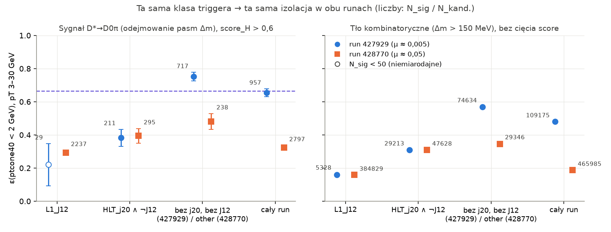
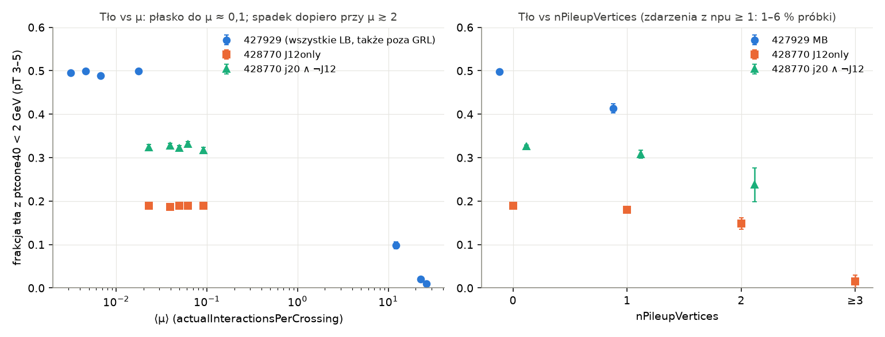
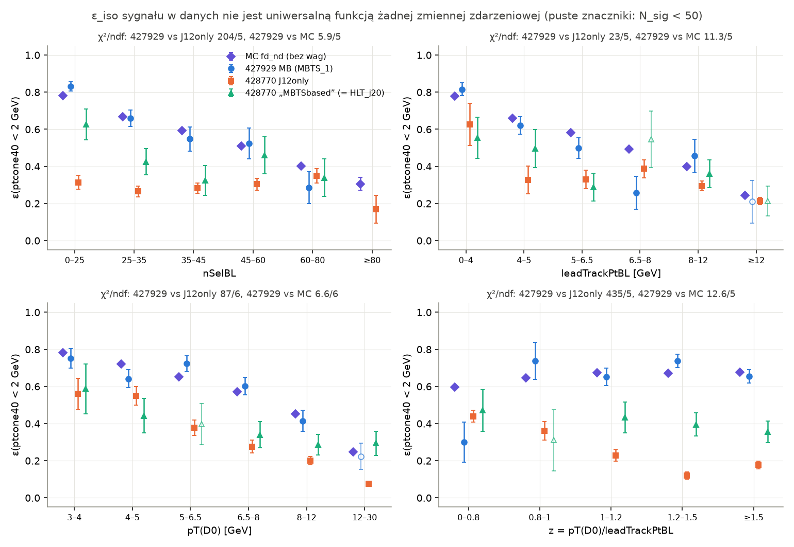
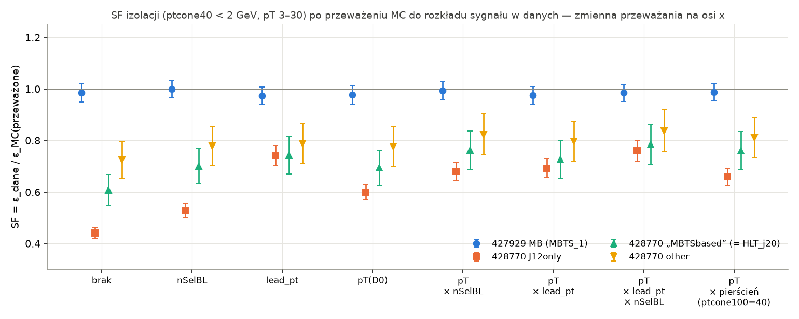

# ISO_origin — skąd deficyt izolacji D⁰ w runie 428770 (17.11.2026)

Projekt B (tło podobne do sygnału). Studium lokalne na `B_trig/runs/lxplus/*.npz` (h5 v2.0, L_xy ≥ 0,25 mm).
Pełne tabele: `out/tables.md` (T1–T10), `out/s3.md`; liczby źródłowe: `out/s1.json`, `out/s2.json`, `out/s3.json`.

**Pytanie.** SF_iso = ε_dane/ε_MC (ptcone40 < 2 GeV) wynosi 0,98 ± 0,04 w 427929 i 0,51 ± 0,02 w 428770. Tryger, pile-up czy krotność/kinematyka?
Czy jedna zmienna pozwala przeważyć MC tak, by domykało się w obu runach?

## 0. Odpowiedź

1. **Przyczyną jest tryger, nie run i nie pile-up (wynik).** Ta sama klasa triggera daje tę samą izolację w obu runach (rys. 1, T6):
   - HLT_j20 ∧ ¬J12: sygnał 0,383 ± 0,051 (427929, N_sig = 211) vs 0,395 ± 0,044 (428770, N_sig = 295); tło 0,3088 ± 0,0027 vs 0,3083 ± 0,0021.
   - L1_J12: tło 0,1603 ± 0,0050 (427929) vs 0,1582 ± 0,0006 (428770); sygnał w 427929 tylko N_sig = 29 (0,22 ± 0,13 vs 0,293 ± 0,014 — niemiarodajny, zgodny).
   - Sam run 427929 podzielony bitem j20: SF = 0,58 ± 0,08 (z j20) i 1,13 ± 0,04 (bez j20 i J12). „Deficyt” odtwarza się więc w dobrym runie.
2. **W 428770 nie ma klasy minimum-bias (wynik + wniosek ze strumienia).** „MBTSbased” to w 93 % HLT_j20 (tryger dżetowy).
   Łańcuchy nieobciążone (noalg_mb_L1MBTS_1/2, mb_mbts) mają bit tylko razem z innym łańcuchem: N_sig = 19 ± 7; „MBTS-only bez j20/sptrk4” = 18 kandydatów, N_sig ≈ 0.
3. **Pile-up wykluczony (wynik).** Frakcja izolowanego tła jest płaska w μ w obu runach (0,187–0,190 w J12only dla μ 0,02–0,09); zdarzenia z nPileupVertices ≥ 1
   to 6,6 % próbki z f niższym o 5 % względnie → efekt łączny < 0,5 %. ptcone40 nie jest odporne na pile-up dopiero przy μ ≳ 2 (f = 0,10 → 0,01 przy μ 12 → 26, 427929 poza GRL).
4. **Żadna jedna zmienna nie jest uniwersalna (wynik).** ε_iso(nSelBL): 427929-MB vs 428770-J12only χ²/ndf = 204/5; lead_pt 23/5; pT(D⁰) 88/6; z 435/5 (rys. 2, T5).
   W 427929 dane zgadzają się z MC w każdej z tych zmiennych (χ²/ndf 5,9/5; 11,3/5; 6,6/6; 12,6/5).
5. **Przeważenie nie domyka 428770 (wynik).** Najlepszy schemat pT × lead_pt × nSelBL: 427929 0,985 ± 0,034; J12only 0,76 ± 0,04; „MBTSbased” 0,78 ± 0,08; other 0,84 ± 0,08
   (χ² względem 1: 48/4; bez wag 704/4). Reszta rośnie z pT(D⁰): J12only 0,97 ± 0,08 (3–5), 0,72 ± 0,06 (5–8), 0,50 ± 0,05 (8–30 GeV).
6. **Hipoteza o reszcie.** Tryger dżetowy wybiera D⁰ leżące w dżecie o pT znacznie większym niż pT(D⁰); o izolacji decyduje pT dżetu wokół D⁰,
   którego nie ma w zmiennych zdarzeniowych (nSelBL, lead_pt), a w MC nie ma bitów triggera. Nie sprawdzono bezpośrednio (brak dżetów w npz).

## 1. Metoda

- Selekcja jak w nocnym `btrig_analyze iso`: pary D⁰←D*, |m(Kπ) − m₀| < 40 MeV, score_H > 0,6, pT 3–30 GeV; 427929 z GRL. Cięcie główne ptcone40 < 2 GeV.
- **Fit**: `charmtag.dstar_refit.fit_passfail` (jednoczesny Δm pass/fail, kształt z MC). Klasy z N_sig ≥ 150: z profilem; biny różniczkowe z N_sig ≥ 150: HESSE.
- **SBS** (odejmowanie pasm Δm): okno 144,4–146,6 MeV, tło z fitu progowego u^a·e^(−bu) do pasm 140,6–143,4 ∪ 148,5–165 MeV, osobno pass/fail i 5 binów pT.
  Waga kandydata +1 (okno) / −r (pasma); z tych wag: ε różniczkowe, rozkłady sygnału i przeważenie MC. N_sig(SBS) ≈ 0,82 · N_sig(fit) (okno).
  Zgodność SBS–fit na klasach: 0,654 ± 0,024 vs 0,649 ± 0,029 (427929), 0,323 ± 0,013 vs 0,338 ± 0,017 (428770 all), 0,293 vs 0,302 (J12only), 0,404 vs 0,414 (MBTSbased).
- **Oznaczenia miarodajności**: „niemiarodajny” = N_sig < 50 albo N_sig/σ < 3; „słaby” = N_sig < 150 (tylko SBS).
- **Tło** (kontrola o dużej statystyce): kandydaci z Δm > 150 MeV, bez cięcia score. To nie jest sygnał — pokazuje zachowanie otoczenia, nie SF.
- **MC**: fd_nd, truth ∈ {0,1}, Δm 143,5–147,5 MeV, ta sama selekcja; N = 41 244; ε_MC(ptcone40 < 2) = 0,664 bez wag.
- **Przeważenie**: SF = Σw·pass / Σw·ε_MC(komórka), czyli MC przeważone do rozkładu sygnału w danych (wagi SBS, nie wszyscy kandydaci).
  Komórki z n_MC < 25 cofają się do mniejszej liczby wymiarów (udział takiego sygnału ≤ 1 %). Błąd: metoda delta (dane) ⊕ statystyka MC.

## 2. Wynik 1 — klasy triggera i run (rys. 1; T1, T6)

ptcone40 < 2 GeV, pT 3–30. SF tu = ε_fit / 0,664 (MC bez wag).

| próbka | N_sig (fit) | ε fit | ε SBS | SF bez wag | tło f (N) |
|---|---|---|---|---|---|
| 427929 MB (MBTS_1, GRL) | 1160 ± 91 | 0,649 ± 0,029 | 0,654 ± 0,024 | 0,98 ± 0,04 | 0,4798 ± 0,0015 (109 k) |
| 427929 MB ∧ ¬j20 ∧ ¬J12 | 918 ± 85 | 0,722 ± 0,030 | 0,752 ± 0,026 | 1,09 ± 0,05 | 0,5696 ± 0,0018 (75 k) |
| 427929 MB ∧ j20 ∧ ¬J12 | 231 ± 35 | 0,439 ± 0,063 | 0,383 ± 0,051 | 0,66 ± 0,10 | 0,3088 ± 0,0027 (29 k) |
| 427929 MB ∧ J12 | – (SBS 29 ± 9) | – | 0,22 ± 0,13 (niemiarodajny) | – | 0,1603 ± 0,0050 (5,3 k) |
| 428770 all | 3270 ± 167 | 0,338 ± 0,017 | 0,323 ± 0,013 | 0,51 ± 0,03 | 0,1877 ± 0,0006 (466 k) |
| 428770 J12only | 2505 ± 148 | 0,302 ± 0,018 | 0,293 ± 0,015 | 0,46 ± 0,03 | 0,1582 ± 0,0006 (376 k) |
| 428770 „MBTSbased” | 515 ± 68 | 0,414 ± 0,046 | 0,404 ± 0,040 | 0,62 ± 0,07 | 0,2946 ± 0,0019 (60 k) |
| 428770 j20 ∧ ¬J12 | 425 ± 66 | 0,411 ± 0,053 | 0,395 ± 0,044 | 0,62 ± 0,08 | 0,3083 ± 0,0021 (48 k) |
| 428770 other (¬J12 ∧ ¬MBTS) | 257 ± 36 | 0,532 ± 0,061 | 0,480 ± 0,048 | 0,80 ± 0,09 | 0,3460 ± 0,0028 (29 k) |
| 428770 noalg_mb/mbts (bit) | – (SBS 19 ± 7) | – | 0,55 ± 0,19 (niemiarodajny) | – | 0,2911 ± 0,0088 (2,6 k) |

Ten sam trigger w obu runach, w binach pT (T6): j20 ∧ ¬J12 — sygnał Δ = −0,2σ (3–30), −1,1σ, +2,3σ, −1,4σ (3–5, 5–8, 8–30; N_sig 54–129, „słabe”);
tło Δ = +0,1σ, +0,6σ, −1,4σ, −1,2σ. J12 — tło Δ = +0,4σ, +0,1σ, +1,1σ, −0,3σ.

### 2a. Dlaczego 428770 nie ma klasy minbias (T4)

Tabele zdarzeń `trg_data_*.npz` (428770: 7,99 M zdarzeń; 427929: 23,9 M w GRL):

- noalg_mb_L1MBTS_2 w 428770: 65 406 zdarzeń, tylko 3,7 % bez innego bitu (w 427929: 91,7 % bez twardego łańcucha); ⟨nSelBL⟩ 33,2 vs 12,0, mediana lead_pt 3,85 vs 1,54 GeV.
  Bit nieobciążonego łańcucha występuje więc prawie wyłącznie w zdarzeniach zapisanych przez inny łańcuch.
- sptrk_pt4_L1MBTS_2: sam w 8,5 % (oczekiwane z 427929: 59 %); N(sptrk4)/N(j20) = 0,67 vs 2,25 w 427929. Łańcuch j20 zachowuje się zgodnie: sam w 37,5 % vs 36,9 %, ⟨nSelBL⟩ 34,8 vs 35,1.
- P(j20 | J12) = 0,0220 = ⟨1/PS⟩ = 0,0225, P(sptrk4 | J12) = 0,0189 — te same zdarzenia, czyli prescale wspólny (L1_MBTS_2), nie niezależny.
- **Wniosek (hipoteza zgodna ze wszystkimi liczbami, bez wglądu w menu):** do strumienia physics_Main piszą J12 i j20_L1MBTS_2 (oraz łańcuchy AFP i nieznane — 1,36 M zdarzeń bez żadnego zapisanego bitu);
  sptrk_pt4 i noalg_mb nie piszą samodzielnie. Klasa „sptrk4” w 428770 ≠ sptrk4 w 427929 (tło sptrk4 ∧ ¬j20 ∧ ¬J12: 0,409 ± 0,008 vs 0,490 ± 0,003, 9,8σ).
- **Skutek dla emulacji (G5):** nocny model zakłada niezależne prescale’y i sptrk4 piszący do strumienia. Odtworzenie: χ²/ndf = 1,2·10⁶/67, przewidziany udział MBTSbased 0,400 vs 0,235.
  Model „strumień Main” (MBTSbased = L1acc ∧ [j20 ∨ (sptrk4 ∧ J12)], łączne ε z 427929): χ²/ndf = 19 870/67, udział 0,222 vs 0,235. Poprawa 60×, nadal brak domknięcia (max odchyłka komórki 0,93).

## 3. Wynik 2 — pile-up (rys. 4; T2, T3)

| test | wynik |
|---|---|
| tło vs μ, 427929 MB (μ 0,003 → 0,018) | 0,4958 / 0,4959 / 0,4893 / 0,4985 (± 0,003–0,005) — płasko |
| tło vs μ, 428770 J12only (μ 0,023 → 0,092) | 0,1898 / 0,1872 / 0,1893 / 0,1892 / 0,1887 (± 0,002) — płasko |
| tło vs nPileupVertices, 428770 J12only | npu = 0: 0,1895 ± 0,0007; 1: 0,1799 ± 0,0028; 2: 0,148 ± 0,013; udział npu ≥ 1: 6,6 % |
| tło przy dużym μ (427929 poza GRL) | μ ≈ 12: 0,098 ± 0,007; μ ≈ 23: 0,020 ± 0,002; μ ≈ 26: 0,011 ± 0,001 (mediana nSelBL 180–284) |
| sygnał vs npu, 428770 all | npu = 0: 0,333 ± 0,017 (fit); npu ≥ 1: 0,401 ± 0,070 (fit, N_sig 169) — brak spadku |
| sygnał vs μ, 427929 MB | 0,717 ± 0,043 / 0,563 ± 0,055 / 0,70 ± 0,09 (słaby) / 0,618 ± 0,058 — rozrzut 2σ przy płaskim tle |
| sygnał vs μ, 428770 all (fit) | 0,452 ± 0,046 (μ < 0,03) / 0,287 / 0,371 / 0,303 / 0,316 (± 0,03–0,045) |
| sygnał vs LB, 428770 all (fit, 5 przedziałów) | 0,372 / 0,333 / 0,317 / 0,295 / 0,377 (± 0,03–0,04) |

- Punkt μ < 0,03 w 428770 leży 2,3σ powyżej reszty; tło w tym samym binie jest płaskie (0,186 vs 0,187–0,188). Traktuję to jako fluktuację, nie efekt.
- nPileupVertices nie jest czystym pile-upem: w 427929 (μ = 0,005) npu ≥ 1 ma 1–2 % zdarzeń MB i 15 % zdarzeń sptrk_pt8 — koreluje z aktywnością (rozszczepione wierzchołki).
  Spadek f z npu jest więc górnym ograniczeniem efektu pile-upu.

## 4. Wynik 3 — uniwersalność i przeważenie (rys. 2, 3; T5, T7, T8, T10)

### 4a. ε_iso(zmienna) w danych — sygnał

χ²/ndf między próbkami (biny z N_sig > 25 w obu):

| zmienna | 427929-MB vs J12only | 427929-MB vs „MBTSbased” | J12only vs „MBTSbased” | 427929-MB vs MC |
|---|---|---|---|---|
| nSelBL | 204/5 | 18,6/5 | 18,7/5 | 5,9/5 (p = 0,31) |
| nTracksPt500 | 198/5 | 15,8/5 | 24,3/5 | 4,4/5 (p = 0,49) |
| lead_pt | 23,4/5 | 14,6/5 | 3,9/6 (p = 0,69) | 11,3/5 (p = 0,05) |
| pT(D⁰) | 87,5/6 | 25,2/6 | 14,9/6 | 6,6/6 (p = 0,36) |
| z = pT(D⁰)/lead_pt | 435/5 | 53,5/5 | 31,6/5 | 12,6/5 (p = 0,03) |

Przykład (nSelBL < 25): 427929 0,831 ± 0,025 (N_sig 366), J12only 0,315 ± 0,038 (218), „MBTSbased” 0,63 ± 0,08 (56), MC 0,783.
W J12only ε_iso jest płaskie w nSelBL (0,27–0,35 dla nSelBL < 80), a stromo spada z pT(D⁰): 0,56 → 0,076 (3–4 → 12–30 GeV; MC 0,78 → 0,25).
Na tle te same porównania dają χ² rzędu 10³–10⁴ (T5) — brak uniwersalności jest bezsporny.

Rozkład sygnału (T10): w 427929 zgodny z MC (pT 12–30: 3,7 ± 0,6 % vs 3,7 %; lead_pt > 8 GeV: 8 % vs 9 %). W J12only: pT 12–30 = 31,5 ± 1,3 %, lead_pt > 8 GeV = 68 %, nSelBL ≥ 45 = 49 % (MC 19 %).

### 4b. SF po przeważeniu MC (ptcone40 < 2, pT 3–30)

| schemat | 427929 MB | 427929 j20 ∧ ¬J12 | 427929 ¬j20 ∧ ¬J12 | 428770 all | J12only | „MBTSbased” | other | χ² vs 1 (4 klasy rozłączne) |
|---|---|---|---|---|---|---|---|---|
| brak | 0,986 ± 0,036 | 0,58 ± 0,08 | 1,133 ± 0,040 | 0,487 ± 0,020 | 0,441 ± 0,022 | 0,61 ± 0,06 | 0,72 ± 0,07 | 704/4 |
| nSelBL | 0,999 ± 0,034 | 0,67 ± 0,09 | 1,108 ± 0,036 | 0,575 ± 0,024 | 0,528 ± 0,027 | 0,70 ± 0,07 | 0,78 ± 0,08 | 343/4 |
| lead_pt | 0,974 ± 0,034 | 0,67 ± 0,09 | 1,053 ± 0,036 | 0,747 ± 0,032 | 0,741 ± 0,039 | 0,74 ± 0,07 | 0,79 ± 0,08 | 64/4 |
| pT(D⁰) | 0,977 ± 0,036 | 0,63 ± 0,08 | 1,077 ± 0,039 | 0,632 ± 0,027 | 0,599 ± 0,031 | 0,69 ± 0,07 | 0,78 ± 0,08 | 198/4 |
| pT × nSelBL | 0,994 ± 0,034 | 0,72 ± 0,10 | 1,064 ± 0,036 | 0,708 ± 0,029 | 0,680 ± 0,034 | 0,76 ± 0,07 | 0,82 ± 0,08 | 102/4 |
| pT × lead_pt | 0,975 ± 0,035 | 0,66 ± 0,09 | 1,057 ± 0,037 | 0,710 ± 0,030 | 0,692 ± 0,036 | 0,73 ± 0,07 | 0,80 ± 0,08 | 94/4 |
| **pT × lead_pt × nSelBL** | **0,985 ± 0,034** | 0,71 ± 0,09 | 1,053 ± 0,035 | **0,773 ± 0,033** | **0,760 ± 0,040** | **0,78 ± 0,08** | 0,84 ± 0,08 | 48/4 |
| pT × pierścień (ptcone100 − ptcone40) | 0,988 ± 0,034 | 0,70 ± 0,09 | 1,064 ± 0,036 | 0,690 ± 0,029 | 0,659 ± 0,033 | 0,76 ± 0,07 | 0,81 ± 0,08 | 123/4 |

- Samo nSelBL (pytanie z zadania) zamyka 30 % luki: ε_MC 0,664 → 0,562 przy ε_dane 0,323 (428770 all). Schemat 3D zamyka 72 % (ε_MC → 0,418); zostaje 0,095.
- Inne cięcia, schemat 3D (T7): ptcone40 < 1: 427929 1,04 ± 0,05, J12only 0,77 ± 0,06; ptcone40 < 4: 1,00 ± 0,02 i 0,80 ± 0,03; ptcone40/pT < 0,5: 0,99 ± 0,03 i 0,82 ± 0,03.
- Nocne liczby z emulacją (J12only 0,80 ± 0,05, MBTSbased 0,76 ± 0,08) i obecne z przeważeniem do sygnału (0,76 ± 0,04, 0,78 ± 0,08) są zgodne.
  Dwa niezależne modele wag dają tę samą resztę ≈ 0,76–0,80, więc reszta nie jest artefaktem emulacji — ale żaden z nich nie domyka.

Reszta w binach pT (schemat 3D, T8):

| klasa | 3–5 GeV | 5–8 GeV | 8–30 GeV |
|---|---|---|---|
| 427929 MB | 0,95 ± 0,05 (N_sig 539) | 1,08 ± 0,05 (302) | 0,91 ± 0,11 (116) |
| 428770 J12only | 0,97 ± 0,08 (629) | 0,72 ± 0,06 (497) | 0,50 ± 0,05 (1067) |
| 428770 „MBTSbased” | 0,81 ± 0,13 (152) | 0,66 ± 0,11 (94) | 0,89 ± 0,13 (124) |
| 428770 all | 0,93 ± 0,06 (887) | 0,72 ± 0,05 (664) | 0,57 ± 0,04 (1246) |

**Która druga zmienna jest potrzebna.** Wynik: potrzebny jest bit triggera dżetowego — przy ustalonym (pT, lead_pt, nSelBL) próbka z j20/J12 ma ε niższe o 20–30 % w obu runach.
Hipoteza: właściwą zmienną ciągłą jest pT dżetu zawierającego D⁰ (albo z_frag = pT(D⁰)/pT(dżetu)). Tych wielkości nie ma ani w npz, ani w MC (bity = −1).

## 5. Wynik 4 — ε_B tła pod pikiem (btrig_epsb; `out/s3.md`)

**Jak ważone jest MC (dowód z kodu).** `btrig_analyze.py` `cmd_epsb` woła `mc_weights(..., c, args)` → `EM.class_prob(em, ns, ld, cls)` (`btrig_emul.py`):
- `all`, `all427929`, `MB427929`: ostatnia linia `return np.ones(len(i))` — **wagi 1**.
- `J12only`: `e["J12"] * none_mbts`; `MBTSbased`: `1.0 - none_mbts`; `other`: `(1 - e["J12"]) * none_mbts` — **wagi emulacji A** z mapy 427929, z domyślnymi `PS_428770` (nie z tabeli).
- Odtworzenie: moje R(emul. A) = R nocne co do 3 cyfr we wszystkich 45 wierszach.

| bin, WP | klasa | R(w = 1) | R(emul. A) = nocne | R(gęstość B) |
|---|---|---|---|---|
| 5–8, 0,80 | 428770 all | 0,72 | 0,72 | 0,90 |
| 5–8, 0,80 | J12only | 0,71 | 0,94 | 0,89 |
| 5–8, 0,80 | MBTSbased | 0,78 | 0,98 | 0,92 |
| 5–8, 0,80 | 427929 MB | 0,92 | 0,92 | 0,95 |
| 5–8, 0,70 | J12only / MBTSbased | 0,66 / 0,77 | 0,96 / 1,03 | 0,90 / 0,95 |
| 3–5, 0,80 | J12only / MBTSbased / 427929 | 0,79 / 0,82 / 0,87 | 0,87 / 0,95 / 0,87 | 0,86 / 0,87 / 0,86 |
| 8–30, 0,80 | J12only / MBTSbased / 427929 | 0,75 / 0,93 / 0,93 | 1,21 / 1,02 / 0,93 | 1,03 / 1,05 / 0,99 |
| 8–30, 0,50 | J12only | 0,64 | 1,68 | 1,18 |

Gęstość B = MC przeważone do rozkładu (nSelBL, lead_pt) kandydatów z pasm bocznych masy danej klasy (`EM.density_weights`).

- **R ≈ 1,0 dla MBTSbased przy WP80/70 jest w całości skutkiem wag emulacji** (bez wag 0,77–0,84 w 3–5 i 5–8 GeV), a emulacja nie domyka (§2a). To nie jest pomiar zgodności.
- **R = 0,69–0,82 dla „all” to porównanie danych dżetowych z MC minbias bez wag** — także nie mówi o modelowaniu.
- Jedyne porównanie bez wag i bez różnicy triggera: 427929, R = 0,87–0,97 (WP80/70; 1,02 przy 3–5 WP50).
- Niezależny model B sprowadza klasy 428770 do 0,86–0,95 (3–5, 5–8 GeV), czyli do poziomu 427929; w 8–30 GeV modele rozchodzą się (J12only 1,03–1,18 vs 1,21–1,68).
  Wniosek: kierunek poprawki jest realny (ε_B maleje z aktywnością), wartości R per klasa są znane z dokładnością modelu: ±0,1 (3–8 GeV), ±0,3 (8–30 GeV).
- Bramka G7 („reweighting per trigger”) jest przez to nierozstrzygnięta: w 3–8 GeV przy WP80/70 model B daje R per klasa w ±0,06 od 427929, model A odbiega do 0,12 (MBTSbased WP50: 1,43 vs 0,91); w 8–30 GeV modele rozchodzą się.

## 6. Sprawdzenia krzyżowe (T9)

ptcone40 < 2, pT 3–30; ε_dane (SBS) i SF po przeważeniu 3D.

| wariant | 427929 MB: ε; SF_rw | J12only: ε; SF_rw | „MBTSbased”: ε; SF_rw | j20 ∧ ¬J12, sygnał: 427929 vs 428770 |
|---|---|---|---|---|
| nominał | 0,654 ± 0,024; 0,985 ± 0,034 | 0,293 ± 0,015; 0,760 ± 0,040 | 0,404 ± 0,040; 0,78 ± 0,08 | 0,383 ± 0,051 vs 0,395 ± 0,044 |
| LB parzyste | 0,648 ± 0,033; 0,97 ± 0,05 | 0,281 ± 0,021; 0,74 ± 0,06 | 0,37 ± 0,06; 0,79 ± 0,12 | 0,34 ± 0,07 vs 0,37 ± 0,07 |
| LB nieparzyste | 0,663 ± 0,035; 1,01 ± 0,05 | 0,305 ± 0,021; 0,78 ± 0,05 | 0,44 ± 0,05; 0,79 ± 0,10 | 0,42 ± 0,07 vs 0,41 ± 0,06 |
| okno masy ±25 MeV | 0,665 ± 0,025; 0,99 ± 0,04 | 0,298 ± 0,015; 0,77 ± 0,04 | 0,44 ± 0,04; 0,84 ± 0,08 | 0,40 ± 0,06 vs 0,43 ± 0,05 |
| okno masy ±55 MeV | 0,630 ± 0,023; 0,95 ± 0,03 | 0,298 ± 0,015; 0,78 ± 0,04 | 0,38 ± 0,04; 0,75 ± 0,08 | 0,39 ± 0,05 vs 0,36 ± 0,05 |
| score_H > 0,3 | 0,668 ± 0,030; 0,98 ± 0,04 | 0,300 ± 0,018; 0,78 ± 0,05 | 0,46 ± 0,05; 0,90 ± 0,09 | 0,32 ± 0,07 vs 0,46 ± 0,05 |
| score_H > 0,8 | 0,683 ± 0,021; 1,03 ± 0,03 | 0,279 ± 0,013; 0,74 ± 0,04 | 0,41 ± 0,04; 0,81 ± 0,07 | 0,48 ± 0,05 vs 0,43 ± 0,04 |
| bez cięcia score | 0,60 ± 0,05; 0,89 ± 0,07 | 0,295 ± 0,030; 0,71 ± 0,08 | 0,30 ± 0,06; 0,57 ± 0,11 | 0,14 ± 0,12 vs 0,26 ± 0,08 |

- Połowy LB, okno masy i próg score 0,3–0,8: 427929 SF_rw 0,95–1,03, J12only 0,74–0,78 — stabilne w granicach błędu.
- Bez cięcia score S/B jest 3–4× gorsze i SBS traci wiarygodność w małych klasach („MBTSbased” 0,57 ± 0,11, j20 w 427929 0,14 ± 0,12): wariant tylko informacyjny.
- Tło j20 ∧ ¬J12 w obu runach zgodne we wszystkich wariantach (0,306–0,310).

## 7. Wnioski i rekomendacja

1. Deficyt SF = 0,51 w 428770 nie jest błędem modelowania izolacji w MC ani efektem runu/pile-upu. To porównanie danych z triggera dżetowego (J12 81 %, j20 12 % par) z MC minimum-bias bez triggera.
2. Tam, gdzie porównanie jest uczciwe (427929, MBTS_1), MC opisuje izolację sygnału: SF = 0,98 ± 0,04 łącznie, 0,95 / 1,08 / 0,91 w binach pT, zgodność różniczkowa w nSelBL, lead_pt, pT, z.
3. Przepisu na przeważenie domykającego oba runy **nie ma** w dostępnych zmiennych. Najlepszy (pT × lead_pt × nSelBL) zostawia 0,76 ± 0,04 w J12only, z zależnością od pT do 0,50 ± 0,05 w 8–30 GeV.
4. Dla analizy używającej izolacji jako wejścia sieci:
   - **Nominalnie nie używać izolacji na 428770** z MC fd_nd/mb_nd jako wzorcem sygnału: ε_S części izolacyjnej byłoby zawyżone o 25–50 % zależnie od pT, a poprawka zależy od klasy triggera.
   - Jeśli izolacja ma zostać: (a) kalibracja i walidacja na 427929 (MB), gdzie SF ≈ 1 z błędem 4 % (stat.); (b) w 428770 SF z danych per (klasa triggera × pT) z tagu D*,
     dziś z błędem 8–9 % na bin pT (J12only) i 14–17 % („MBTSbased”); (c) preferować zmienne luźne/względne: ptcone40 < 4 i ptcone40/pT < 0,5 mają resztę 0,80–0,82 zamiast 0,76.
   - Docelowo: MC z decyzją L1_J12/HLT_j20 albo dżety w ntuplach (pT dżetu przy D⁰) — dopiero to pozwala sprawdzić hipotezę z pkt 6 §0 i zbudować domykające wagi.
5. Nazwę klasy „MBTSbased” w `btrig_common.classify` należy czytać jako „HLT_j20_L1MBTS_2”; test G8 (J12only vs MBTSbased vs MB427929) porównuje dwie próbki dżetowe z jedną minbias.
6. Emulacja A (`btrig_emul.class_prob`) wymaga modelu strumienia (wspólny prescale L1_MBTS_2, sptrk4/noalg_mb nie piszą do Main). Do tego czasu R per klasa w ε_B i SF per klasa z wagami A mają niepewność modelu jak w §5.

## 8. Zastrzeżenia

- Sygnał J12 w 427929 to 29 ± 9 D* — równość „ten sam trigger → ta sama izolacja” dla J12 opiera się na tle (5,3 k kandydatów) i na j20 (N_sig 211 vs 295).
- Skład strumienia physics_Main wywnioskowano z korelacji bitów, nie z menu triggera.
- SBS zakłada kształt tła Δm niezależny od zmiennej różniczkowej wewnątrz (bin pT × pass/fail); błędy nie zawierają niepewności r. Fit i SBS zgadzają się w 1σ tam, gdzie oba są dostępne (T1, T2).
- Błędy SF_rw nie zawierają korelacji między schematami ani systematyki modelu tła; χ² „vs 1” traktuje 4 klasy jako niezależne (są rozłączne).
- Kompletność 427929 (458/583 plików) niepotwierdzona — wpływa tylko na statystykę.
- ptcone60/80 nie ma w npz; ptcone100 użyto tylko w schemacie „pierścień”.

## 9. Pliki

| plik | rola |
|---|---|
| `iso_common.py` | wczytanie, klasy, fit pass/fail, SBS i wagi SBS |
| `s1_data_eff.py` → `out/s1.json` | ε w danych per klasa/zmienna (fit + SBS), pile-up na tle, bity i strumień, domknięcie emulacji (~3,5 min, 6 rdzeni) |
| `s2_universal_rw.py` → `out/s2.json` | χ² uniwersalności, ten sam trigger w obu runach, przeważenie MC, sprawdzenia krzyżowe |
| `s3_epsb.py` → `out/s3.json`, `out/s3.md` | ε_B MC z wagami 1 / emulacja A / gęstość B |
| `s5_figs.py` → `fig1…fig4*.png` | rysunki |
| `s6_tables.py` → `out/tables.md` | pełne tabele T1–T10 |

Uruchomienie: `P=~/Documents/charm/.venv_h5/bin/python; cd B_trig/ISO_origin; $P s1_data_eff.py; $P s2_universal_rw.py; $P s3_epsb.py > out/s3.md; $P s6_tables.py; $P s5_figs.py`.
