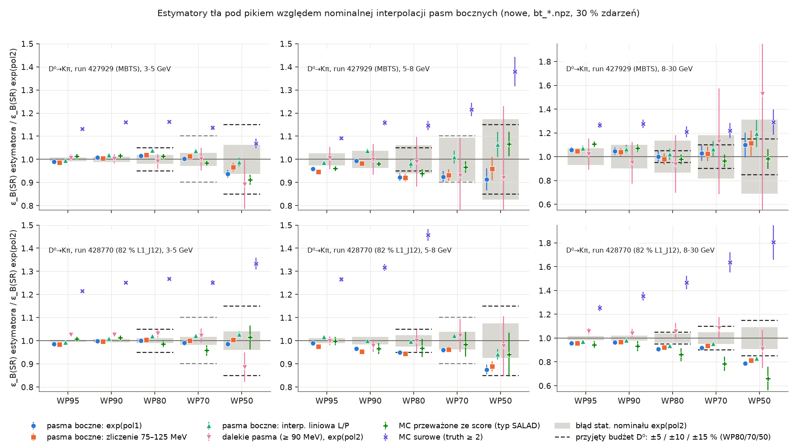
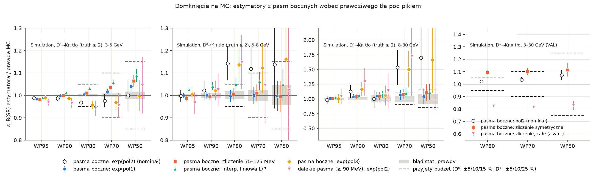

# EST_spread — rozrzut estymatorów tła pod pikiem jako systematyka modelu tła (17.11.2026)

Projekt B (charmbkg), D⁰→Kπ i D⁺→Kππ, ATLAS minbias 2022. Praca lokalna, tylko odczyt źródeł; wszystko nowe leży w `charm_work/EST_spread/`.
Wzór: ALICE, arXiv:1605.07569 (cztery estymatory tła D⁰ zgodne w ~10 %, wynik = średnia, rozrzut wchodzi do systematyki; `RECON_lit_B/RAPORT.md` §4, P4).

## 0. Odpowiedź

- **D⁰, dane, estymatory oparte na danych** (interpolacja exp(pol2), zliczenie w pasmach, interpolacja liniowa, MC przeważone ze score): rozrzut RMS w runie 427929 wynosi **1,0–3,5 %** przy 3–5 GeV, **2,2–4,4 %** przy 5–8 GeV i **1,7–8,1 %** przy 8–30 GeV (WP95→WP50). W 428770 jest podobnie do 8 GeV (0,7–4,1 %), a przy 8–30 GeV rośnie do 5–15 % (WP80–50).
- Ten rozrzut jest wszędzie mniejszy od przyjętego budżetu D⁰ (±5 / ±10 / ±15–20 % przy WP80/70/50) i przy pT > 5 GeV mniejszy od błędu statystycznego nominału.
- Surowe MC odstaje od estymatorów z danych o 13–16 % (427929, 3–5 GeV) i 22–33 % (428770). To jest wynik z nocy (dane/MC 0,86–0,88) widziany od strony estymatora. Po przeważeniu MC zgadza się z interpolacją w 1,3–1,6 % przy WP95–80.
- **D⁺, dane** (podpróbka 428770, fit pol2, pasma symetryczne, SALAD hgb i sk_mlp): RMS **3,2 / 4,0 / 7,7 %** przy WP80/70/50 dla 3–30 GeV; w binach pT 3–9 % (WP80), 5–12 % (WP70), 9–27 % (WP50).
- **Na MC rozrzut wariantów interpolacji nie jest zachowawczy sam w sobie.** Dla D⁰ pokrywa odchylenie nominału exp(pol2) od prawdy w 4 z 15 komórek (półzakres: 7 z 15). Odchylenia nominału są jednak zgodne ze statystyką MC (χ² = 18,7/15), a po dodaniu rozrzutu w kwadraturze χ² = 12,8/15.
- Najbliżej prawdy na MC D⁰ jest exp(pol1) (11 z 15 komórek; średnie odchylenie −0,7 ± 0,2 %). Zliczenie w pasmach i exp(pol1) mają błąd statystyczny 2,5–3 razy mniejszy niż exp(pol2).
- Żaden estymator z pasm bocznych nie widzi lokalnej zmiany składu tła (B1: wszystkie trzy przewidywania 0,65–0,85 prawdy dla D⁺). Rozrzut tego nie pokryje — potrzebny osobny składnik.
- **Zalecenie:** systematyka = półzakres czterech estymatorów z danych, liczony per run, gatunek, bin pT i WP, plus składnik składu z B1. Dla D⁰ w 427929 daje to ok. ±4–5 / ±6–7 / ±16–18 % (WP80/70/50), czyli potwierdza obecny budżet i pokazuje, że przy WP50 dominuje skład, nie wybór estymatora. Dla D⁺ wychodzi ok. ±7 / ±8 / ±15 % (3–30 GeV, podpróbka 428770); WP80 jest o 2 pp powyżej obecnych ±5 %.
- Braki: D⁺ nigdy nie był policzony na 427929 ani przy WP95; rotacja/mieszanie z ponownym dopasowaniem wierzchołka i like-sign nie istnieją w ntuplach; SALAD v1.0 nie był uruchomiony na 427929. Lista w §5.

## 1. Co zebrano i jak czytać tabele

Tabela zbiorcza: `out/tabela_estymatory.csv` — 1290 wierszy, 57 grup. Kolumny: grupa, gatunek, bin pT, WP, estymator, klasa, wartość, błąd stat. (puste = brak w źródle), wielkość, próbka, dane/domknięcie MC, `new` (1 = policzone tutaj), ścieżka źródła, uwaga.
Rozrzuty: `out/rozrzut.csv` (246 wierszy). Tabele liczbowe: dodatek A (z `out/tables.md`).

**Grupa = jedna próbka, jedna selekcja, jeden klasyfikator.** Rozrzut liczę tylko wewnątrz grupy. Między grupami różnią się: wersja danych (v1.1 / v2.0), ułamek statystyki, weto refleksji, okno masy i klasyfikator (nominalny H albo trenowany w danym etapie) — bezwzględne ε_B nie są porównywalne.

| grupa | gatunek | próbka | biny pT | WP | estymatory | typ | źródło |
|---|---|---|---|---|---|---|---|
| G1 | D⁰ | 427929, MBTS_1 ∧ GRL, v2.0, 30 % zdarzeń, H | 3 | 95/90/80/70/50 | exp(pol1/2/3), zliczenie sym, liniowa L/P, dalekie pasma; MC surowe t≥2 i t≥8; MC przeważone V1, V2 | dane, **nowe** | `out/est_new.json` z `B_trig/runs/lxplus/bt_*.npz` |
| G2 | D⁰ | 428770 (82 % L1_J12), v2.0, 30 %, H | 3 | jw. | jw. | dane, **nowe** | jw. |
| G3 | D⁰ | MC mb_nd v2.0 30 %, tło truth ≥ 2 (i ≥ 8) | 3 | jw. | 6 wariantów pasm wobec prawdy | domknięcie MC, **nowe** | jw. |
| G4 | D⁺ | 428770, v1.1, podpróbka data_p0, klasyfikator S8 | 3 + łącznie | 80/70/50 | fit pol2, SB sym, SB całe, SB lewe/prawe, SALAD hgb, SALAD sk_mlp, MC surowe | dane | `S8_salad/work/out/data_{hgb,sk_mlp}.json` |
| G5, G6 | D⁺, D⁰ | 428770, v1.1, pełna lumi, nominalny H | 3 + łącznie | 80/70/50 | SALAD sk_mlp, MC surowe, SB całe | dane | `S8_salad/runs/lxplus/salad_s8/bkg_shape_salad_*.json` |
| G7 | D⁰ | 428770, v1.1, data_p1, weto refleksji, klasyfikator B1 | łącznie | 80/70/50 | fit pol2, SB, SALAD hgb/sk_mlp (t≥8, t≥2), MC surowe | dane | `B1_salad_v1/out_D0/data_eff_D0*.json` |
| G8 | D⁰ | 428770, v1.1, bieg lxplus full, klasyfikator S4 | łącznie | 80/70/50 | fit, SB, SALAD mlp, FETA | dane | `S4_feta/runs/lxplus/full/results.json` |
| G9 | D⁰ | MC v1.1, pseudo-dane gładko zniekształcone | łącznie | 80/70/50 | SB, SALAD ×3, FETA, flow, MC surowe, druga kopia prawdy | domknięcie MC | jw. |
| G10, G11 | D⁰, D⁺ | MC v1.1 podpróbki, klasyfikator S6 | łącznie | 80/70/50 | fit pol2; szablony masy z rotacji losowej, rotacji π, odbicia η, toru z innego zdarzenia, zamiany K↔π | domknięcie MC | `S6_kand/work/out/s6_*.json` |
| G12 | D⁺ | MC v1.1 (smoke_vm), nominalny H | 3 + łącznie | 80/70/50 | fit pol2, SB sym, SB całe, pasmo wewnętrzne | domknięcie MC | `VAL_validate/runs/smoke_vm/validation/Dplus.json` |
| G13 | D⁺ | MC v1.1, pseudo-dane gładko zniekształcone | 3 + łącznie | 80/70/50 | SALAD hgb, sk_mlp, SB całe, MC surowe | domknięcie MC | `S8_salad/work/out/closure_*.json` |
| G14 | D⁺, D⁰ | MC v1.1, 11 + 27 trybów adwersarialnych | łącznie | 80/70/50 | SALAD, SB, MC surowe | domknięcie MC | `B1_salad_v1/out{,_D0}/closure_*.json` |
| G15, G16 | D⁰ | MC v1.1 podpróbki S / S2 | łącznie | 80/70/50 | SB oba/bliskie/dalekie ± weto, kopuła, flow | domknięcie MC | `S_bkggen/work/out/s2_mc.json`, `s2b_veto.json`, `S2_flow/runs/cloud_v1/results.json` |

Komórki nieporównywalne (nie wchodzą do żadnego rozrzutu):
- **SB całe (asymetryczne) dla D⁺** — znane obciążenie −18…−22 % (nachylenie ε_B(m) × asymetria pasm; `VAL`, T4f). Pokazane, wyłączone z zestawu.
- **MC surowe** — znana niezgodność dane/MC (12–14 % w 427929, 19–29 % w 428770; `B_trig/BKG_427929/RAPORT.md` §5). Liczone osobno jako zestaw C.
- **ε_B obiektów candrot w SR** (rotacja ×0,2–0,5, zamiana K↔π ×3–8 prawdy; `S6_kand/work/out/s6_*.json`) — to nie estymator tła pod pikiem, tylko test podobieństwa cech. Z S6 biorę wyłącznie przewidywanie N_B z kształtu masy.
- **Generatory z osobno trenowanym klasyfikatorem** (S4 część C, S2 część C; Zproxy) — każdy wariant ma inny klasyfikator, więc ε_B nie odnosi się do tego samego cięcia.
- **KF_kontrfakt** — zawiera σ_μ i σ_N (sufit zysku), nie ε_B; rotacja k ≈ 9 daje 0…+13 % w σ (`KF_kontrfakt/ceiling_single_real.json`). Poza zestawieniem.
- **Zamiana K↔π jako składowa refleksji** — liczby istnieją tylko na poziomie fitu i stosunku R/S, nie ε_B (§4.5).
- **`btrig_epsb.md`, klasy trygera 428770** — MC emulowane mapą wydajności per klasa; zgodne z G2 dla klasy `all`, pozostałe klasy to inne podpróbki. Nie powielam.

Definicje w G1–G3 (kod `B_trig/BKG_427929/bkg_common.py`, importowany bez zmian): SR |m − m₀| < 55 MeV, pasma |m − m₀| ≥ 75 MeV w oknie 1,75–2,00 GeV (lewe 40 MeV, prawe 60 MeV), progi WP z kwantyli score prawdziwych D⁰ w fd_nd per bin pT. Błędy: bootstrap Poissona, 300 replik, pełna kowariancja między estymatorami. „Dalekie pasma” = exp(pol2) tylko na |m − m₀| ≥ 90 MeV; weta refleksji w tej próbce zrobić się nie da (brak m_swap w tablicach inkluzywnych).

## 2. Rozrzut na danych

### 2.1 D⁰, oba runy (nowe; tabele T1, T2; rys. 1)

Zestawy: A = pięć wariantów interpolacji z pasm; B = cztery klasy oparte na danych (exp(pol2), zliczenie sym, liniowa L/P, MC przeważone ze score); C = B + MC surowe (truth ≥ 2).

RMS [%] zestawu B, WP95 / 90 / 80 / 70 / 50:

| run | 3–5 GeV | 5–8 GeV | 8–30 GeV |
|---|---|---|---|
| 427929 | 1,0 / 0,8 / 1,3 / 1,9 / 3,5 | 2,2 / 2,3 / 3,3 / 3,1 / 4,4 | 3,7 / 2,7 / 1,7 / 3,6 / 8,1 |
| 428770 | 0,9 / 0,7 / 1,2 / 2,3 / 1,1 | 1,5 / 2,1 / 2,3 / 2,2 / 4,1 | 2,1 / 2,5 / 5,3 / 8,8 / 14,6 |
| σ_stat exp(pol2), 427929 | 0,8 / 1,2 / 1,9 / 2,8 / 6,2 | 2,7 / 3,7 / 6,1 / 9,4 / 17,4 | 7,1 / 9,9 / 13,4 / 18,2 / 31,2 |

Półzakres (max − min)/2 zestawu B w 427929: 1,3 / 0,9 / 1,9 / 2,6 / 4,6 %; 2,7 / 2,8 / 4,1 / 4,0 / 5,2 %; 5,0 / 3,4 / 2,1 / 5,0 / 9,9 %.

- **Względem budżetu ±5 / ±10 / ±15–20 % (WP80/70/50):** rozrzut B jest 2–4 razy mniejszy w 427929 we wszystkich binach. W 428770 przekracza budżet tylko przy 8–30 GeV, WP80 (5,3 % wobec ±5 %), gdzie MC przeważone ma n_eff/N = 0,50 i jest o 14–34 % poniżej interpolacji.
- **χ² zgodności** (pełna kowariancja): przy 3–5 GeV estymatory są statystycznie rozróżnialne — zestaw B 427929: 257/3 (WP95) → 39/3 (WP50). Źródło: zliczenie i interpolacja liniowa mają błąd 0,26 % i różnią się o 0,9 % (korelacja 0,96). Trójka słabo skorelowana (exp(pol2), zliczenie, MC przeważone): 56/2 przy WP95, potem 4,7 / 1,9 / 6,7 / 4,1 na 2 stopnie swobody. Przy 8–30 GeV w 427929 zestaw B jest zgodny w granicach χ²/ndf ≤ 3,7.
  Rozrzut przy 3–5 GeV jest więc rzeczywistą zależnością od metody, a nie szumem; przy 8–30 GeV w 427929 jest nieodróżnialny od statystyki.
- **Względem wyniku z nocy:** MC surowe / exp(pol2) w 427929 przy 3–5 GeV = 1,13 / 1,16 / 1,16 / 1,14 / 1,07, czyli odwrotność R = 0,86–0,88. Włączenie go do zestawu (C) podnosi RMS do 5,2–5,8 % przy 3–5 GeV niezależnie od WP i do 8–14 % w wyższych binach; w 428770 do 8–40 %. MC przeważone ze score / exp(pol2) = 1,013 ± 0,009 / 1,016 ± 0,012 / 1,014 ± 0,020 / 0,985 ± 0,029 / 0,912 ± 0,066 — to samo co „0,99 ± 0,02” z `BKG_427929` §5.
- Dalekie pasma (≥ 90 MeV) nie wnoszą informacji: błąd 1,4–1,8 razy większy od nominału, a na MC obciążenie −2,9 ± 1,1 %. Wyłączone z zestawów.

### 2.2 D⁰, podpróbki 428770 v1.1 (T4b, T4c, T5)

| grupa | zestaw | RMS WP80 / 70 / 50 [%] | półzakres [%] |
|---|---|---|---|
| G7 (B1, data_p1) | fit pol2, SB, SALAD hgb i sk_mlp (MC truth ≥ 2) | 2,6 / 3,2 / 7,7 | 3,5 / 3,8 / 9,4 |
| G7 | jw., SALAD z MC truth ≥ 8 | 1,9 / 2,6 / 9,2 | 2,5 / 3,2 / 12,6 |
| G8 (S4, lxplus full) | fit, SB, SALAD mlp, FETA | 3,4 / 4,9 / 8,3 | 4,1 / 6,8 / 11,2 |

Trzy niezależne próbki i selekcje dają dla D⁰ ten sam rząd: 1–3 % (WP80), 3–5 % (WP70), 4–9 % (WP50). Błąd fitu w G7: 2,9 / 4,0 / 7,6 %. W G8 błędu ε_B w źródle nie ma.

### 2.3 D⁺, podpróbka 428770 v1.1 (T4a, T5)

Zestaw B = fit pol2, SB sym (70–170 MeV), SALAD hgb, SALAD sk_mlp. RMS / półzakres [%]:

| bin | WP80 | WP70 | WP50 | σ_stat fitu WP80 / 70 / 50 |
|---|---|---|---|---|
| 3–5 | 3,3 / 4,2 | 4,9 / 6,1 | 14,4 / 18,9 | 2,7 / 4,3 / 11,1 |
| 5–8 | 5,5 / 7,8 | 9,2 / 12,4 | 8,5 / 10,4 | 6,2 / 9,6 / 46 |
| 8–30 | 9,2 / 12,4 | 11,8 / 15,3 | 26,6 / 32,6 | 7,9 / 13,2 / 39,5 |
| 3–30 | 3,2 / 4,4 | 4,0 / 4,4 | 7,7 / 10,9 | 2,4 / 3,8 / 10,9 |

- Względem budżetu ±5 / ±10 / ±25 %: dla 3–30 GeV rozrzut mieści się (3 / 4 / 8 %). W binach pT przy WP80 wychodzi poza ±5 % (5,5 % i 9,2 %), przy WP70 poza ±10 % tylko w 8–30 GeV (11,8 %). Wszystkie przekroczenia są na poziomie 1–1,5 σ_stat fitu.
- Z MC surowym (zestaw C): 4,1 / 4,6 / 7,8 % (3–30 GeV), 12–18 % w 5–8 GeV.
- Błędy SALAD i SB w źródle nie są zapisane, więc χ² nie liczę.
- To jest run 428770 z mieszanką trygerów. Dla D⁺ nie ma odpowiednika G1.

## 3. Domknięcie na MC: który estymator jest najbliżej prawdy i czy rozrzut pokrywa

### 3.1 D⁰, warianty interpolacji (nowe; T3, T3b, T3c; rys. 2)

- **Najbliżej prawdy:** exp(pol1) w 11 z 15 komórek. Średnie |odchylenie| w binach 3–5 / 5–8 / 8–30 GeV: exp(pol1) 1,6 / 0,1 / 4,1 %; zliczenie sym 2,6 / 0,8 / 5,9 %; exp(pol2) 1,7 / 8,5 / 27,6 %; liniowa L/P 4,0 / 4,6 / 7,6 %.
- Precyzyjne estymatory mają mierzalne obciążenia zależne od WP: przy 3–5 GeV zliczenie sym −1,9 ± 0,3 % (WP95) → +3,5 ± 1,2 % (WP70); liniowa L/P +3,1 ± 0,8 % (WP80), +5,9 ± 1,2 % (WP70). χ² wobec 1 po 15 komórkach: exp(pol1) 31, zliczenie 52, liniowa 88, exp(pol2) 18,7.
- exp(pol2) jest nieobciążony w granicach błędu (średnio −1,2 ± 0,6 %), ale ma błąd 2,5–3 razy większy. Przy pT > 5 GeV i WP ≤ 80 jego odchylenia sięgają +12…+70 % przy błędzie 8–53 %.
- **Pokrycie:** |odchylenie exp(pol2)| ≤ RMS pięciu wariantów w 4/15 komórek, ≤ półzakres w 7/15. Suma kwadratów pulli: sama statystyka 18,7/15; RMS ⊕ statystyka 12,8/15; budżet ⊕ statystyka 9,7/15.
- Wniosek: rozrzut wariantów interpolacji jest za mały jako jedyna miara, gdy nominałem jest estymator o dużym błędzie statystycznym. Jest wystarczający po dodaniu błędu statystycznego nominału albo po zmianie nominału na exp(pol1)/zliczenie przy pT > 5 GeV. Obecny budżet jest zachowawczy.
- Z tłem truth ≥ 8 wnioski te same (T3b).

### 3.2 D⁰, pozostałe domknięcia (T4d, T4e, T4h–j, T5)

| grupa | zestaw | RMS WP80 / 70 / 50 [%] | średnia − prawda [%] | najlepszy | prawda w zakresie |
|---|---|---|---|---|---|
| G9 (S4) | SB, SALAD mlp, SALAD hgb, FETA, flow | 3,5 / 5,0 / 6,7 | +3,7 / +3,3 / +4,3 | SB (+0,8 / +1,4 / +3,1) | tak / tak / tak |
| G9 | SB, SALAD mlp, SALAD hgb | 2,2 / 2,5 / 3,6 | +1,4 / +1,2 / +7,4 | SB | tak / tak / nie |
| G10 (S6) | fit pol2, rotacja losowa, tor z innego zdarzenia | 2,1 / 4,9 / 4,4 | −1,2 / +0,9 / +9,6 | rotacja (0,0), pol2 (+0,4), mieszanie (+4,5) | tak / tak / nie |
| G10 | + rotacja π, odbicie η, zamiana K↔π | 10 / 15 / 46 | −2,4 / −3,2 / −8,8 | — | tak |
| G15 (S) | SB oba, SB bliskie, kopuła, flow | 5,6 / 5,7 / 10,0 | +2,0 / +9,5 / +27,8 | kopuła przy WP70/50 | tak / nie / nie |

- W G9 prawda ma błąd statystyczny ±3 / 5 / 6 % (`S4_feta/README_S4.md`), „druga kopia prawdy” daje 0,995 / 0,974 / 1,033. Rozrzut pięciu metod (3,5–6,7 %) pokrywa odchylenie średniej i najlepszego.
- **Odpowiednik zestawu ALICE dla D⁰** (G10: fit pasm, rotacja toru, tor z innego zdarzenia; szablony masy unormowane w pasmach): zgodność 2–5 %, wszystkie w 1σ od prawdy przy WP80/70 (błędy szablonów 5–25 %). Rotacja o π i zamiana K↔π odstają (0,78 / 0,69 i 1,10 / 1,15 / 1,21).
- G15 pokazuje przypadek, w którym rozrzut nie pokrywa: bez weta refleksji wszystkie warianty pasm zawyżają ε_B przy WP50 (1,32–1,44), prawda leży poza zakresem. Z wetem (G15b) prawda wraca do zakresu.
- B1-D⁰, zniekształcenie składu (`B1_salad_v1/out_D0/b1_closure_D0.md`, cat_local): SALAD / SB / MC surowe = 0,972 / 0,900 / 0,972 (WP80), 0,949 / 0,856 / 0,949 (WP70), 0,850 / 0,729 / 0,849 (WP50). Wszystkie trzy poniżej 1.

### 3.3 D⁺ (T4e, T4f, T4g, T5)

- **G12 (VAL), najbliżej prawdy: fit pol2** — 1,022 ± 0,013 / 1,035 ± 0,020 / 1,072 ± 0,040 (3–30 GeV). SB sym: 1,092 / 1,101 / 1,115 (obciążone +9–11 %). SB całe: 0,823 / 0,815 / 0,828.
  Połowa różnicy pol2 − SB sym = 3,5 / 3,3 / 2,1 % pokrywa odchylenie pol2 przy WP80 i WP70 (2,2 i 3,5 %), nie pokrywa przy WP50 (7,2 ± 4,0 %). Budżet ±5 / ±10 / ±25 % pokrywa wszystko.
- **G13 (S8, gładkie zniekształcenie):** SALAD hgb 1,107 / 1,083 / 1,253, sk_mlp 0,980 / 0,928 / 1,035 (σ_stat prawdy 3,7 / 5,7 / 11,8 %). Połowa różnicy dwóch wariantów SALAD = 6 / 8 / 11 %; odchylenie hgb przy WP80 (10,7 %) i WP50 (25 %) jest większe.
- **B1-D⁺, zniekształcenie składu** (`B1_salad_v1/out/b1_closure_Dplus.md`, cat_local): SALAD 0,845 / 0,809 / 0,701, SB 0,647 / 0,584 / 0,508, MC surowe 0,846 / 0,810 / 0,702. Wszystkie estymatory zaniżają; prawda poza zakresem o 15–30 %. Rozrzut estymatorów z pasm bocznych tej klasy błędu nie pokrywa z konstrukcji.
- **G11 (S6), zestaw ALICE dla D⁺ nie działa:** rotacja losowa 0,57 / 0,59 / 0,51, tor z innego zdarzenia 0,72 / 0,72 / 0,80, odbicie η 0,61 / 0,69 / 0,77; tylko zamiana K↔π (pseudo-WS) 0,97 / 0,97 / 0,86. Ten ostatni został obalony w pełnym ficie (χ²/ndf 3–6; `Y_wsfit`, notatka „Pseudo-WS w ficie D+”). Fit pol2 w tym przeglądzie: 1,095 / 1,123 / 1,097 (fit χ² w 25 binach).

### 3.4 Podsumowanie domknięć

| pytanie | D⁰ | D⁺ |
|---|---|---|
| najbliżej prawdy | exp(pol1), zliczenie w pasmach; z klas: SB i SALAD mlp | fit pol2 |
| rozrzut pokrywa odchylenie nominału | tylko z błędem stat. nominału (4/15 bez) | WP80/70 tak, WP50 nie |
| rozrzut pokrywa gładkie zniekształcenie MC | tak (G9) | częściowo (SALAD hgb +11 / +25 %) |
| rozrzut pokrywa zmianę składu pod pikiem | nie (−3 / −5 / −15 %) | nie (−15 / −19 / −30 %) |

„Rozrzut jako systematyka” jest więc za mały w dwóch sytuacjach: (i) nominał o dużym błędzie statystycznym, (ii) błąd wspólny wszystkim estymatorom (skład tła, refleksje bez weta). W pozostałych przypadkach jest wystarczający i 2–4 razy mniejszy od obecnego budżetu.

## 4. Rekomendacja: przepis w stylu ALICE dla analizy pojedynczych D

### 4.1 Estymatory

1. **Interpolacja z pasm po cięciu**: exp(pol2) w ficie masy (nominał analizy). Dla ε_B pod pikiem przy pT > 5 GeV lub WP ≤ 70 liczyć także exp(pol1).
2. **Zliczenie w pasmach symetrycznych** (dla D⁺ koniecznie symetrycznych; SB całe wyłączone).
3. **Interpolacja liniowa lewe/prawe** — inna zależność od kształtu widma.
4. **MC przeważone do danych w pasmach** (SALAD v1.0, `mc_truth_min: 2` dla D⁰; do czasu ekstrakcji 18 cech — przeważenie ze score jak V2).

Nie wchodzą: MC surowe (raportowane osobno jako kontrola dane/MC), SB całe dla D⁺, dalekie pasma, generatory (FETA, flow, kopuła — brak liczb per bin, C2ST 0,60–0,96), szablony candrot dla D⁺. Rotacja i mieszanie toru dla D⁰ mogą wejść jako piąty estymator dopiero z ponownym dopasowaniem wierzchołka (produkcja).

### 4.2 Jak liczyć

- Per run, gatunek, bin pT, WP: σ_est = półzakres (max − min)/2 czterech estymatorów. Wartości dla D⁰ są w T2 (kolumna B).
- Jeżeli σ_est < σ_stat nominału, do budżetu wchodzi σ_stat nominału (już jest w ficie), a σ_est nie jest dodawane drugi raz. Kontrola: χ² zgodności z pełną kowariancją (bootstrap histogramu kategoria × masa, 300 replik; kod `est_new.py`).
- **Osobny składnik składu tła** (rozrzut go nie widzi): z B1. D⁺: czułość −3,3 / −4,1 / −6,4 % na +1 pp MisMatch\* × ograniczenie z danych |Δf_MM| ≲ 1,5 pp → ±5 / ±6 / ±10 %. D⁰: z cat_local (Δf = +2,8 pp) −3 / −5 / −15 %; ograniczenia Δf_MM z danych dla D⁰ nie ma (bieg FMM testowy: 11–13 pp), więc biorę pełny efekt.
- Run 427929 jest miejscem pomiaru; w 428770 ten sam przepis miesza się z trygerem (MC surowe odstaje o 22–33 %, przeważenie ma n_eff/N 0,13–0,50).

### 4.3 Co wychodzi i co to zmienia

D⁰, 427929, σ_est ⊕ skład [%]:

| bin | WP95 | WP80 | WP70 | WP50 |
|---|---|---|---|---|
| 3–5 | 1,3 (bez składu) | 1,9 ⊕ 3 = 3,6 | 2,6 ⊕ 5 = 5,6 | 4,6 ⊕ 15 = 15,7 |
| 5–8 | 2,7 | 4,1 ⊕ 3 = 5,1 | 4,0 ⊕ 5 = 6,4 | 5,2 ⊕ 15 = 15,9 |
| 8–30 | 5,0 | 2,1 ⊕ 3 = 3,7 | 5,0 ⊕ 5 = 7,1 | 9,9 ⊕ 15 = 18,0 |
| obecnie | — | ±5 | ±10 | ±15–20 |

D⁺, podpróbka 428770, 3–30 GeV: 4,4 ⊕ 5 = 6,7 %; 4,4 ⊕ 6 = 7,6 %; 10,9 ⊕ 10 = 14,5 % (obecnie ±5 / ±10 / ±25 %).

- **D⁰: budżet ±5 / ±10 / ±15–20 % zostaje potwierdzony niezależną drogą.** Przy WP70 można zejść do ok. ±6–7 %. Przy WP50 prawie cały budżet to skład tła — poprawi go pomiar f_MM w danych (bieg `fmm`), nie kolejne estymatory.
- **D⁺ przy WP80: ±5 % jest o ok. 2 pp za mało** (6,7 % łącznie; w binach 5–8 i 8–30 GeV sam rozrzut 7,8 i 12,4 %, na poziomie 1–1,5 σ_stat). Proponuję ±7 % do czasu pomiaru na 427929.
- **D⁺ przy WP50: ±25 % jest zachowawcze dla 3–30 GeV (14,5 %),** ale w binach pT rozrzut sięga 19 % (3–5 GeV) i 33 % (8–30 GeV). Nie obniżać.
- **WP95 (używany w tabeli noty §6.5):** rozrzut 1,3 / 2,7 / 5,0 %. Składnik składu przy WP95 nie był mierzony (B1 ma tylko WP80/70/50). Nota §6.5 przypisuje ±5 / 10 / 25 % do WP95/80/50 — w źródłach budżet jest zdefiniowany dla WP80/70/50; to trzeba w nocie poprawić.
- Systematyki nie wolno brać z zestawu C (z MC surowym): daje 5–6 % w 427929 i 8–40 % w 428770, ale mierzy niezgodność dane/MC, którą przeważenie usuwa.
- To są liczby dla naszej selekcji (klasyfikator H, pT 3–30 GeV). Analiza AFP (CharmNet, v2.1, obszar `tag`) musi przepis przeliczyć u siebie.

### 4.4 Estymator nominalny

Na MC exp(pol2) nie jest najlepszym estymatorem ε_B pod pikiem przy pT > 5 GeV: błąd 8–53 % wobec 3–14 % dla exp(pol1) i zliczenia (WP ≤ 80). Zmiana nominału ε_B (Asimov, Zproxy, normalizacja mieszania) na exp(pol1) lub zliczenie symetryczne to decyzja otwarta; fitu masy nie dotyczy.

### 4.5 Składowa refleksji K↔π (D⁰)

Liczby istnieją, ale nie w postaci ε_B, więc nie wchodzą do rozrzutu:
- R/S refleksji dane/MC = 0,957 ± 0,041 (WP70, tag D\*, pełna lumi; `HYP_d0/t4/t4_results.md` §5) → szablon ±5 %.
- Szablon refleksji z danych w ficie zmienia N(D⁰) przy WP70 z 5785 ± 506 / 3928 ± 248 / 7146 ± 232 na 5560 ± 473 / 3616 ± 217 / 6806 ± 214 (`S8_salad/runs/lxplus/compare.md`, wariant nom_refl), czyli −4 / −8 / −5 %.
- Po wecie 25 MeV refleksje to 0,025 % tła w SR; zmiana ×0,5 / ×1,5 daje < 0,3 % ε_B przy WP80/70 (`B1_salad_v1/out_D0/charm-B1-salad-v1.md` §6e). Przy keep_both (bez weta) tej liczby nie ma.

## 5. Braki

| # | czego brakuje | skutek | koszt uzupełnienia |
|---|---|---|---|
| 1 | D⁺ w próbce inkluzywnej v2.0 obu runów (bt_\*.npz zawiera tylko D⁰) | brak rozrzutu D⁺ w 427929 i przy WP95; D⁺ tylko z podpróbki 428770 v1.1 | ekstrakcja na lxplus (wariant zadania btrig dla decayType D⁺), potem `est_new.py` lokalnie ok. 15 min |
| 2 | 18 cech H i η w tablicach inkluzywnych | SALAD v1.0 nie uruchomiony na 427929; w zestawie jest przeważenie ze score na 6 zmiennych | ta sama ekstrakcja z dodatkowymi kolumnami; SALAD lokalnie minuty |
| 3 | rotacja / mieszanie toru z ponownym dopasowaniem wierzchołka, like-sign | zestaw ALICE dostępny tylko dla D⁰, na MC, bez binów pT, z zachowanym wierzchołkiem; dla D⁺ nieużyteczny | produkcja Athena z łatką `doWrongSign` / `doTrackRotation` (CPU ×1,5–3; `KF_kontrfakt/charm-KF-kontrfakt.md` §2); nigdy nie uruchomiona |
| 4 | szablony candrot per bin pT i na danych v2.0 | G10/G11 tylko 3–30 GeV | lokalnie z `VAL_validate/runs/smoke_vm/*.npz` lub `S6_kand/sub`: ok. 20–40 min CPU na gatunek (trening klasyfikatora etapu); nie zrobione — inny klasyfikator niż w G1–G3, więc i tak osobna grupa |
| 5 | fit pol2 pseudo-danych w domknięciach B1 i S8 | nie wiadomo, czy interpolacja po cięciu wykrywa zmianę składu, którą SALAD/SB przepuszczają (tak twierdzi `signal_like_background.md` §3a, bez liczby na MC) | ok. 2,5 min na tryb × 38 trybów ≈ 1,5 h CPU lokalnie; powyżej limitu 30 min |
| 6 | ε_B z fitu pol2 na pełnej lumi 428770 v1.1 per bin (G5, G6 mają tylko SALAD, MC surowe, SB całe) | rozrzut na pełnej statystyce v1.1 niepoliczalny (< 3 porównywalne estymatory) | ponowny krok `s8salad` z `data_eff` na lxplus |
| 7 | błędy statystyczne SALAD, SB i FETA w G4, G7, G8 | brak χ² zgodności dla D⁺ i dla podpróbek D⁰ | bootstrap w `s8_study.py` / `b1_dataeff_d0.py`; wejścia D⁺ (`S8_salad/work/out/*.npz`) nie ma już lokalnie |
| 8 | generatory (FETA, flow, kopuła): ε_B per bin pT, dla D⁺, na v2.0 | generatory tylko jako pojedyncze liczby 3–30 GeV dla D⁰ | trening GPU; kierunek zamknięty decyzją z 4.11 — nie uzupełniać |
| 9 | domknięcie przeważenia ze score (V2) na MC ze znanym zniekształceniem | V2 sprawdzone tylko na danych (zgodność z interpolacją) | lokalnie ok. 10–15 min na bt_mb_nd; nie zrobione |
| 10 | składnik składu przy WP95 i ograniczenie Δf_MM dla D⁰ w danych | budżet WP95 bez składnika; D⁰ przy WP50 zdominowany przez nieograniczony skład | pełny bieg `fmm` (ORCH, w toku 17.11) + powtórka B1 z WP95 |
| 11 | statystyka 427929 przy 8–30 GeV (σ_stat 7–31 %) | rozrzut tam nieodróżnialny od szumu | pozostałe 70 % zdarzeń runu (lxplus) daje ×1,8 w precyzji |
| 12 | ε_B refleksji przy keep_both (bez weta) | składowa refleksji poza rozrzutem | z `HYP_d0/runs/lxplus` (30 % danych), szacunkowo 30–60 min lokalnie |

Nowe w tym raporcie (policzone lokalnie, 13 min CPU, 1 rdzeń): G1–G3, czyli 10 estymatorów × 2 runy × 3 biny × 5 WP na danych i 6 estymatorów × 2 definicje tła na MC, z kowariancją.

## 6. Zastrzeżenia

- G1–G3 to 30 % zdarzeń i tylko D⁰; lewe pasmo ma 40 MeV. „Zliczenie sym” jest symetryczne tylko z nazwy (75–125 MeV, lewe ucięte) — stąd jego obciążenie zależne od WP.
- MC przeważone (V1, V2): wagi z `BKG_427929/out/s3_w_*.npz`, jedno ziarno; błąd nie zawiera wariancji treningu. V2 używa score jako cechy, więc w pasmach domyka się z konstrukcji; test dotyczy przeniesienia pod pik.
- χ² w T3b pomija korelacje między WP w tym samym binie; χ² w T5 (G12, G13) zakłada niezależne błędy.
- Składnik składu dla D⁰ (−3 / −5 / −15 %) to pełny efekt jednego trybu adwersarialnego, nie pomiar; dla D⁺ skalowanie do 1,5 pp zakłada liniowość.
- Liczby 4.3 dla D⁺ pochodzą z jednej podpróbki 428770 z mieszanką trygerów i klasyfikatora etapu S8.
- G10/G11: szablony candrot ze źródła kandydatów „sb” (realizowalne na danych), wierzchołek zachowany.
- W G10 rotacja o π przy WP50 ma zero zdarzeń po cięciu (wartość 0 w tabeli) — zawyża RMS zestawu sześciu szablonów.
- Rozbieżność w źródłach: nota §6.5 i §6.1 (wiersz 5) podają budżet raz dla WP95/80/50, raz dla WP80/70/50. Przyjąłem WP80/70/50 (`B1_salad_v1`, `signal_like_background.md` §3a).

## 7. Pliki

| plik | rola |
|---|---|
| `RAPORT.md` | ten raport (= `RAPORT_head.md` + `out/tables.md`) |
| `out/tabela_estymatory.csv` | tabela zbiorcza, 1290 wierszy ze ścieżkami źródeł |
| `out/rozrzut.csv` | RMS, półzakres, χ², odchylenia od prawdy per komórka i zestaw |
| `out/tables.md` | tabele T1–T5 (dodatek A) |
| `out/est_new.json`, `out/est_new_rep.npz` | nowe liczby i repliki bootstrapu |
| `fig1_estymatory_dane_D0.png` | D⁰, dane: estymator / exp(pol2), dwa runy × trzy biny pT |
| `fig2_domkniecie_MC.png` | domknięcie MC: estymator / prawda, D⁰ (trzy biny) i D⁺ (VAL) |
| `est_new.py`, `collect.py`, `tables.py`, `figs.py` | kod |

Uruchomienie: `cd EST_spread && P=~/Documents/charm/.venv_h5/bin/python; $P est_new.py; $P collect.py; $P tables.py; $P figs.py` (13 min + sekundy).

## Dodatek A. Tabele liczbowe

### T1-427929. D⁰, dane 427929: ε_B(SR) × 100 per estymator (NOWE)

| bin | WP | exp(pol2) | exp(pol1) | exp(pol3) | zliczenie sym | liniowa L/P | dalekie ≥ 90 | MC V2 (typ SALAD) | MC V1 | MC surowe t≥2 | MC surowe t≥8 |
|---|---|---|---|---|---|---|---|---|---|---|---|
| 3-5 | 95 | 29,380 ± 0,246 | 29,095 ± 0,074 | 29,440 ± 0,259 | 28,996 ± 0,076 | 29,267 ± 0,075 | 29,577 ± 0,420 | 29,772 ± 0,079 | 33,525 ± 0,085 | 33,252 ± 0,081 | 33,296 ± 0,082 |
| 3-5 | 90 | 16,916 ± 0,200 | 17,039 ± 0,057 | 17,035 ± 0,208 | 16,999 ± 0,059 | 17,240 ± 0,059 | 16,952 ± 0,345 | 17,186 ± 0,065 | 19,818 ± 0,072 | 19,627 ± 0,069 | 19,603 ± 0,070 |
| 3-5 | 80 | 7,269 ± 0,136 | 7,385 ± 0,039 | 7,293 ± 0,139 | 7,409 ± 0,040 | 7,546 ± 0,040 | 7,202 ± 0,232 | 7,371 ± 0,043 | 8,553 ± 0,049 | 8,457 ± 0,046 | 8,391 ± 0,046 |
| 3-5 | 70 | 3,363 ± 0,093 | 3,375 ± 0,027 | 3,402 ± 0,100 | 3,411 ± 0,027 | 3,491 ± 0,027 | 3,363 ± 0,165 | 3,312 ± 0,029 | 3,877 ± 0,034 | 3,822 ± 0,032 | 3,742 ± 0,031 |
| 3-5 | 50 | 0,753 ± 0,047 | 0,706 ± 0,013 | 0,748 ± 0,047 | 0,727 ± 0,013 | 0,745 ± 0,014 | 0,672 ± 0,079 | 0,687 ± 0,016 | 0,825 ± 0,019 | 0,805 ± 0,016 | 0,742 ± 0,015 |
| 5-8 | 95 | 27,308 ± 0,739 | 26,201 ± 0,189 | 27,127 ± 0,782 | 25,854 ± 0,191 | 26,947 ± 0,200 | 27,457 ± 1,317 | 26,227 ± 0,222 | 29,456 ± 0,238 | 29,811 ± 0,229 | 29,602 ± 0,231 |
| 5-8 | 90 | 15,121 ± 0,559 | 15,036 ± 0,155 | 15,189 ± 0,604 | 14,852 ± 0,158 | 15,682 ± 0,171 | 15,108 ± 1,003 | 14,833 ± 0,171 | 16,957 ± 0,189 | 17,519 ± 0,187 | 17,207 ± 0,187 |
| 5-8 | 80 | 6,948 ± 0,424 | 6,407 ± 0,116 | 6,921 ± 0,440 | 6,396 ± 0,116 | 6,822 ± 0,126 | 6,878 ± 0,750 | 6,530 ± 0,120 | 7,541 ± 0,137 | 7,964 ± 0,140 | 7,576 ± 0,136 |
| 5-8 | 70 | 3,274 ± 0,309 | 3,029 ± 0,078 | 3,273 ± 0,318 | 3,052 ± 0,079 | 3,306 ± 0,088 | 3,045 ± 0,530 | 3,165 ± 0,081 | 3,695 ± 0,094 | 3,980 ± 0,096 | 3,604 ± 0,092 |
| 5-8 | 50 | 0,894 ± 0,156 | 0,817 ± 0,042 | 0,907 ± 0,162 | 0,858 ± 0,044 | 0,952 ± 0,049 | 0,824 ± 0,277 | 0,954 ± 0,047 | 1,153 ± 0,056 | 1,233 ± 0,057 | 0,979 ± 0,051 |
| 8-30 | 95 | 25,295 ± 1,789 | 26,755 ± 0,582 | 25,221 ± 1,776 | 26,500 ± 0,621 | 27,117 ± 0,591 | 25,819 ± 3,325 | 27,978 ± 0,668 | 31,939 ± 0,718 | 32,051 ± 0,643 | 30,928 ± 0,640 |
| 8-30 | 90 | 15,223 ± 1,506 | 15,945 ± 0,483 | 15,436 ± 1,527 | 15,803 ± 0,517 | 16,221 ± 0,495 | 14,452 ± 2,661 | 16,287 ± 0,483 | 19,011 ± 0,546 | 19,424 ± 0,522 | 18,303 ± 0,513 |
| 8-30 | 80 | 8,168 ± 1,097 | 8,187 ± 0,372 | 9,321 ± 1,335 | 8,013 ± 0,384 | 8,333 ± 0,383 | 7,667 ± 1,970 | 7,988 ± 0,331 | 9,452 ± 0,385 | 9,884 ± 0,381 | 8,826 ± 0,381 |
| 8-30 | 70 | 4,696 ± 0,857 | 4,835 ± 0,294 | 5,265 ± 1,002 | 4,808 ± 0,298 | 5,004 ± 0,306 | 5,305 ± 2,083 | 4,530 ± 0,247 | 5,366 ± 0,291 | 5,727 ± 0,299 | 4,847 ± 0,285 |
| 8-30 | 50 | 1,790 ± 0,559 | 1,967 ± 0,186 | 2,003 ± 0,619 | 1,994 ± 0,190 | 2,140 ± 0,203 | 2,738 ± 2,110 | 1,759 ± 0,149 | 2,159 ± 0,181 | 2,312 ± 0,189 | 1,845 ± 0,178 |

### T1-428770. D⁰, dane 428770: ε_B(SR) × 100 per estymator (NOWE)

| bin | WP | exp(pol2) | exp(pol1) | exp(pol3) | zliczenie sym | liniowa L/P | dalekie ≥ 90 | MC V2 (typ SALAD) | MC V1 | MC surowe t≥2 | MC surowe t≥8 |
|---|---|---|---|---|---|---|---|---|---|---|---|
| 3-5 | 95 | 27,363 ± 0,135 | 27,000 ± 0,040 | 27,297 ± 0,149 | 26,913 ± 0,041 | 27,174 ± 0,041 | 28,087 ± 0,222 | 27,567 ± 0,196 | 31,103 ± 0,208 | 33,252 ± 0,081 | 33,296 ± 0,082 |
| 3-5 | 90 | 15,673 ± 0,110 | 15,639 ± 0,034 | 15,636 ± 0,120 | 15,614 ± 0,035 | 15,824 ± 0,034 | 16,093 ± 0,175 | 15,867 ± 0,161 | 18,277 ± 0,178 | 19,627 ± 0,069 | 19,603 ± 0,070 |
| 3-5 | 80 | 6,669 ± 0,074 | 6,666 ± 0,025 | 6,652 ± 0,078 | 6,692 ± 0,026 | 6,810 ± 0,026 | 6,882 ± 0,120 | 6,580 ± 0,105 | 7,629 ± 0,118 | 8,457 ± 0,046 | 8,391 ± 0,046 |
| 3-5 | 70 | 3,054 ± 0,052 | 3,025 ± 0,016 | 3,048 ± 0,055 | 3,053 ± 0,016 | 3,120 ± 0,016 | 3,121 ± 0,095 | 2,926 ± 0,069 | 3,404 ± 0,080 | 3,822 ± 0,032 | 3,742 ± 0,031 |
| 3-5 | 50 | 0,604 ± 0,024 | 0,595 ± 0,007 | 0,594 ± 0,024 | 0,605 ± 0,007 | 0,621 ± 0,007 | 0,535 ± 0,038 | 0,612 ± 0,032 | 0,717 ± 0,037 | 0,805 ± 0,016 | 0,742 ± 0,015 |
| 5-8 | 95 | 23,554 ± 0,267 | 23,308 ± 0,076 | 23,651 ± 0,285 | 22,956 ± 0,079 | 23,968 ± 0,080 | 23,529 ± 0,448 | 23,531 ± 0,424 | 26,425 ± 0,455 | 29,811 ± 0,229 | 29,602 ± 0,231 |
| 5-8 | 90 | 13,299 ± 0,215 | 12,837 ± 0,061 | 13,295 ± 0,229 | 12,683 ± 0,060 | 13,300 ± 0,063 | 13,023 ± 0,361 | 12,846 ± 0,312 | 14,550 ± 0,346 | 17,519 ± 0,187 | 17,207 ± 0,187 |
| 5-8 | 80 | 5,468 ± 0,134 | 5,191 ± 0,041 | 5,392 ± 0,137 | 5,166 ± 0,041 | 5,449 ± 0,043 | 5,473 ± 0,258 | 5,293 ± 0,213 | 6,017 ± 0,241 | 7,964 ± 0,140 | 7,576 ± 0,136 |
| 5-8 | 70 | 2,471 ± 0,095 | 2,372 ± 0,028 | 2,439 ± 0,095 | 2,379 ± 0,030 | 2,524 ± 0,031 | 2,527 ± 0,175 | 2,432 ± 0,133 | 2,753 ± 0,148 | 3,980 ± 0,096 | 3,604 ± 0,092 |
| 5-8 | 50 | 0,693 ± 0,052 | 0,606 ± 0,014 | 0,688 ± 0,055 | 0,616 ± 0,015 | 0,652 ± 0,016 | 0,677 ± 0,089 | 0,652 ± 0,065 | 0,741 ± 0,074 | 1,233 ± 0,057 | 0,979 ± 0,051 |
| 8-30 | 95 | 25,574 ± 0,414 | 24,524 ± 0,115 | 25,338 ± 0,432 | 24,530 ± 0,120 | 24,839 ± 0,118 | 27,046 ± 0,737 | 24,160 ± 0,756 | 27,107 ± 0,821 | 32,051 ± 0,643 | 30,928 ± 0,640 |
| 8-30 | 90 | 14,358 ± 0,327 | 13,845 ± 0,094 | 14,163 ± 0,345 | 13,879 ± 0,097 | 14,118 ± 0,098 | 14,892 ± 0,603 | 13,408 ± 0,607 | 15,323 ± 0,685 | 19,424 ± 0,522 | 18,303 ± 0,513 |
| 8-30 | 80 | 6,735 ± 0,260 | 6,121 ± 0,068 | 6,611 ± 0,262 | 6,205 ± 0,073 | 6,312 ± 0,072 | 7,127 ± 0,470 | 5,801 ± 0,370 | 6,674 ± 0,424 | 9,884 ± 0,381 | 8,826 ± 0,381 |
| 8-30 | 70 | 3,497 ± 0,173 | 3,213 ± 0,048 | 3,487 ± 0,182 | 3,277 ± 0,050 | 3,336 ± 0,050 | 3,789 ± 0,324 | 2,741 ± 0,214 | 3,194 ± 0,251 | 5,727 ± 0,299 | 4,847 ± 0,285 |
| 8-30 | 50 | 1,279 ± 0,118 | 1,008 ± 0,029 | 1,288 ± 0,122 | 1,039 ± 0,031 | 1,062 ± 0,031 | 1,162 ± 0,202 | 0,846 ± 0,128 | 0,984 ± 0,150 | 2,312 ± 0,189 | 1,845 ± 0,178 |

### T2. D⁰, dane: rozrzut estymatorów [%] (RMS / (max−min)/2), χ²/ndf zgodności (pełna kowariancja), błąd stat. nominału

| run | bin | WP | A: 5 interpolacji | χ²/ndf A | B: pol2, sym, lin., MC V2 | χ²/ndf B | E: pol2, sym, MC V2 | χ²/ndf E | C: B + MC surowe | σ_stat(pol2) | budżet D⁰ |
|---|---|---|---|---|---|---|---|---|---|---|---|
| 427929 | 3-5 | 95 | 0,6 / 0,8 | 717/4 | 1,0 / 1,3 | 257/3 | 1,1 / 1,3 | 56.5/2 | 5,2 / 7,1 | 0,8 | — |
| 427929 | 3-5 | 90 | 0,6 / 1,0 | 700/4 | 0,8 / 0,9 | 218/3 | 0,7 / 0,8 | 4.7/2 | 5,8 / 7,7 | 1,2 | — |
| 427929 | 3-5 | 80 | 1,3 / 1,9 | 548/4 | 1,3 / 1,9 | 178/3 | 0,8 / 1,0 | 1.9/2 | 5,7 / 7,8 | 1,9 | ±5 |
| 427929 | 3-5 | 70 | 1,3 / 1,9 | 361/4 | 1,9 / 2,6 | 142/3 | 1,2 / 1,5 | 6.7/2 | 5,2 / 7,3 | 2,8 | ±10 |
| 427929 | 3-5 | 50 | 2,3 / 3,2 | 104/4 | 3,5 / 4,6 | 39/3 | 3,8 / 4,6 | 4.1/2 | 5,2 / 7,9 | 6,2 | ±15–20 |
| 427929 | 5-8 | 95 | 2,1 / 2,7 | 371/4 | 2,2 / 2,7 | 282/3 | 2,3 / 2,7 | 6.6/2 | 5,1 / 7,3 | 2,7 | — |
| 427929 | 5-8 | 90 | 1,8 / 2,7 | 280/4 | 2,3 / 2,8 | 230/3 | 0,9 / 1,0 | 0.3/2 | 6,5 / 8,6 | 3,7 | — |
| 427929 | 5-8 | 80 | 3,7 / 4,1 | 184/4 | 3,3 / 4,1 | 144/3 | 3,6 / 4,2 | 2.8/2 | 8,0 / 11,3 | 6,1 | ±5 |
| 427929 | 5-8 | 70 | 3,8 / 4,3 | 128/4 | 3,1 / 4,0 | 108/3 | 2,9 / 3,5 | 1.7/2 | 9,7 / 13,8 | 9,4 | ±10 |
| 427929 | 5-8 | 50 | 5,2 / 7,6 | 55/4 | 4,4 / 5,2 | 58/3 | 4,4 / 5,3 | 2.3/2 | 13,5 / 19,2 | 17,4 | ±15–20 |
| 427929 | 8-30 | 95 | 3,0 / 3,6 | 23/4 | 3,7 / 5,0 | 11/3 | 4,1 / 5,0 | 2.9/2 | 8,3 / 12,2 | 7,1 | — |
| 427929 | 8-30 | 90 | 2,3 / 3,2 | 13/4 | 2,7 / 3,4 | 7/3 | 2,8 / 3,4 | 0.6/2 | 8,8 / 12,7 | 9,9 | — |
| 427929 | 8-30 | 80 | 5,6 / 7,8 | 12/4 | 1,7 / 2,1 | 10/3 | 1,0 / 1,1 | 0.0/2 | 8,4 / 11,2 | 13,4 | ±5 |
| 427929 | 8-30 | 70 | 4,0 / 5,8 | 9/4 | 3,6 / 5,0 | 6/3 | 2,4 / 3,0 | 0.5/2 | 8,4 / 12,1 | 18,2 | ±10 |
| 427929 | 8-30 | 50 | 5,6 / 8,8 | 13/4 | 8,1 / 9,9 | 8/3 | 5,6 / 6,4 | 1.2/2 | 10,5 / 13,8 | 31,2 | ±15–20 |
| 428770 | 3-5 | 95 | 0,6 / 0,8 | 2201/4 | 0,9 / 1,2 | 705/3 | 1,0 / 1,2 | 24.7/2 | 8,5 / 11,1 | 0,5 | — |
| 428770 | 3-5 | 90 | 0,5 / 0,7 | 1881/4 | 0,7 / 0,8 | 584/3 | 0,7 / 0,8 | 2.8/2 | 9,4 / 12,1 | 0,7 | — |
| 428770 | 3-5 | 80 | 0,9 / 1,2 | 1077/4 | 1,2 / 1,7 | 370/3 | 0,7 / 0,8 | 1.2/2 | 10,1 / 13,3 | 1,1 | ±5 |
| 428770 | 3-5 | 70 | 1,0 / 1,6 | 764/4 | 2,3 / 3,2 | 292/3 | 2,0 / 2,1 | 3.1/2 | 10,0 / 14,0 | 1,7 | ±10 |
| 428770 | 3-5 | 50 | 1,6 / 2,2 | 247/4 | 1,1 / 1,4 | 92/3 | 0,6 / 0,7 | 0.1/2 | 12,0 / 15,5 | 4,0 | ±15–20 |
| 428770 | 5-8 | 95 | 1,4 / 2,2 | 1953/4 | 1,5 / 2,2 | 1707/3 | 1,2 / 1,3 | 7.8/2 | 10,3 / 13,8 | 1,1 | — |
| 428770 | 5-8 | 90 | 2,0 / 2,4 | 1321/4 | 2,1 / 2,4 | 1106/3 | 2,0 / 2,4 | 9.2/2 | 13,0 / 17,4 | 1,6 | — |
| 428770 | 5-8 | 80 | 2,4 / 2,8 | 763/4 | 2,3 / 2,8 | 579/3 | 2,3 / 2,8 | 6.1/2 | 18,0 / 23,8 | 2,4 | ±5 |
| 428770 | 5-8 | 70 | 2,3 / 3,1 | 467/4 | 2,2 / 3,0 | 350/3 | 1,6 / 1,9 | 1.2/2 | 22,2 / 29,0 | 3,8 | ±10 |
| 428770 | 5-8 | 50 | 5,5 / 6,6 | 118/4 | 4,1 / 5,9 | 88/3 | 4,8 / 5,9 | 2.9/2 | 30,3 / 40,1 | 7,5 | ±15–20 |
| 428770 | 8-30 | 95 | 1,7 / 2,1 | 355/4 | 2,1 / 2,9 | 116/3 | 2,4 / 2,9 | 7.8/2 | 11,2 / 15,0 | 1,6 | — |
| 428770 | 8-30 | 90 | 1,4 / 1,8 | 316/4 | 2,5 / 3,4 | 96/3 | 2,8 / 3,4 | 3.1/2 | 14,7 / 20,0 | 2,3 | — |
| 428770 | 8-30 | 80 | 3,7 / 4,8 | 209/4 | 5,3 / 7,5 | 66/3 | 6,1 / 7,5 | 5.9/2 | 21,2 / 29,2 | 3,9 | ±5 |
| 428770 | 8-30 | 70 | 3,4 / 4,2 | 110/4 | 8,8 / 11,8 | 39/3 | 10,0 / 11,9 | 7.6/2 | 27,9 / 40,2 | 5,0 | ±10 |
| 428770 | 8-30 | 50 | 10,8 / 12,3 | 51/4 | 14,6 / 20,5 | 27/3 | 16,8 / 20,6 | 6.7/2 | 39,8 / 56,1 | 9,2 | ±15–20 |

### T2b. Kontrola: różnice par estymatorów względem exp(pol2), 427929, 3–5 GeV (błąd różnicy z replik)

| WP | sym − pol2 [%] | lin. − pol2 [%] | pol1 − pol2 [%] | MC V2 − pol2 [%] |
|---|---|---|---|---|
| 95 | -1,3 ± 0,76 | -0,4 ± 0,80 | -1,0 ± 0,79 | 1,3 ± 0,9 |
| 90 | 0,5 ± 1,10 | 1,9 ± 1,15 | 0,7 ± 1,15 | 1,6 ± 1,2 |
| 80 | 1,9 ± 1,70 | 3,8 ± 1,79 | 1,6 ± 1,78 | 1,4 ± 2,0 |
| 70 | 1,4 ± 2,55 | 3,8 ± 2,64 | 0,3 ± 2,64 | -1,5 ± 2,9 |
| 50 | -3,4 ± 5,79 | -1,1 ± 6,02 | -6,2 ± 5,97 | -8,8 ± 6,6 |

### T3. D⁰, MC (bt_mb_nd, tło truth ≥ 2): estymator/prawda (NOWE)

| bin | WP | exp(pol2) | exp(pol1) | exp(pol3) | zliczenie sym | liniowa L/P | dalekie ≥ 90 | RMS / półzakres 5 interp. [%] | najbliższy prawdy | prawda w [min,max] |
|---|---|---|---|---|---|---|---|---|---|---|
| 3-5 | 95 | 0,987 ± 0,009 | 0,984 ± 0,003 | 0,989 ± 0,009 | 0,981 ± 0,003 | 0,990 ± 0,003 | 0,970 ± 0,015 | 0,3 / 0,4 | liniowa L/P (-1,0 %) | nie |
| 3-5 | 90 | 0,986 ± 0,012 | 0,999 ± 0,005 | 0,986 ± 0,012 | 0,998 ± 0,005 | 1,012 ± 0,005 | 0,966 ± 0,021 | 1,0 / 1,3 | exp(pol1) (-0,1 %) | tak |
| 3-5 | 80 | 0,968 ± 0,019 | 1,004 ± 0,008 | 0,957 ± 0,019 | 1,011 ± 0,008 | 1,031 ± 0,008 | 0,942 ± 0,034 | 2,8 / 3,7 | exp(pol1) (0,4 %) | tak |
| 3-5 | 70 | 0,976 ± 0,030 | 1,016 ± 0,012 | 0,968 ± 0,031 | 1,035 ± 0,012 | 1,059 ± 0,012 | 0,956 ± 0,056 | 3,4 / 4,5 | exp(pol1) (1,6 %) | tak |
| 3-5 | 50 | 1,000 ± 0,069 | 1,040 ± 0,027 | 0,998 ± 0,069 | 1,064 ± 0,028 | 1,089 ± 0,028 | 1,045 ± 0,126 | 3,4 / 4,4 | exp(pol2) (-0,0 %) | tak |
| 5-8 | 95 | 0,997 ± 0,028 | 1,000 ± 0,011 | 1,006 ± 0,030 | 0,986 ± 0,011 | 1,026 ± 0,011 | 0,966 ± 0,048 | 1,3 / 2,0 | exp(pol1) (0,0 %) | tak |
| 5-8 | 90 | 1,022 ± 0,043 | 1,001 ± 0,017 | 1,022 ± 0,044 | 0,995 ± 0,017 | 1,041 ± 0,018 | 1,025 ± 0,072 | 1,6 / 2,2 | exp(pol1) (0,1 %) | tak |
| 5-8 | 80 | 1,143 ± 0,077 | 0,997 ± 0,026 | 1,136 ± 0,077 | 1,005 ± 0,027 | 1,050 ± 0,028 | 1,148 ± 0,121 | 5,9 / 6,9 | exp(pol1) (-0,3 %) | tak |
| 5-8 | 70 | 1,118 ± 0,109 | 1,000 ± 0,037 | 1,121 ± 0,111 | 1,011 ± 0,038 | 1,063 ± 0,040 | 1,046 ± 0,168 | 4,8 / 5,7 | exp(pol1) (0,0 %) | nie |
| 5-8 | 50 | 1,138 ± 0,196 | 0,998 ± 0,068 | 1,162 ± 0,202 | 0,995 ± 0,068 | 1,048 ± 0,072 | 1,025 ± 0,308 | 6,5 / 7,8 | exp(pol1) (-0,2 %) | tak |
| 8-30 | 95 | 0,980 ± 0,069 | 1,009 ± 0,027 | 1,003 ± 0,073 | 1,011 ± 0,028 | 1,026 ± 0,028 | 1,045 ± 0,129 | 1,5 / 2,3 | exp(pol3) (0,3 %) | tak |
| 8-30 | 90 | 1,124 ± 0,111 | 1,038 ± 0,041 | 1,164 ± 0,120 | 1,046 ± 0,043 | 1,065 ± 0,042 | 1,292 ± 0,236 | 4,5 / 5,8 | exp(pol1) (3,8 %) | nie |
| 8-30 | 80 | 0,997 ± 0,148 | 1,049 ± 0,060 | 1,058 ± 0,169 | 1,049 ± 0,062 | 1,077 ± 0,062 | 1,138 ± 0,304 | 2,5 / 3,8 | exp(pol2) (-0,3 %) | tak |
| 8-30 | 70 | 1,534 ± 0,295 | 1,062 ± 0,086 | 1,502 ± 0,310 | 1,082 ± 0,087 | 1,097 ± 0,088 | 1,729 ± 0,673 | 17,1 / 18,8 | exp(pol1) (6,2 %) | nie |
| 8-30 | 50 | 1,698 ± 0,532 | 1,046 ± 0,130 | 1,663 ± 0,566 | 1,109 ± 0,137 | 1,115 ± 0,139 | 2,538 ± 1,722 | 21,9 / 24,6 | exp(pol1) (4,6 %) | nie |

### T3b. D⁰, MC: jakość estymatorów po 15 komórkach (bin × WP); χ² bez korelacji między WP (przybliżenie)

| tło MC | estymator | χ²/15 wobec 1 | średnie ważone odchylenie [%] | średnie \|odchylenie\| [%] (3–5 / 5–8 / 8–30) |
|---|---|---|---|---|
| truth ≥ 2 | exp(pol2) | 18.7 | -1,20 ± 0,61 | 1,7 / 8,5 / 27,6 |
| truth ≥ 2 | exp(pol1) | 31.0 | -0,70 ± 0,24 | 1,6 / 0,1 / 4,1 |
| truth ≥ 2 | exp(pol3) | 19.9 | -1,19 ± 0,64 | 2,1 / 8,9 / 27,8 |
| truth ≥ 2 | zliczenie sym | 52.1 | -0,75 ± 0,24 | 2,6 / 0,8 / 5,9 |
| truth ≥ 2 | liniowa L/P | 87.6 | 0,67 ± 0,24 | 4,0 / 4,6 / 7,6 |
| truth ≥ 2 | dalekie | 16.1 | -2,93 ± 1,08 | 4,2 / 5,6 / 54,8 |
| truth ≥ 8 | exp(pol2) | 17.3 | -1,40 ± 0,60 | 2,2 / 4,7 / 24,1 |
| truth ≥ 8 | exp(pol1) | 33.6 | -1,00 ± 0,24 | 0,9 / 4,0 / 2,6 |
| truth ≥ 8 | exp(pol3) | 17.8 | -1,45 ± 0,62 | 2,5 / 4,0 / 22,7 |
| truth ≥ 8 | zliczenie sym | 51.8 | -1,16 ± 0,25 | 1,8 / 4,8 / 2,0 |
| truth ≥ 8 | liniowa L/P | 53.2 | 0,32 ± 0,25 | 3,0 / 3,8 / 3,7 |
| truth ≥ 8 | dalekie | 16.3 | -3,28 ± 1,02 | 4,8 / 8,9 / 39,9 |

### T3c. D⁰, MC (truth ≥ 2): czy rozrzut 5 interpolacji pokrywa odchylenie nominału exp(pol2) od prawdy

| bin | WP | odchylenie pol2 [%] | σ_stat [%] | RMS [%] | półzakres [%] | \|odch.\| ≤ RMS | \|odch.\| ≤ półzakres | \|odch.\|/√(RMS²+σ²) | \|odch.\|/√(budżet²+σ²) |
|---|---|---|---|---|---|---|---|---|---|
| 3-5 | 95 | -1,3 | 0,9 | 0,3 | 0,4 | nie | nie | 1,36 | 0,25 |
| 3-5 | 90 | -1,4 | 1,2 | 1,0 | 1,3 | nie | nie | 0,90 | 0,27 |
| 3-5 | 80 | -3,2 | 1,9 | 2,8 | 3,7 | nie | tak | 0,95 | 0,60 |
| 3-5 | 70 | -2,4 | 3,0 | 3,4 | 4,5 | tak | tak | 0,53 | 0,23 |
| 3-5 | 50 | -0,0 | 6,9 | 3,4 | 4,4 | tak | tak | 0,00 | 0,00 |
| 5-8 | 95 | -0,3 | 2,8 | 1,3 | 2,0 | tak | tak | 0,11 | 0,06 |
| 5-8 | 90 | 2,2 | 4,3 | 1,6 | 2,2 | nie | tak | 0,48 | 0,33 |
| 5-8 | 80 | 14,3 | 7,7 | 5,9 | 6,9 | nie | nie | 1,48 | 1,57 |
| 5-8 | 70 | 11,8 | 10,9 | 4,8 | 5,7 | nie | nie | 0,99 | 0,80 |
| 5-8 | 50 | 13,8 | 19,6 | 6,5 | 7,8 | nie | nie | 0,67 | 0,56 |
| 8-30 | 95 | -2,0 | 6,9 | 1,5 | 2,3 | nie | tak | 0,28 | 0,23 |
| 8-30 | 90 | 12,4 | 11,1 | 4,5 | 5,8 | nie | nie | 1,03 | 1,01 |
| 8-30 | 80 | -0,3 | 14,8 | 2,5 | 3,8 | tak | tak | 0,02 | 0,02 |
| 8-30 | 70 | 53,4 | 29,5 | 17,1 | 18,8 | nie | nie | 1,57 | 1,72 |
| 8-30 | 50 | 69,8 | 53,2 | 21,9 | 24,6 | nie | nie | 1,21 | 1,26 |

Pokrycie: |odch.| ≤ RMS w 4/15 komórek, ≤ półzakres w 7/15. Σ pull² z (RMS ⊕ stat) = 12.8/15; z (budżet ⊕ stat; WP95/90 liczone z ±5 %) = 9.7/15; z samą statystyką = 18.7/15.

### T4a. D⁺, dane (podpróbka S8): ε_B(SR) estymatora / ε_B z fitu pol2 (błąd podany tylko dla fitu)

| bin | WP | fit pol2 | SB sym | SALAD hgb | SALAD sk_mlp | MC surowe | SB całe (asym.) | SB lewe | SB prawe |
|---|---|---|---|---|---|---|---|---|---|
| 3-5 | 80 | 1,000 ± 0,027 | 1,086 | 1,037 | 1,008 | 1,140 | 0,802 | 1,545 | 0,569 |
| 3-5 | 70 | 1,000 ± 0,043 | 1,133 | 1,127 | 1,086 | 1,238 | 0,835 | 1,671 | 0,573 |
| 3-5 | 50 | 1,000 ± 0,111 | 1,279 | 1,489 | 1,409 | 1,564 | 0,952 | 2,160 | 0,573 |
| 5-8 | 80 | 1,000 ± 0,062 | 1,096 | 1,169 | 1,085 | 1,405 | 0,789 | 1,553 | 0,547 |
| 5-8 | 70 | 1,000 ± 0,096 | 1,085 | 1,281 | 1,172 | 1,537 | 0,781 | 1,540 | 0,540 |
| 5-8 | 50 | 1,000 ± 0,460 | 1,001 | 1,225 | 1,098 | 1,552 | 0,699 | 1,491 | 0,447 |
| 8-30 | 80 | 1,000 ± 0,079 | 0,953 | 0,921 | 0,774 | 1,134 | 0,732 | 1,121 | 0,576 |
| 8-30 | 70 | 1,000 ± 0,132 | 0,964 | 0,873 | 0,727 | 1,111 | 0,709 | 1,136 | 0,537 |
| 8-30 | 50 | 1,000 ± 0,395 | 0,879 | 0,600 | 0,512 | 0,755 | 0,644 | 0,936 | 0,527 |
| all | 80 | 1,000 ± 0,024 | 1,057 | 1,024 | 0,969 | 1,088 | 0,779 | 1,480 | 0,555 |
| all | 70 | 1,000 ± 0,038 | 1,087 | 1,093 | 1,014 | 1,127 | 0,794 | 1,558 | 0,550 |
| all | 50 | 1,000 ± 0,109 | 1,143 | 1,247 | 1,141 | 1,245 | 0,833 | 1,780 | 0,531 |

### T4b. D⁰, dane (podpróbka B1, 3–30 GeV): estymator / fit pol2

| bin | WP | fit pol2 | SB zliczenie | SALAD hgb t≥2 | SALAD sk_mlp t≥2 | SALAD hgb t≥8 | SALAD sk_mlp t≥8 | MC surowe t≥2 | MC surowe t≥8 |
|---|---|---|---|---|---|---|---|---|---|
| all | 80 | 1,000 ± 0,029 | 0,984 | 1,055 | 1,005 | 1,030 | 0,980 | 1,270 | 1,251 |
| all | 70 | 1,000 ± 0,040 | 0,958 | 1,033 | 0,957 | 0,992 | 0,937 | 1,234 | 1,195 |
| all | 50 | 1,000 ± 0,076 | 0,879 | 0,979 | 0,827 | 0,839 | 0,779 | 1,072 | 0,946 |

### T4c. D⁰, dane (S4, bieg lxplus full, 3–30 GeV): estymator / fit

| bin | WP | fit Gauss+exp(pol2) | SB zliczenie | SALAD mlp | FETA |
|---|---|---|---|---|---|
| all | 80 | 1,000 | 0,982 | 1,065 | 0,982 |
| all | 70 | 1,000 | 0,987 | 1,082 | 0,946 |
| all | 50 | 1,000 | 0,986 | 1,056 | 0,839 |

### T4d. D⁰, MC (S4, bieg lxplus full, 3–30 GeV): ε_B przewidziane / prawda

| bin | WP | SB zliczenie | SALAD mlp | SALAD hgb | SALAD hgb bez m | FETA | flow p(x\|m) | MC surowe | druga kopia prawdy |
|---|---|---|---|---|---|---|---|---|---|
| all | 80 | 1,008 | 0,990 | 1,044 | 1,055 | 1,046 | 1,095 | 1,065 | 0,995 |
| all | 70 | 1,014 | 0,979 | 1,042 | 1,050 | 1,003 | 1,129 | 1,024 | 0,974 |
| all | 50 | 1,031 | 1,065 | 1,125 | 1,108 | 0,917 | 1,076 | 0,949 | 1,033 |

### T4e-D⁰. D⁰, MC (S6, 3–30 GeV): N_B(SR) z szablonu masy unormowanego w pasmach bocznych / prawda

| bin | WP | fit pol2 | rotacja losowa | rotacja π | odbicie η | tor z innego zdarzenia | zamiana K↔π |
|---|---|---|---|---|---|---|---|
| all | 80 | 1,006 | 1,000 ± 0,059 | 0,781 ± 0,089 | 1,010 ± 0,074 | 0,959 ± 0,047 | 1,103 ± 0,033 |
| all | 70 | 1,004 | 1,072 ± 0,104 | 0,686 ± 0,146 | 0,939 ± 0,101 | 0,952 ± 0,069 | 1,151 ± 0,048 |
| all | 50 | 1,081 | 1,161 ± 0,254 | 0,000 ± 0,000 | 0,973 ± 0,218 | 1,045 ± 0,180 | 1,213 ± 0,099 |

### T4e-D⁺. D⁺, MC (S6, 3–30 GeV): N_B(SR) z szablonu masy unormowanego w pasmach bocznych / prawda

| bin | WP | fit pol2 | rotacja losowa | rotacja π | odbicie η | tor z innego zdarzenia | zamiana K↔π |
|---|---|---|---|---|---|---|---|
| all | 80 | 1,095 | 0,571 ± 0,053 | 0,837 ± 0,092 | 0,610 ± 0,053 | 0,715 ± 0,044 | 0,973 ± 0,039 |
| all | 70 | 1,123 | 0,588 ± 0,090 | 0,910 ± 0,169 | 0,693 ± 0,088 | 0,722 ± 0,069 | 0,970 ± 0,058 |
| all | 50 | 1,097 | 0,505 ± 0,184 | 1,163 ± 0,684 | 0,774 ± 0,188 | 0,800 ± 0,161 | 0,858 ± 0,102 |

### T4f. D⁺, MC (VAL smoke_vm): estymator / prawda

| bin | WP | fit pol2 | SB sym | SB całe (asym.) | pasmo wewn. |
|---|---|---|---|---|---|
| 3-5 | 80 | 1,023 ± 0,014 | 1,094 ± 0,018 | 0,822 ± 0,013 | 1,015 ± 0,023 |
| 3-5 | 70 | 1,029 ± 0,021 | 1,100 ± 0,028 | 0,811 ± 0,020 | 1,027 ± 0,036 |
| 3-5 | 50 | 1,087 ± 0,044 | 1,125 ± 0,059 | 0,821 ± 0,042 | 1,093 ± 0,079 |
| 5-8 | 80 | 1,040 ± 0,042 | 1,105 ± 0,056 | 0,833 ± 0,040 | 1,064 ± 0,074 |
| 5-8 | 70 | 1,099 ± 0,058 | 1,118 ± 0,078 | 0,825 ± 0,055 | 1,038 ± 0,101 |
| 5-8 | 50 | 1,004 ± 0,097 | 1,005 ± 0,116 | 0,777 ± 0,085 | 1,162 ± 0,178 |
| 8-30 | 80 | 0,954 ± 0,093 | 0,938 ± 0,105 | 0,792 ± 0,084 | 0,864 ± 0,139 |
| 8-30 | 70 | 1,042 ± 0,131 | 1,020 ± 0,161 | 0,914 ± 0,135 | 0,956 ± 0,213 |
| 8-30 | 50 | 1,858 ± 0,258 | 1,548 ± 0,470 | 1,435 ± 0,416 | 0,895 ± 0,414 |
| all | 80 | 1,022 ± 0,013 | 1,092 ± 0,017 | 0,823 ± 0,012 | 1,016 ± 0,022 |
| all | 70 | 1,035 ± 0,020 | 1,101 ± 0,026 | 0,815 ± 0,018 | 1,026 ± 0,033 |
| all | 50 | 1,072 ± 0,040 | 1,115 ± 0,053 | 0,828 ± 0,038 | 1,099 ± 0,071 |

### T4g. D⁺, MC (S8, gładkie zniekształcenie): ε_B przewidziane / prawda

| bin | WP | SALAD hgb | SALAD sk_mlp | SB całe (asym.) | MC surowe |
|---|---|---|---|---|---|
| 3-5 | 80 | 1,092 | 0,973 | 0,787 | 0,978 |
| 3-5 | 70 | 1,036 | 0,908 | 0,586 | 0,862 |
| 3-5 | 50 | 1,134 | 0,963 | 0,537 | 0,819 |
| 5-8 | 80 | 1,232 | 1,102 | 0,467 | 1,055 |
| 5-8 | 70 | 1,187 | 1,049 | 0,343 | 0,981 |
| 5-8 | 50 | 2,049 | 1,774 | 0,376 | 1,551 |
| 8-30 | 80 | 0,791 | 0,784 | 0,240 | 0,647 |
| 8-30 | 70 | 0,995 | 1,017 | 0,204 | 0,808 |
| 8-30 | 50 | 0,910 | 0,918 | 0,035 | 0,707 |
| all | 80 | 1,107 ± 0,037 | 0,980 ± 0,037 | 0,718 ± 0,037 | 0,973 ± 0,037 |
| all | 70 | 1,083 ± 0,057 | 0,928 ± 0,057 | 0,537 ± 0,057 | 0,866 ± 0,057 |
| all | 50 | 1,253 ± 0,118 | 1,035 ± 0,118 | 0,483 ± 0,118 | 0,866 ± 0,118 |

### T4h. D⁰, MC (S, 3–30 GeV, bez weta): ε_B kontroli / prawda

| bin | WP | SB oba | SB bliskie | kopuła | flow |
|---|---|---|---|---|---|
| all | 80 | 1,022 | 1,081 | 0,927 | 1,049 |
| all | 70 | 1,074 | 1,148 | 1,002 | 1,156 |
| all | 50 | 1,318 | 1,438 | 1,083 | 1,273 |

### T4i. D⁰, MC (S, z wetem refleksji): ε_B kontroli / prawda

| bin | WP | SB oba + weto | SB dalekie + weto | SB bliskie + weto | kopuła + weto |
|---|---|---|---|---|---|
| all | 80 | 0,963 | 0,910 | 1,013 | 0,875 |
| all | 70 | 0,991 | 0,929 | 1,052 | 0,932 |
| all | 50 | 1,159 | 1,063 | 1,252 | 0,973 |

### T4j. D⁰, MC (S2 cloud_v1): ε_B generatora w SR / prawda

| bin | WP | flow | copula |
|---|---|---|---|
| all | 80 | 1,259 | 2,364 |
| all | 70 | 1,301 | 3,498 |
| all | 50 | 0,781 | 5,630 |

### T4k-D⁺. D⁺, dane 428770 pełna lumi (S8 lxplus): ε_B × 1 (wartości bezwzględne; brak fitu pol2 w źródle)

| bin | WP | SALAD sk_mlp | MC surowe | SB całe (asym.) |
|---|---|---|---|---|
| 3-5 | 80 | 0,019 | 0,023 | 0,015 |
| 3-5 | 70 | 0,008 | 0,010 | 0,006 |
| 3-5 | 50 | 0,002 | 0,002 | 0,001 |
| 5-8 | 80 | 0,023 | 0,031 | 0,015 |
| 5-8 | 70 | 0,012 | 0,015 | 0,007 |
| 5-8 | 50 | 0,004 | 0,005 | 0,002 |
| 8-30 | 80 | 0,027 | 0,038 | 0,022 |
| 8-30 | 70 | 0,013 | 0,019 | 0,011 |
| 8-30 | 50 | 0,003 | 0,005 | 0,004 |
| all | 80 | 0,020 | 0,024 | 0,015 |
| all | 70 | 0,009 | 0,011 | 0,007 |
| all | 50 | 0,002 | 0,003 | 0,002 |

### T4k-D⁰. D⁰, dane 428770 pełna lumi (S8 lxplus): ε_B × 1 (wartości bezwzględne; brak fitu pol2 w źródle)

| bin | WP | SALAD sk_mlp | MC surowe | SB całe (asym.) |
|---|---|---|---|---|
| 3-5 | 80 | 0,071 | 0,087 | 0,069 |
| 3-5 | 70 | 0,032 | 0,039 | 0,031 |
| 3-5 | 50 | 0,006 | 0,007 | 0,006 |
| 5-8 | 80 | 0,058 | 0,074 | 0,052 |
| 5-8 | 70 | 0,027 | 0,033 | 0,024 |
| 5-8 | 50 | 0,007 | 0,007 | 0,006 |
| 8-30 | 80 | 0,061 | 0,077 | 0,062 |
| 8-30 | 70 | 0,030 | 0,037 | 0,032 |
| 8-30 | 50 | 0,008 | 0,009 | 0,010 |
| all | 80 | 0,068 | 0,086 | 0,065 |
| all | 70 | 0,031 | 0,038 | 0,030 |
| all | 50 | 0,007 | 0,007 | 0,007 |

### T5. Rozrzut w pozostałych grupach (RMS / półzakres [%]; na MC: odchylenie średniej i najlepszego od prawdy)

| grupa | bin | WP | zestaw | n | RMS | półzakres | średnia − prawda | najlepszy (odch.) | prawda w [min,max] |
|---|---|---|---|---|---|---|---|---|---|
| G4_Dp_dane_S8sub | 3-5 | 80 | B_klasy4 (fit, SBsym, SALAD×2) | 4 | 3,3 | 4,2 | — | — | — |
| G4_Dp_dane_S8sub | 3-5 | 70 | B_klasy4 (fit, SBsym, SALAD×2) | 4 | 4,9 | 6,1 | — | — | — |
| G4_Dp_dane_S8sub | 3-5 | 50 | B_klasy4 (fit, SBsym, SALAD×2) | 4 | 14,4 | 18,9 | — | — | — |
| G4_Dp_dane_S8sub | 5-8 | 80 | B_klasy4 (fit, SBsym, SALAD×2) | 4 | 5,5 | 7,8 | — | — | — |
| G4_Dp_dane_S8sub | 5-8 | 70 | B_klasy4 (fit, SBsym, SALAD×2) | 4 | 9,2 | 12,4 | — | — | — |
| G4_Dp_dane_S8sub | 5-8 | 50 | B_klasy4 (fit, SBsym, SALAD×2) | 4 | 8,5 | 10,4 | — | — | — |
| G4_Dp_dane_S8sub | 8-30 | 80 | B_klasy4 (fit, SBsym, SALAD×2) | 4 | 9,2 | 12,4 | — | — | — |
| G4_Dp_dane_S8sub | 8-30 | 70 | B_klasy4 (fit, SBsym, SALAD×2) | 4 | 11,8 | 15,3 | — | — | — |
| G4_Dp_dane_S8sub | 8-30 | 50 | B_klasy4 (fit, SBsym, SALAD×2) | 4 | 26,6 | 32,6 | — | — | — |
| G4_Dp_dane_S8sub | all | 80 | B_klasy4 (fit, SBsym, SALAD×2) | 4 | 3,2 | 4,4 | — | — | — |
| G4_Dp_dane_S8sub | all | 70 | B_klasy4 (fit, SBsym, SALAD×2) | 4 | 4,0 | 4,4 | — | — | — |
| G4_Dp_dane_S8sub | all | 50 | B_klasy4 (fit, SBsym, SALAD×2) | 4 | 7,7 | 10,9 | — | — | — |
| G4_Dp_dane_S8sub | 3-5 | 80 | C_klasy4+MCraw | 5 | 5,0 | 6,6 | — | — | — |
| G4_Dp_dane_S8sub | 3-5 | 70 | C_klasy4+MCraw | 5 | 6,9 | 10,7 | — | — | — |
| G4_Dp_dane_S8sub | 3-5 | 50 | C_klasy4+MCraw | 5 | 14,7 | 20,9 | — | — | — |
| G4_Dp_dane_S8sub | 5-8 | 80 | C_klasy4+MCraw | 5 | 12,0 | 17,6 | — | — | — |
| G4_Dp_dane_S8sub | 5-8 | 70 | C_klasy4+MCraw | 5 | 15,3 | 22,1 | — | — | — |
| G4_Dp_dane_S8sub | 5-8 | 50 | C_klasy4+MCraw | 5 | 17,5 | 23,5 | — | — | — |
| G4_Dp_dane_S8sub | 8-30 | 80 | C_klasy4+MCraw | 5 | 12,2 | 18,8 | — | — | — |
| G4_Dp_dane_S8sub | 8-30 | 70 | C_klasy4+MCraw | 5 | 13,8 | 20,6 | — | — | — |
| G4_Dp_dane_S8sub | 8-30 | 50 | C_klasy4+MCraw | 5 | 23,7 | 32,5 | — | — | — |
| G4_Dp_dane_S8sub | all | 80 | C_klasy4+MCraw | 5 | 4,1 | 5,8 | — | — | — |
| G4_Dp_dane_S8sub | all | 70 | C_klasy4+MCraw | 5 | 4,6 | 6,0 | — | — | — |
| G4_Dp_dane_S8sub | all | 50 | C_klasy4+MCraw | 5 | 7,8 | 10,7 | — | — | — |
| G4_Dp_dane_S8sub | 3-5 | 80 | D_wszystkie6 (z obciążonym SB asym) | 6 | 10,4 | 16,7 | — | — | — |
| G4_Dp_dane_S8sub | 3-5 | 70 | D_wszystkie6 (z obciążonym SB asym) | 6 | 11,8 | 18,8 | — | — | — |
| G4_Dp_dane_S8sub | 3-5 | 50 | D_wszystkie6 (z obciążonym SB asym) | 6 | 18,2 | 23,9 | — | — | — |
| G4_Dp_dane_S8sub | 5-8 | 80 | D_wszystkie6 (z obciążonym SB asym) | 6 | 16,9 | 28,2 | — | — | — |
| G4_Dp_dane_S8sub | 5-8 | 70 | D_wszystkie6 (z obciążonym SB asym) | 6 | 20,5 | 33,1 | — | — | — |
| G4_Dp_dane_S8sub | 5-8 | 50 | D_wszystkie6 (z obciążonym SB asym) | 6 | 23,6 | 38,9 | — | — | — |
| G4_Dp_dane_S8sub | 8-30 | 80 | D_wszystkie6 (z obciążonym SB asym) | 6 | 14,7 | 21,9 | — | — | — |
| G4_Dp_dane_S8sub | 8-30 | 70 | D_wszystkie6 (z obciążonym SB asym) | 6 | 16,2 | 22,4 | — | — | — |
| G4_Dp_dane_S8sub | 8-30 | 50 | D_wszystkie6 (z obciążonym SB asym) | 6 | 22,8 | 33,3 | — | — | — |
| G4_Dp_dane_S8sub | all | 80 | D_wszystkie6 (z obciążonym SB asym) | 6 | 10,2 | 15,7 | — | — | — |
| G4_Dp_dane_S8sub | all | 70 | D_wszystkie6 (z obciążonym SB asym) | 6 | 10,8 | 16,4 | — | — | — |
| G4_Dp_dane_S8sub | all | 50 | D_wszystkie6 (z obciążonym SB asym) | 6 | 13,2 | 18,8 | — | — | — |
| G7_D0_dane_B1 | all | 80 | B_klasy4 (fit, SB, SALAD×2 truth>=2) | 4 | 2,6 | 3,5 | — | — | — |
| G7_D0_dane_B1 | all | 70 | B_klasy4 (fit, SB, SALAD×2 truth>=2) | 4 | 3,2 | 3,8 | — | — | — |
| G7_D0_dane_B1 | all | 50 | B_klasy4 (fit, SB, SALAD×2 truth>=2) | 4 | 7,7 | 9,4 | — | — | — |
| G7_D0_dane_B1 | all | 80 | B_klasy4 (SALAD truth>=8) | 4 | 1,9 | 2,5 | — | — | — |
| G7_D0_dane_B1 | all | 70 | B_klasy4 (SALAD truth>=8) | 4 | 2,6 | 3,2 | — | — | — |
| G7_D0_dane_B1 | all | 50 | B_klasy4 (SALAD truth>=8) | 4 | 9,2 | 12,6 | — | — | — |
| G7_D0_dane_B1 | all | 80 | C_klasy4+MCraw | 5 | 10,0 | 13,5 | — | — | — |
| G7_D0_dane_B1 | all | 70 | C_klasy4+MCraw | 5 | 9,9 | 13,4 | — | — | — |
| G7_D0_dane_B1 | all | 50 | C_klasy4+MCraw | 5 | 9,2 | 12,9 | — | — | — |
| G8_D0_dane_S4 | all | 80 | fit, SB, SALAD mlp, FETA | 4 | 3,4 | 4,1 | — | — | — |
| G8_D0_dane_S4 | all | 70 | fit, SB, SALAD mlp, FETA | 4 | 4,9 | 6,8 | — | — | — |
| G8_D0_dane_S4 | all | 50 | fit, SB, SALAD mlp, FETA | 4 | 8,3 | 11,2 | — | — | — |
| G9_D0_MC_S4 | all | 80 | SB, SALAD×2, FETA, flow | 5 | 3,5 | 5,1 | 3,7 | sb_copy (0,8) | tak |
| G9_D0_MC_S4 | all | 70 | SB, SALAD×2, FETA, flow | 5 | 5,0 | 7,2 | 3,3 | feta (0,3) | tak |
| G9_D0_MC_S4 | all | 50 | SB, SALAD×2, FETA, flow | 5 | 6,7 | 10,0 | 4,3 | sb_copy (3,1) | tak |
| G9_D0_MC_S4 | all | 80 | SB, SALAD×2 | 3 | 2,2 | 2,7 | 1,4 | sb_copy (0,8) | tak |
| G9_D0_MC_S4 | all | 70 | SB, SALAD×2 | 3 | 2,5 | 3,1 | 1,2 | sb_copy (1,4) | tak |
| G9_D0_MC_S4 | all | 50 | SB, SALAD×2 | 3 | 3,6 | 4,4 | 7,4 | sb_copy (3,1) | nie |
| G10_D0_MC_S6 | all | 80 | pol2 + 5 szablonów candrot | 6 | 10,0 | 16,5 | -2,4 | rot_rand (-0,0) | tak |
| G10_D0_MC_S6 | all | 70 | pol2 + 5 szablonów candrot | 6 | 15,0 | 24,0 | -3,2 | pol2 (0,4) | tak |
| G10_D0_MC_S6 | all | 50 | pol2 + 5 szablonów candrot | 6 | 45,5 | 66,5 | -8,8 | flip_eta (-2,7) | tak |
| G10_D0_MC_S6 | all | 80 | ALICE-3: pol2, rotacja, mieszanie | 3 | 2,1 | 2,3 | -1,2 | rot_rand (-0,0) | tak |
| G10_D0_MC_S6 | all | 70 | ALICE-3: pol2, rotacja, mieszanie | 3 | 4,9 | 6,0 | 0,9 | pol2 (0,4) | tak |
| G10_D0_MC_S6 | all | 50 | ALICE-3: pol2, rotacja, mieszanie | 3 | 4,4 | 5,3 | 9,6 | mix (4,5) | nie |
| G11_Dp_MC_S6 | all | 80 | pol2 + 5 szablonów candrot | 6 | 23,6 | 32,7 | -20,0 | swap (-2,7) | tak |
| G11_Dp_MC_S6 | all | 70 | pol2 + 5 szablonów candrot | 6 | 21,9 | 32,1 | -16,6 | swap (-3,0) | tak |
| G11_Dp_MC_S6 | all | 50 | pol2 + 5 szablonów candrot | 6 | 25,2 | 38,0 | -13,4 | pol2 (9,7) | tak |
| G11_Dp_MC_S6 | all | 80 | ALICE-3: pol2, rotacja, mieszanie | 3 | 27,8 | 33,0 | -20,7 | pol2 (9,5) | tak |
| G11_Dp_MC_S6 | all | 70 | ALICE-3: pol2, rotacja, mieszanie | 3 | 28,0 | 33,0 | -18,9 | pol2 (12,3) | tak |
| G11_Dp_MC_S6 | all | 50 | ALICE-3: pol2, rotacja, mieszanie | 3 | 30,2 | 37,0 | -19,9 | pol2 (9,7) | tak |
| G12_Dp_MC_VAL | 3-5 | 80 | pol2, SBsym, SBasym | 3 | 11,7 | 13,9 | -2,0 | pol2 (2,3) | tak |
| G12_Dp_MC_VAL | 3-5 | 70 | pol2, SBsym, SBasym | 3 | 12,6 | 14,8 | -2,0 | pol2 (2,9) | tak |
| G12_Dp_MC_VAL | 3-5 | 50 | pol2, SBsym, SBasym | 3 | 13,4 | 15,0 | 1,1 | pol2 (8,7) | tak |
| G12_Dp_MC_VAL | 5-8 | 80 | pol2, SBsym, SBasym | 3 | 11,7 | 13,7 | -0,7 | pol2 (4,0) | tak |
| G12_Dp_MC_VAL | 5-8 | 70 | pol2, SBsym, SBasym | 3 | 13,2 | 14,5 | 1,4 | pol2 (9,9) | tak |
| G12_Dp_MC_VAL | 5-8 | 50 | pol2, SBsym, SBasym | 3 | 11,5 | 12,2 | -7,1 | pol2 (0,4) | tak |
| G12_Dp_MC_VAL | 8-30 | 80 | pol2, SBsym, SBasym | 3 | 8,2 | 9,1 | -10,6 | pol2 (-4,6) | nie |
| G12_Dp_MC_VAL | 8-30 | 70 | pol2, SBsym, SBasym | 3 | 5,7 | 6,5 | -0,8 | sb_sym (2,0) | tak |
| G12_Dp_MC_VAL | 8-30 | 50 | pol2, SBsym, SBasym | 3 | 11,1 | 13,1 | 61,4 | sb_asym (43,5) | nie |
| G12_Dp_MC_VAL | all | 80 | pol2, SBsym, SBasym | 3 | 11,7 | 13,8 | -2,1 | pol2 (2,2) | tak |
| G12_Dp_MC_VAL | all | 70 | pol2, SBsym, SBasym | 3 | 12,4 | 14,5 | -1,6 | pol2 (3,5) | tak |
| G12_Dp_MC_VAL | all | 50 | pol2, SBsym, SBasym | 3 | 12,5 | 14,2 | 0,5 | pol2 (7,2) | tak |
| G13_Dp_MC_S8smooth | all | 80 | SB, SALAD×2, MC surowe | 4 | 15,0 | 20,6 | -5,6 | salad_sk_mlp (-2,0) | tak |
| G13_Dp_MC_S8smooth | all | 70 | SB, SALAD×2, MC surowe | 4 | 23,3 | 32,0 | -14,7 | salad_sk_mlp (-7,2) | tak |
| G13_Dp_MC_S8smooth | all | 50 | SB, SALAD×2, MC surowe | 4 | 31,0 | 42,4 | -9,1 | salad_sk_mlp (3,5) | tak |
| G15_D0_MC_S2gen | all | 80 | SB×2, kopuła, flow | 4 | 5,6 | 7,6 | 2,0 | sb_both (2,2) | tak |
| G15_D0_MC_S2gen | all | 70 | SB×2, kopuła, flow | 4 | 5,7 | 7,1 | 9,5 | copula (0,2) | nie |
| G15_D0_MC_S2gen | all | 50 | SB×2, kopuła, flow | 4 | 10,0 | 13,9 | 27,8 | copula (8,3) | nie |
| G15b_D0_MC_S2veto | all | 80 | SB×3 + weto, kopuła | 4 | 5,6 | 7,4 | -6,0 | sb_near_veto (1,3) | tak |
| G15b_D0_MC_S2veto | all | 70 | SB×3 + weto, kopuła | 4 | 5,2 | 6,3 | -2,4 | sb_both_veto (-0,9) | tak |
| G15b_D0_MC_S2veto | all | 50 | SB×3 + weto, kopuła | 4 | 9,4 | 12,5 | 11,2 | copula_veto (-2,7) | tak |
